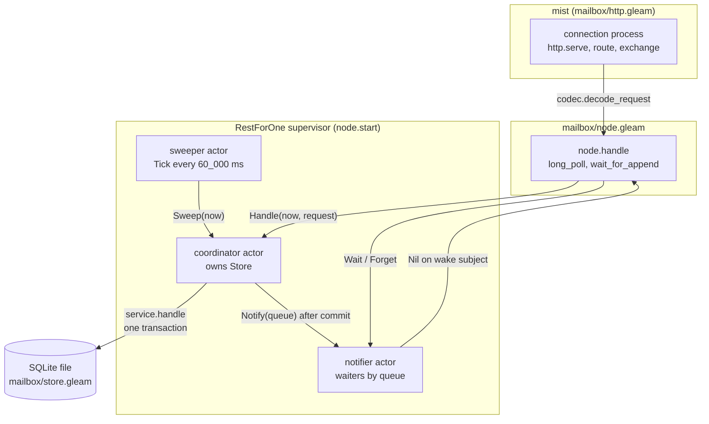
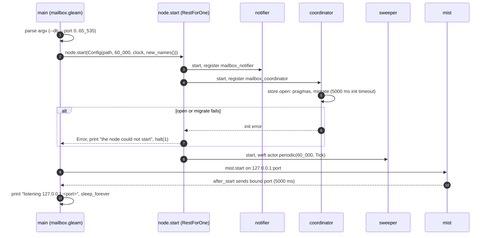
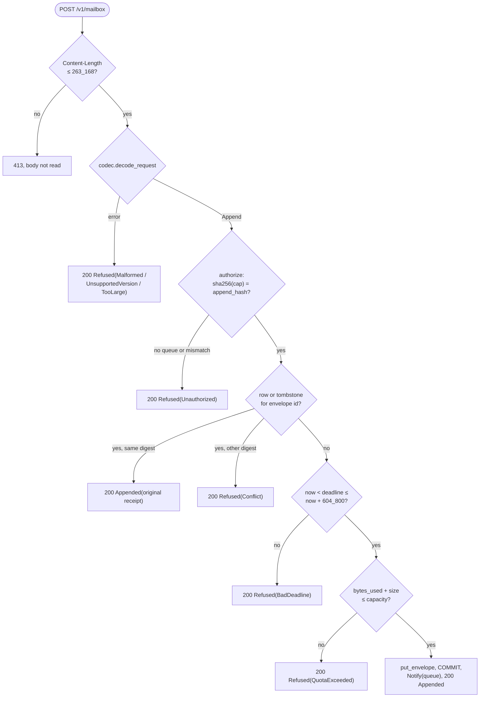
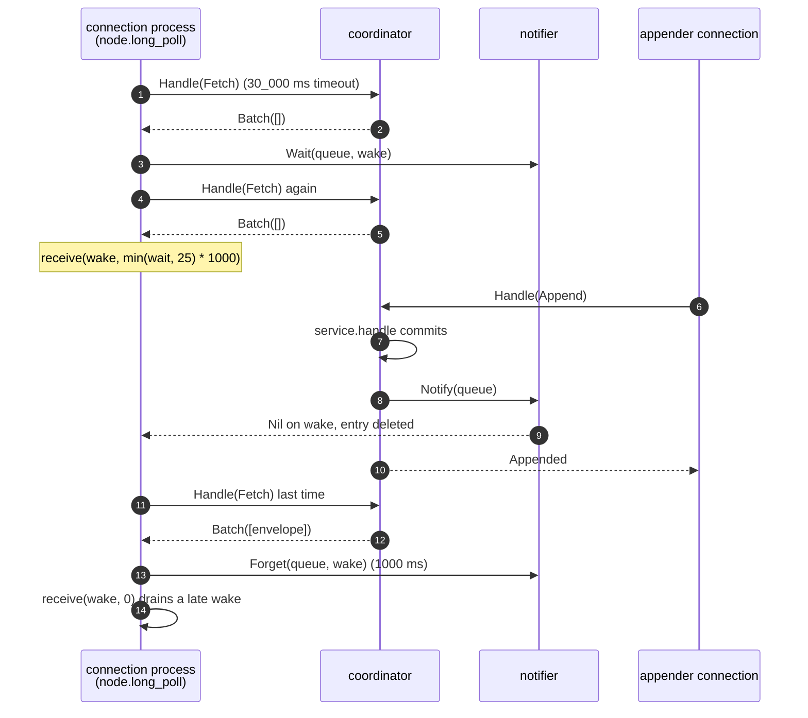
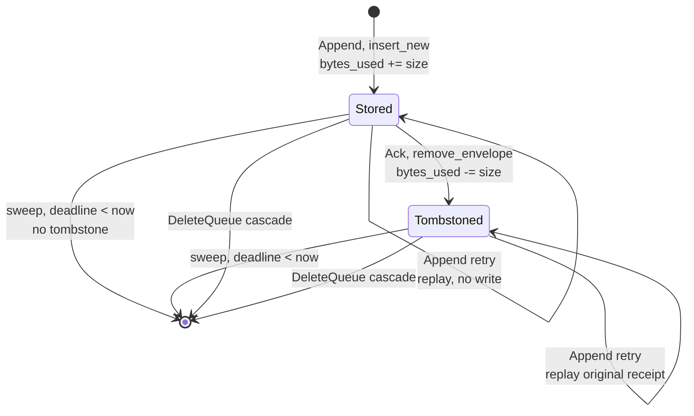
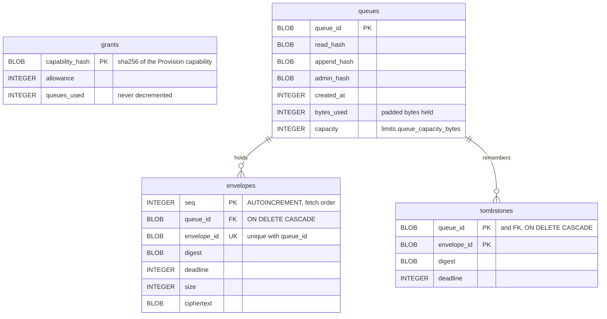

# Mailbox Architecture

The mailbox stores padded ciphertext for recipients who are offline and
hands it back when they ask (`docs/spec.md` §2.2, §6). It never sees
plaintext, sender identity or agent names: it keeps queues, envelopes,
the capability hashes that authorize each operation, and tombstones that
stop an acknowledged envelope from coming back. This document describes
the processes that do that work, who owns which state, and how a request
moves from an HTTP connection to a committed SQLite row. It reflects the
code at `bf7d597`, with the move of its processes onto
[weft](../weft.md) at `7782850`.

The wire format of each request is in `packages/core/src/core/mailbox/codec.gleam`
(type tables in its module doc), and the request and response types are in
`packages/core/src/core/mailbox/protocol.gleam`. The Tor side, which
forwards an onion service's streams to the mailbox's loopback port, is in
[ADR-001](../adr/001-tor-sidecar.md).

## Components

Every request crosses three layers: a mist connection process that frames
HTTP, the `node` module that adds the long poll, and the single
`coordinator` actor that owns the SQLite connection. Two more actors sit
beside the coordinator: the `notifier`, which tracks which connection
processes are waiting on which queue, and the `sweeper`, which asks the
coordinator to delete expired rows once a minute.

The connection process does all waiting, so a parked long poll blocks
only its own HTTP connection. The coordinator never waits on anything but
SQLite, and the notifier never touches SQLite.

| Module or process | Owns | Does not own |
| --- | --- | --- |
| `mailbox/http` (mist connection) | HTTP framing, the 413/404/405/400 decisions, the per-request log line | Any durable state; protocol semantics |
| `mailbox/node` | The long-poll sequence for one `Fetch`, run in the caller's process | Waiter bookkeeping (notifier); storage (coordinator) |
| `mailbox/coordinator` actor | The only `Store` (one `sqlight.Connection`), and the order in which commands run | Request semantics (`mailbox/service`); the waiter table |
| `mailbox/service` | What each `Request` means: authorization, idempotency, quota, deadlines | The connection and SQL text (`mailbox/store`); time (passed in as `now`) |
| `mailbox/store` | The schema, every SQL statement, pragmas, migrations, `transaction` | Protocol rules; which process calls it |
| `mailbox/notifier` actor | `Dict(BitArray, List(Subject(Nil)))`: queue id to waiting wake subjects | Envelopes; timers |
| `mailbox/sweeper` actor | Its own next-tick timer | The sweep itself, which runs in the coordinator |

## Startup

`mailbox serve --db <path> --port <n>` starts the supervised node first and
the HTTP listener second, so no request can arrive before the database is
open and migrated.

The children start in the order notifier, coordinator, sweeper, which is
also the restart order under `RestForOne`: a notifier crash restarts all
three, a coordinator crash restarts the coordinator and the sweeper, and a
sweeper crash restarts only the sweeper. The restart budget is the
`static_supervisor` default (2 restarts in 5 seconds). The mist supervisor
is linked to `main`, not placed under the node supervisor.

## Pipeline: an Append

An `Append` is the write path: one envelope, authorized by the queue's
append capability, stored at most once.

Every protocol answer is a 200 whose TLV body says what happened. A
storage error anywhere in the transaction becomes `Refused(Unavailable)`.

1. **Frame.** `http.exchange` refuses a request whose `Content-Length`
   exceeds `codec.max_request_bytes()` (262_144 + 1024 = 263_168) before
   reading the body, and refuses any `Transfer-Encoding` with a 400.
2. **Decode.** `codec.decode_request` checks the version first; a decode
   failure is answered with `Refused(codec.refusal(error))`.
3. **Authorize.** `service.authorize` loads the queue with
   `store.queue_by_id` and compares `sha256(capability)` with the stored
   `append_hash` in constant time. A missing queue and a wrong capability
   are the same refusal, so the mailbox is not an oracle for which queues
   exist.
4. **Answer what is known.** `service.append_to` reads the live row and
   the tombstone for `(queue, envelope)` before anything else. A retry with
   the same bytes gets the original receipt, with the original deadline,
   even after the envelope was acknowledged and deleted. Different bytes
   under the same id are `Conflict`.
5. **Admit.** `service.insert_new` checks the deadline window, then the
   byte quota, then calls `store.put_envelope`, which raises `bytes_used`
   and inserts the row. All of steps 3 to 5 run inside one
   `BEGIN IMMEDIATE` transaction.
6. **Wake.** After `service.handle` returns, `coordinator.announce` sends
   `Notify(queue)` to the notifier, and only then replies to the caller.

## Pipeline: a long-poll Fetch

A `Fetch` with `wait_seconds > 0` waits for an append instead of returning
an empty batch at once. The waiting happens in the connection process; the
coordinator runs only short, non-blocking fetches.

The second fetch, after registering, closes the race in which an append
commits between the first fetch and the `Wait`. A wake and a timeout are
treated the same: the poll fetches once more and returns that answer,
which may be empty. It does not register again; a client that wants to
keep waiting sends another `Fetch`.

1. **Fetch.** `node.long_poll` calls `run`, which is
   `coordinator.handle(..., 30_000)`. A non-empty batch or any refusal is
   returned immediately, so a wrong capability registers nothing.
2. **Register.** `node.wait_for_append` creates a fresh `wake` subject and
   casts `Wait(queue, wake)` to the notifier.
3. **Refetch.** If that fetch returns anything but an empty batch, it is
   the answer.
4. **Wait.** `process.receive(wake, int.min(wait_seconds, 25) * 1000)`,
   with 25 from `limits.long_poll_seconds`.
5. **Last fetch, forget, drain.** One more `run`, then
   `notifier.forget`, which waits up to 1000 ms for the notifier to drop
   the subject, then a zero-timeout receive to discard a wake that arrived
   in between.

`service.fetch_batch` clamps `max_envelopes` to 1 through 16
(`limits.fetch_batch_envelopes`) and returns the longest prefix of the
queue, in insertion order, whose padded sizes sum to at most
`limits.fetch_batch_bytes` (1_048_576). It never deletes; only `Ack`,
expiry and `DeleteQueue` remove rows.

## State machines

An envelope moves between a live row, a tombstone, and nothing.

A tombstone keeps the envelope's digest and accepted deadline, so it
answers a retry for exactly as long as the sender could still be retrying.
Two rules the diagram does not show: an expired row that has not been swept
yet is hidden from `Fetch` (`deadline >= now`) but still counts against the
queue's quota and still answers a retry; and an envelope that expired and
was swept leaves no tombstone, so its id becomes free again.

A queue exists from `CreateQueue` until `DeleteQueue`. A provisioning grant
counts the queues created under it (`queues_used`) and never counts down:
deleting a queue does not return its unit, which stops create-and-delete
churn against one grant.

## Storage

The store is one SQLite file opened by `store.open`, which sets
`journal_mode=WAL`, `synchronous=FULL`, `fullfsync=ON`,
`checkpoint_fullfsync=ON`, `foreign_keys=ON` and `busy_timeout=5000` on
every connection. `fullfsync` matters on macOS, where `synchronous=FULL`
alone does not flush the drive's cache. esqlite runs `step` and `exec` as
dirty I/O NIFs, so an fsync does not block a normal scheduler.

All four tables are `STRICT`. There is no foreign key from `queues` to
`grants`: the grant that created a queue is not recorded, because nothing
needs to trace a queue back to it. `bytes_used` is a counter kept in step
by `put_envelope`, `remove_envelope` and `sweep` inside their transactions.
Capabilities are stored only as SHA-256 hashes and compared with
`primitives.constant_time_equal`; a hash leak is not a capability leak.

Every write command runs in `store.transaction`, which issues
`BEGIN IMMEDIATE` and commits only when the body returns `Ok`; a refusal is
an `Ok` value and commits an empty transaction. Migrations are an
append-only list applied by `migrate` through `PRAGMA user_version`, each
in its own transaction together with its version bump. A file whose
`user_version` is above `schema_version` (1) is refused with
`FutureSchema`.

## Concurrency

| Process | Owns | Reached by |
| --- | --- | --- |
| coordinator | the `Store` and its connection | `coordinator.handle`, `sweep`, `create_grant`: a send to the registered `mailbox_coordinator` name, then a timed receive |
| notifier | the waiter table | casts `Wait`, `Notify`; `Forget` with a 1000 ms reply |
| sweeper | its `Tick` timer | nothing; it only sends |
| mist connection | one request, and the `wake` subject of a long poll | mist |
| `main` | nothing after startup | `sleep_forever` |

The coordinator runs one command to completion before the next, so the
single-writer rule of spec §8.4 holds without locks: SQLite sees one
connection. A caller that times out after 30_000 ms gets
`Refused(Unavailable)`, but the command may still commit afterwards; a
client must treat `Unavailable` as "outcome unknown" and retry with the
same envelope id, which the idempotency rules make safe. When the
coordinator or notifier is not registered, calls answer
`Refused(Unavailable)` or do nothing, rather than crash the caller.

The sweeper is a `weft/actor` whose `periodic` timer is fixed-delay: the
next tick is armed once the handler for this one returns, after the sweep
reply or its 30_000 ms timeout, so ticks are at least 60_000 ms apart and
never overlap.
Sweeps run inside the coordinator, serialized with requests.

## Known gaps

- `service.create_grant` is declared to return `Capability(provision)`, a
  type variable, rather than `Capability(Provision)`.
- `store.open` sets `journal_mode=WAL` but does not check the mode SQLite
  reports back.
- `Fetch` authorizes and selects in two statements outside a transaction;
  it relies on the coordinator being the only connection.
- The worst-case duration of one long poll is not bounded by
  `long_poll_seconds` alone: three coordinator calls of up to 30_000 ms
  each surround the wait. The `mailbox/node` module doc says why a weft
  deadline around the whole poll was not added.
- If the HTTP client disconnects during a long poll, the connection process
  keeps waiting until its timeout or a wake; whether mist stops the handler
  earlier was not checked.
- A notifier crash restarts the coordinator and sweeper too, and drops all
  waiters, who then sleep to their timeout. Restart behaviour was not
  exercised by tests.
- If the node supervisor exhausts its restart budget, `main` keeps sleeping
  and mist keeps answering, every request `Refused(Unavailable)`; this was
  not tested.
- `mailbox grant` writes the grant row before the capability file. If the
  file write then fails, the grant stays in the database with no surviving
  capability.
- No rate limit, no per-operation quota beyond bytes, and no bound on
  concurrent connections.
