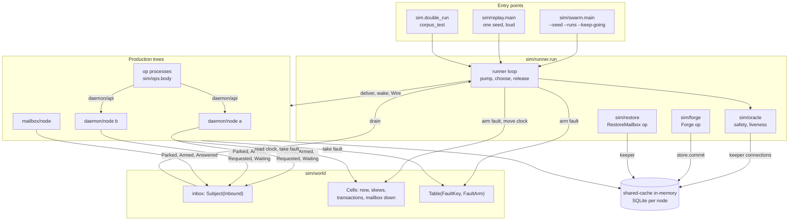
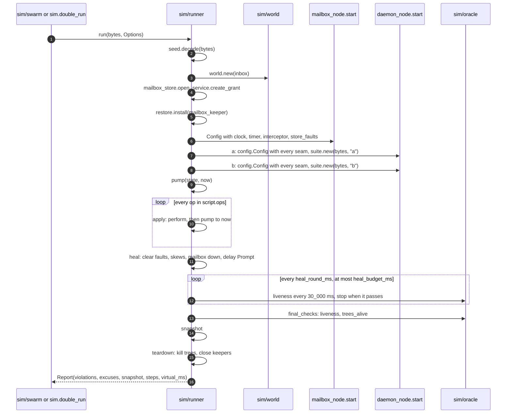
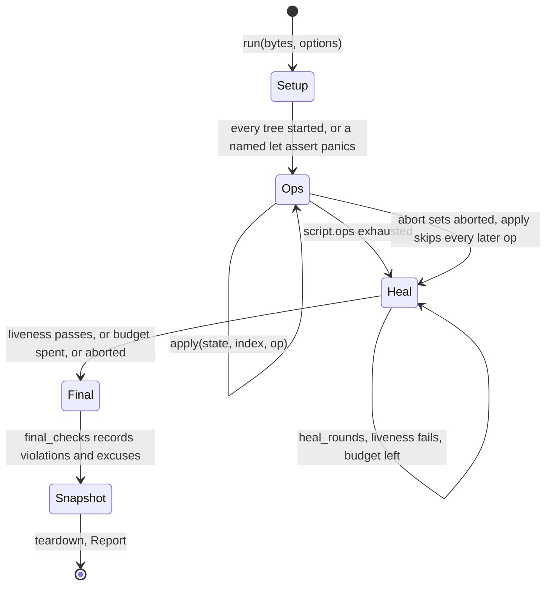
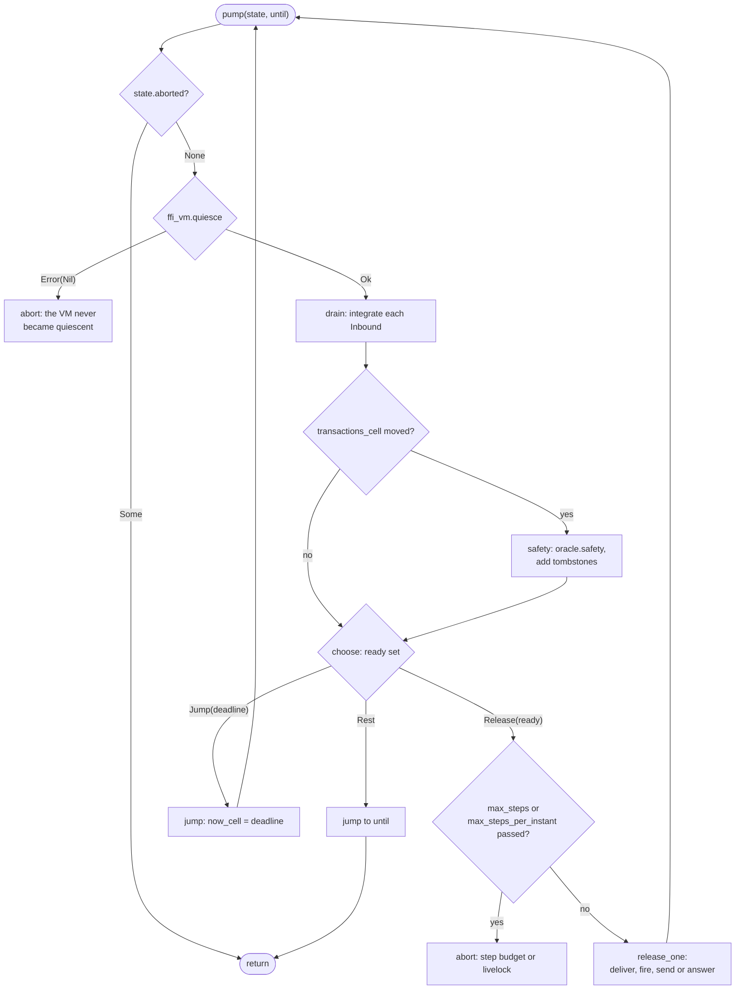
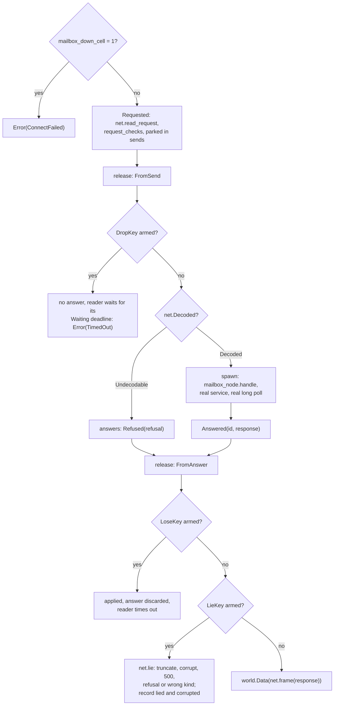

# Shell DST Architecture

`packages/sim` is the deterministic simulation test of the real shell: two
`daemon/node` trees and one `mailbox/node` tree run in one VM, against a
simulated network, clock, timer wheel and store faults that a seed drives.
This document describes who owns which state, how an event moves through
the runner, how a seed becomes a run, and what the oracle checks. It also
holds the measurements that judge the harness: blind recall, mutation score
and coverage. It reflects the code at `632db2f`.

The plan and its rulings are in [`docs/dst/plan.md`](../dst/plan.md), the
evidence for the plan is
[`docs/review/2026-11-01-dst-audit.md`](../review/2026-11-01-dst-audit.md),
and the seams production exposes are in `packages/daemon/CLAUDE.md` and
`packages/mailbox/CLAUDE.md` ("Simulation seams"). The mailbox's own
processes are in [mailbox.md](mailbox.md).

## Components

The runner is the only process that decides what happens next. Every
production process runs as itself, and every boundary it has with another
process or with the outside world reports to the runner's inbox instead of
acting. The oracle reads committed tables through keeper connections, never
a process's memory.



The runner's state is a single value passed through a recursive loop, so a
run has no mutable state of its own except what the seams must read without
a message: the cells and the fault table.

| Module or process | Owns | Does not own |
| --- | --- | --- |
| `sim/runner` | The event loop, the parked sets (`mail`, `timers`, `sends`, `answers`), the virtual clock's writes, the keys that order events | What any op does (`sim/ops`); what is correct (`sim/oracle`) |
| `sim/world` | The value of every seam, the `Inbound` message, `Cells` and the fault `Table` | When anything takes effect; a seam only reports |
| `sim/seed` | The seed's byte layout, `FaultClass`, `Op`, the decoder | Carrying an op out |
| `sim/ops` | The `daemon/api` calls of each operator and agent op, retries, the past-limit check | Which op runs next |
| `sim/net` | The server side of the HTTP exchange and the shape of each lie | Whether a lie or loss is armed (`sim/runner.answer`) |
| `sim/forge` | A byzantine peer's sealed message and its session commit | The receiving daemon, which processes the forgery as any envelope |
| `sim/restore` | The `sim_backup` table, its trigger, and the restore statement | Dropping the restored pairs from the tombstone history (`sim/runner`) |
| `sim/oracle` | Each named check, the excuses | Reading a process's memory; it reads `tables` rows only |
| `sim/tables` | Read-only SQL over daemon and mailbox tables, the row digest | Any write |
| `sim/suite` | Entropy from seed, label and a shared counter; fake ML-KEM and ML-DSA at real sizes | SHA-256, HMAC, the AEAD, X25519 and Ed25519, which are real |
| `sim/rng` | SplitMix64 as a plain value | The VM's generator, which nothing here touches |
| `sim/internal/ffi_vm` over `sim_ffi.erl` | Quiescence, atomics, ETS, the supervisor's children, the stderr sink, the logger level, the term digest | Any production module; it is reached only from `sim` |
| `sim/swarm` | Drawing seeds, the failure census, throughput | A pass or fail exit code: `main` returns `Nil`, so a campaign that found failures exits 0, and only its printed census reports them |

What is real and what is simulated is in `packages/sim/CLAUDE.md`.

## Lifecycle of a run

`runner.run` builds the world, plays every op, heals, checks liveness and
tears down. Setup installs the backup trigger before the mailbox starts, so
every envelope the mailbox ever inserts is in `sim_backup`.



The order matters at one place: a keeper connection stays open on each
shared-cache in-memory database for the whole run, so a database outlives a
store that a kill or a `Restart` closes, and a restarted tree resumes from
the same rows.

The run's phases have one exit that bypasses the rest.



`abort` records a `runner` violation. It fires when the VM never becomes
quiescent, when a run releases more than `max_steps` (400,000) events
(`sim/runner.gleam:96`), or when one virtual instant holds more than
`max_steps_per_instant` (20,000) (`sim/runner.gleam:99`), which is how a
livelock is reported.

## Pipeline: one step of the event loop

`pump` is the event loop. One iteration waits for quiescence, drains what the
last release caused, runs the safety checks if a transaction began, and
releases exactly one event.



Determinism rests on what this loop controls, so the rules below are the part
to take from it.

1. **Quiesce.** `sim_ffi:quiesce` waits for `total_active_tasks_all` to read 1
   across three yields, then confirms that every registered process is
   `waiting`, because the statistic does not count a process inside a dirty
   NIF and every SQLite call is one. After a kill it confirms every process.
2. **Drain.** `integrate` files each `Inbound`. A parcel joins its sender's
   queue, an arming joins the wheel at `now + delay`, a request runs its
   three checks (`request_checks`) and joins `sends`, an answer joins
   `answers`.
3. **Choose.** `ready` lists the head of each sender's parcel queue, every
   timer at or before `now`, every parked request and every parked answer.
   The list is sorted by a key that does not depend on BEAM scheduling, and
   `pick` indexes it with the run's `Rng`. With `NetDelay` enabled, one choice
   in four excludes the network. When nothing is ready, time jumps to the
   earliest timer if that is within `until`.
4. **Release.** Exactly one event happens, its trace line is appended, and the
   loop returns to step 1.

Keys carry the rule that makes replay exact. A parcel's key is its sender's
tag, target, label and a sequence per that stem; a request's key is its node
and content; a timer's key is its deadline and the arming role. Request ids
are assigned at release. Only the head of a sender's queue is ready, so one
sender's parcels keep program order.

Ask replies, self-sends, weft-internal wakes and run outcomes, the event
fan-out, the notifier's wake-ups and supervisor traffic are not parked. Each is
caused by one released event and settles inside its step.

## Pipeline: one exchange with the mailbox

A daemon's real `mailbox_client` frames the request and parses the response.
The connection `world.dialer` returns reports the bytes as `Requested` and
blocks its reader on a `Wire` subject. The faults live on the two arms below.



The two recorded sets feed the excuses. `lied` holds the envelope of an
`Append` whose response was a lie, and `corrupted` holds every envelope in a
lied-about `Batch`. A reader's deadline is rounded up to a whole second
(`sim/world.gleam:391`), because the client computes it from the monotonic
clock, which differs by a millisecond between two runs of one seed.

## Seeds and ops

A seed is a byte string, so a campaign can draw one and a failure can print
one. Byte 0 is the mode (`% 4`: approval and budget), bytes 1 and 2 a
little-endian fault mask, and the rest two-byte ops (op byte, argument byte),
at most `max_ops` (48) (`sim/seed.gleam:37`). The op byte selects by `% op_count`
(21) (`sim/seed.gleam:42`). An op whose class is masked is an honest send or a
short advance, so a seed keeps making progress. `swarm.draw` makes `3 + 2n`
bytes with `n` from 8 to 47.

| Op byte `% 21` | Op | Class |
| --- | --- | --- |
| 0, 1 | `Send`, `Burst` | always |
| 2 to 5 | `Consume`, `Invite`, `Accept`, `Approve` | always |
| 6 | `End` (two argument residues in eight), else `Send` | always |
| 7 | `Raise` | always |
| 8, 9 | `Advance` | always |
| 10 | `ArmStore` | `StoreDaemon` or `StoreMailbox` |
| 11 | `ArmEngine` | `Engine` |
| 12 | `ArmLoss` | `NetLoss` |
| 13 | `ToggleMailbox` | `MailboxDown` |
| 14 | `ArmLie` | `Byzantine` |
| 15 | `SetSkew` | `Skew` |
| 16 | `Forge` | `Peer` |
| 17 | `Exceed` | `Limits` |
| 18 | `Restart` | `Restarts` |
| 19 | `Kill` | `Kills` |
| 20 | `RestoreMailbox` | `Restore` |

`NetDelay` has no op: the class turns on the holding rule in `choose`. World
ops (`Advance`, the arms, `Forge`, `Restart`, `Kill`, `RestoreMailbox`) act in
the runner; the rest run in a process `spawn_op` starts, because a call blocks
on an engine whose job the runner has not released. `send`, `invite` and
`accept` retry `attempts` (3) times (`sim/ops.gleam:46`), `retry_ms` (500) apart
(`sim/ops.gleam:49`), under an idempotency key. `api.send_with_key` always gets
no lifetime, so every message lives for the full retention.

Time is a bound on what a seed reaches. `advance_ms` (`sim/seed.gleam:518`)
moves at most 156,000 ms, so 48 ops and the 900,000 ms `heal_budget_ms`
(`sim/runner.gleam:102`) bound a run at 8,388 virtual seconds, and skew adds
at most 600. That is below the 86,400 s `invitation_window_seconds`
(`limits.gleam:16`), and below the 601,200 s a sender's message lives
(`message_retention_seconds` minus `retention_slack_seconds`,
`limits.gleam:23`, `limits.gleam:34`). It exceeds the 3,600 s
`receipt_window_seconds` (`limits.gleam:102`) only if about 18 of a seed's ops
are advances at the top of their scale.

### Faults

Every fault enters at a production boundary, and every hook is a production
no-op when nothing is armed. A fault is armed in the `Table` and taken once by
the hook that hits it.

| Class | Armed as | Taken by | What the code under test sees |
| --- | --- | --- | --- |
| `StoreDaemon`, `StoreMailbox` | `StoreKey(node)`, `StoreArm(fault, skip)` | `take_store` in `store.transaction` | `StoreDown`: fails before `BEGIN`. `StoreAckLost`: commits, then fails |
| `Engine` | `EngineKey(node, kind)`, `FateArm(fate)` | `engine_hook` | `FailBeforeApply`, or `ApplyThenFail` |
| `NetLoss` | `DropKey(node)`, `LoseKey(node)` | `send`, `answer` | The request never arrives, or the response is discarded after it applied |
| `NetDelay` | `Delay` is `Holding` | `choose` | A timer fires while a request or response is parked |
| `MailboxDown` | `mailbox_down_cell` | `world.dialer` | `ConnectFailed` |
| `Byzantine` | `LieKey(node)`, `LieArm(lie)` | `answer` | Twelve lies (`lie_of`): three framing faults, eight refusals, a wrong kind |
| `Skew` | a skew cell | `world.clock` | One node up to 600 s off |
| `Peer` | none: `forge_op` runs at once | the real mailbox and receiver | `RepeatId`, `StrayAccept`, `StrayReject`, `Garbage` |
| `Limits` | none: `ops.exceed` | `daemon/api` | Eleven inputs at or past a limit |
| `Restarts` | none: `restart` | the supervisor killed | A new tree over the same stores |
| `Kills` | none: `kill` | one child, by registered role | The supervisor's restart; at most two per incarnation of `daemon.kills` (`sim/runner.gleam:790`), and two on the mailbox |
| `Restore` | none: `restore_mailbox` | the mailbox's tables | Every tombstoned envelope back at its old `seq` |

`seed.job_kinds` (`sim/seed.gleam:583`) lists 23 of the engine's 27 kinds: an
`ArmEngine` never aims at `Retransmit`, `Incidents`, `IncidentCount` or
`DrainingInboxes`.

## The oracle

Safety runs after any step in which `transactions_cell` moved, and three more
checks run when a request is written. Liveness runs after the heal phase. Every
check reads committed rows, so a check that passes says the state a restart
resumes from is right.

| Check | Runs | Claim |
| --- | --- | --- |
| `budget_books` | safety | `used` equals ready and consumed deliveries, `held` equals held deliveries in order, `used` is at most `granted` |
| `rows_decode` | safety | Every relationship and offer blob decodes |
| `active_only` | safety | A delivery exists only on an active or closed relationship |
| `delivered_once` | safety | One payload tag is delivered at most once per daemon |
| `never_resurrected` | safety | The mailbox stores no envelope it tombstoned, restored pairs aside |
| `append_committed` | at write | An `Append`'s bytes are a committed outbox row's |
| `single_inflight` | at write | One `Append` per envelope per daemon is in flight |
| `ack_processed` | at write | An `Ack` names only committed `Processed` rows |
| `outbox_settled` | liveness | Every row is `stored`; a `failed` one only on a closed relationship or a lied `Append` |
| `delivered_and_receipted` | liveness | Every committed message is delivered once on the paired relationship and `received_by_peer`, unless either side closed |
| `queues_drained` | liveness | Every `processed` row is acknowledged; the mailbox holds nothing for a live queue |
| `offers_opened` | liveness | No offer is `provisioning` |
| `pairings_settled` | liveness | No relationship is `joining`; `awaiting` only with a `pending` peer |
| `ops_returned` | liveness | Every op returned, and none accepted an input past a limit |
| `trees_alive` | final | All three supervisors are alive |

Two excuses exist, each counted and printed by the swarm. `lied_append` matches
a failed row whose `Append` response was a lie. `corrupted_fetch` matches a
message, receipt or handshake whose envelope reached its reader in a
lied-about `Batch`.

The heal phase clears armed faults, brings the mailbox up, zeroes skews, stops
holding the network and lets time run in rounds of `heal_round_ms` (5,000)
(`sim/runner.gleam:105`). It restarts, reconnects and resets nothing, so a stall
a fault caused is still a stall when liveness reads it.

Determinism is checked by `sim.double_run`, which runs a seed twice and compares
snapshots: the event trace, op outcomes, sorted log lines, and a digest of each
row of the listed tables. The list (`sim/runner.gleam:1689`) holds eight daemon
tables and four mailbox tables. `fingerprints`, `incidents`, `attempts`,
`send_keys` and `blobs` are not in it, so a divergence only those tables show
is not detected.

## Judging the harness

Every number below was printed by the tool named, at `632db2f`, unless a row
says otherwise. Wall-clock throughput ranged from 4.31 to 7.51 seeds/s across
these campaigns; runs-to-find does not depend on it.

### Blind recall

Each row reverts one fix by hand in a scratch worktree and runs, from
`packages/sim`:

```sh
ERL_FLAGS="+t 10000000" gleam run -m sim/swarm -- --seed S --runs N --keep-going
```

The harness is unmodified and gets no hint. The unmodified tree printed no
failure over the same ranges: seed 1 with `--runs 5000`, seed 2 with `--runs
2000`, each with the excuses `lied_append` (12 and 2) and, on seed 1,
`corrupted_fetch` (3). "First find" is the run index the census printed,
counted from zero.

| Fix | Revert | Seed 1 | Seed 2 | Violation named |
| --- | --- | --- | --- | --- |
| Stale session after send | In `relationship.send`, bind the sealed link as `_sealed`, so the plan keeps the pre-send session | run 4 of N = 2000 | run 13 of N = 2000 | `delivered_and_receipted: b message # delivered # times` (seed 1), `a message` (seed 2) |
| Processed id and digest | In `engine.handle_envelope`, `Some(_stored) -> repeat(state, ref)` | not found, N = 5000 | not found, N = 2000 | none |
| Carrier re-bootstrap after `SidecarRestarted` (`3035697`) | In `carrier.followed`, `tor.SidecarRestarted -> sm.keep(data)` | not found, N = 2000 | not found, N = 2000 | none |
| Expired-message payloads (`42d4f6f`) | In `store_application`, the expired arm stores `Delivered(status: plan.Expired)` and an `Audit` | not found, N = 2000 | not found, N = 2000 | none |
| Implicit accept (`42d4f6f`) | earlier measurement, not rerun | run 730 | | |
| Description bound (`42d4f6f`) | earlier measurement, not rerun | run 1 | | |
| Scheduler claims (`3035697`) | earlier measurement, not rerun | run 30 | | |
| H1, clock skew | earlier measurement, not rerun | run 32 | | |
| H2, repeated id | earlier measurement, not rerun | run 817 | | |
| Re-served repeat, restore class | earlier measurement, not rerun | run 23 | run 9 | |

That is seven of ten found. Each revert was confirmed to change behaviour apart
from the swarm: core prints `128 passed, 6 failures` under stale session and `186 passed, 2
failures` under expired payloads (`hardening_test`, `dedup_test`), and the carrier revert fails 3 restart tests
in `workers_test`. The digest revert fails no test anywhere: the daemon suite
prints `157 passed, no failures`.

The three misses are harness gaps, each for a different reason.

- **Processed id and digest.** The arm (`engine.gleam:1049`) needs one envelope
  id to arrive with different bytes after a `Processed` row exists. The only
  source is a `Corrupt` lie on a `Batch` followed by the intact copy being
  fetched again, so the mailbox must keep the envelope past a corrupted round.
  The line was not executed in 500 swarm seeds under coverage. By reading, a
  message lost that way would also be excused, since `corrupted_fetch` matches
  its envelope. Both the swarm and the daemon suite miss this rule, so no test
  anywhere defends it.
- **Carrier.** The runner starts each daemon with `tor: None`, so the carrier is
  `Unused`, never subscribes to the sidecar and never reaches `followed`
  (`carrier.gleam:347`). `workers_test` is what defends the fix.
- **Expired payloads.** The arm (`relationship.gleam:930`) needs a message past
  its `expires_at`, and the bound in "Seeds and ops" leaves a run about 590,000
  virtual seconds short. `sim/forge` also seals with the full lifetime
  (`sim/forge.gleam:192`). No oracle check would notice a stored expired
  payload. `hardening_test` is what defends the fix.

### Mutation score

44 mutants of the core state machines ran against `gleam test` in
`packages/core`, one at a time, in a scratch copy, on a tree that printed
`188 passed, no failures`. The list below was fixed before any ran, cut from 62
for time; the 18 cut unrun are not in the denominator. Exit code 0 is a
survivor.

**Attempted 44, killed 29, survived 15: 65.9%.**

| Id | Mutation | Core tests | Swarm, seed 1, N = 300 |
| --- | --- | --- | --- |
| R01 | `budget`: drop the clamp | killed | |
| R02 | `join`: drop the expiry check | killed | |
| R03 | `join`: drop the description bound | killed | |
| R04 | `join`: drop the carrier admission | **survived** | not found |
| R06 | `approve`: become `AwaitingAccept` | killed | |
| R07 | `decline`: `Closed(ClosedLocally)` | killed | |
| R09 | `close`: drop the `Close` row | killed | |
| R11 | `deliver`: keep the pre-receipt session | killed | |
| R12 | `send`: drop the size checks | **survived** | run 4, `delivered_and_receipted`, `ops_returned` |
| R13 | `lifetime_seconds`: allow widening | **survived** | not found |
| R15 | `check_answerable`: `>` to `>=` | killed | |
| R16 | `check_answerable`: drop expiry | killed | |
| R18 | `in_active`: `Close` stays `Active` | killed | |
| R19 | `in_active`: a receipt marks nothing | killed | |
| R20 | `in_awaiting`: `Accept` stays waiting | killed | |
| R21 | `in_awaiting`: `Reject` as `ClosedByPeer` | killed | |
| R22 | `in_awaiting`: a receipt accepts | **survived** | not found |
| R23 | `in_pending`: any message activates | killed | |
| R24 | `store_application`: deliver an expired message | killed | |
| R25 | `store_application`: drop `RepeatedMessage` | killed | |
| R26 | `admit`: `<` to `<=` on the budget | killed | |
| R27 | `admit`: off by one on held | killed | |
| R28 | `raise_budget`: drop the ceiling | **survived** | not found |
| R31 | `deliver`: drop the fingerprint | killed | |
| R33 | `seal_message`: row deadline is `now` | killed | |
| O01 | `create`: drop the description bound | killed | |
| O02 | `expire`: negate the deadline test | **survived** | not found |
| O03 | `redeem`: ignore the deadline | **survived** | not found |
| O04 | `recognise_retry`: `&&` to `\|\|` | **survived** | not found |
| O05 | `consume`: drop `check_not_ours` | killed | |
| O06 | `consume`: drop `check_names` | **survived** | not found |
| O07 | `consume`: drop the carrier admission | killed | |
| O08 | `approve_as_agreed`: `OperatorApproves` approves | killed | |
| M01 | `payload_fits`: `<=` to `<` | **survived** | not found |
| M02 | `description_fits`: `<=` to `<` | **survived** | not found |
| M03 | `content_type_fits`: `<=` to `<` | **survived** | not found |
| M04 | `receipt_ids`: allow an empty list | **survived** | not found |
| M05 | `receipt_ids`: off by one on the bound | killed | |
| P01 | `is_outbound`: no `Transmit` | **survived** | not found |
| P02 | `is_visible`: a held delivery wakes | **survived** | not found |
| X01 | `due_at`: `<` to `<=` | killed | |
| X02 | `check_bounds`: `>=` to `>` | killed | |
| X03 | `check_kind`: retransmit on `Closed` | killed | |
| X04 | `is_retransmitted`: receipts too | killed | |

No survivor is strictly equivalent. P01 and P02 change a `Plan`'s effects, but
the nudges are advisory: without `Transmit` the scheduler's tick still sends the
row, and a spurious wake only causes an extra read. The gap is that core
asserts no effect list. The other
13 are real test gaps in core:

| Survivors | What is unasserted | Why the swarm does not cover it |
| --- | --- | --- |
| M01, M02, M03 | An input exactly at a bound is accepted | `ops.exceed` says an input at a limit must be accepted, but only `past` checks an outcome: a refusal at the limit passes `ops_returned`. A false pass in the harness |
| R12 | `send` refuses oversized input | Covered: the swarm kills it |
| R13 | A lifetime cannot widen past retention | `api.send_with_key` always passes no lifetime |
| R04 | `join` refuses a disallowed endpoint | Every invitation names the onion mailbox under `TorOnly` |
| R22 | A receipt in `AwaitingAccept` changes nothing | `sim/forge` forges only on an `Active` session, and an honest receipt cannot arrive there |
| R28 | `raise_budget` stops at the ceiling | No find in 300 seeds; not extended, and whether `RaiseHuge` ran is not established |
| O02, O03 | Expiry of an offer | The time bound in "Seeds and ops"; `engine.expire_offers` calls `expire` only on rows past their deadline |
| O04, O06, M04 | A retried initial with another digest, a `Hello` naming another invitation, an empty receipt list | No forgery produces them |

### Coverage

Line coverage under the DST alone, from the Erlang `cover` driver
`scripts/dst/cov.erl`. The swarm figures come from one small module beside it
that runs the unmodified `cov:only` on seeds 0 to 499 of generator 1:

```erlang
-module(dst_swarm).
-export([swarm_test_/0]).
swarm_test_() ->
    {timeout, 36000, fun() ->
        [ 'sim@runner':run(S, {options, quiet}) || S <- 'sim@swarm':seeds(1, 0, 500) ],
        ok
    end}.
```

```sh
cd packages/sim && gleam test
erlc -o "$COV" ../../scripts/dst/cov.erl "$COV/dst_swarm.erl"
erl +t 10000000 -noshell -pa build/dev/erlang/*/ebin -pa "$COV" \
  -eval 'cov:run(["corpus.txt", "daemon", "mailbox", "core"])'
erl +t 10000000 -noshell -pa build/dev/erlang/*/ebin -pa "$COV" \
  -eval 'cov:only(["swarm.txt", "dst_swarm", "daemon", "mailbox", "core"])'
```

| Set | Corpus and regressions (11 tests) | Swarm, 500 seeds |
| --- | --- | --- |
| Daemon package, all modules | 45.9% (1250/2724) | 47.6% (1296/2724) |
| Mailbox package, all modules | 53.5% (371/693) | 54.5% (378/693) |
| Core package, all modules | 74.7% (1215/1627) | 77.9% (1267/1627) |
| Daemon runtime, modules below | 69.6% (1049/1508) | 72.7% (1097/1508) |
| Mailbox runtime, modules below | 62.2% (285/458) | 63.8% (292/458) |
| Both runtimes | 67.9% (1334/1966) | 70.7% (1389/1966) |

The audit's target for both runtimes, 90%, is not met. Per module, swarm column:

| Module | Coverage | Zero-call functions |
| --- | --- | --- |
| `daemon/engine` | 80.3% (256/319) | `incidents/2`, `quarantine/3`, `retransmit_one/3` |
| `daemon/store` | 79.6% (304/382) | `copy_row/3`, `end_schedule/2`, `incident_record/1`, `incidents/2`, `parse_incident_kind/1` |
| `daemon/scheduler` | 84.1% (106/126) | `start/2` |
| `daemon/fetcher` | 87.4% (90/103) | |
| `daemon/fetch_manager` | 90.9% (30/33) | `start/2` |
| `daemon/provisioner` | 97.3% (36/37) | `start/2` |
| `daemon/carrier` | 10.9% (11/101) | `begin/1`, `dial_onion/5`, `followed/2`, `handle/3`, `run/1`, `settled/2`, and others |
| `daemon/node` | 76.0% (73/96) | `stop/1`, `wait_for_lock/3`, `start_offline/1`, `classify_failure/1` |
| `daemon/mail` | 73.5% (25/34) | `direct/1`, `name/1` |
| `daemon/transport` | 36.0% (9/25) | `dial_loopback/2`, `from_socket_error/1` |
| `daemon/mailbox_client` | 81.2% (39/48) | |
| `daemon/api` | 49.0% (73/149) | `invite_ticket/4`, `accept_ticket/3`, `incidents/2`, `subscribe/2`, `store_blob/3`, `fetch_blob/3`, and others |
| `daemon/events` | 81.8% (9/11) | `subscribe/2` |
| `daemon/status` | 93.3% (14/15) | |
| `daemon/lock` | 75.9% (22/29) | `handle/2` |
| `mailbox/coordinator` | 80.0% (24/30) | `create_grant/4` |
| `mailbox/node` | 92.1% (35/38) | |
| `mailbox/notifier` | 100.0% (27/27) | |
| `mailbox/service` | 58.7% (88/150) | `remove_queue/3`, `store_blob/5`, `fetch_blob/4`, `place_blob/4`, `insert_blob/5` |
| `mailbox/store` | 74.3% (110/148) | `delete_queue/2`, `put_blob/7`, `live_blob/3`, `blob_record/2` |
| `mailbox/sweeper` | 88.9% (8/9) | `start/1` |
| `mailbox/http` | 0.0% (0/56) | all (`serve/2`, `route/2`, and others) |

These zero-call functions bound what a pass can claim:

- **End-to-end retransmit (ADR-006) is not exercised.** `retransmit_one/3`,
  `copy_row/3`, `resend_receipt/5` and `retransmit/4` are never called, because a
  run reaches the receipt window only with an unlikely draw (see "Seeds and
  ops"). A message a lie lost is excused by `corrupted_fetch` rather than
  delivered by its retransmit.
- **Quarantine (ADR-010) is not exercised.** `quarantine/3` needs one envelope to
  fail more than `max_process_attempts` (5) times (`limits.gleam:121`), and each
  armed fault fires once.
- **Incident records are written and never read.** `incident_record/1` and
  `incidents/2` have no call, and no oracle check reads the `incidents` table.
- **Tickets (ADR-009) and the sidecar** are not driven, as the carrier row and
  the blob functions show.

`core/relationship`'s `in_pending/3` and `core/offer`'s `recognise_retry/4` are
also at zero: no generated op sends a message to a pending inviter or a second
initial message to a consumed offer, in these 500 seeds.

## Concurrency

The runner is one process, and quiescence makes every other process a function
of what the runner released. The table says which process owns what while a run
goes on.

| Process | Owns | Rule |
| --- | --- | --- |
| Runner | `State`, `Cells` writes, keepers, the wheel | Writes cells and the table only at quiescence, between steps |
| Daemon and mailbox actors | Their production state | Every cross-actor send parks; nothing is delivered until the runner releases it |
| Op process (`who`: `op<n>`) | One blocking `daemon/api` call | Reports `Finished`; reads the current handle from the shared table on each attempt |
| Request process (`who`: `req<n>`) | One `mailbox_node.handle` | A long poll blocks only this process |
| Connection reader, a run's task | One exchange | Blocks on its `Wire`; its first request's key is its ordering role (`net:<key>`) |

Three rules follow.

- **Time.** Only the runner moves `now_cell`, and it moves forward. A due timer is
  an event like any other, so a timer's firing is ordered by the seed.
- **Draws.** The engine is the only process that draws from a daemon's `suite`
  during a run, and the runner orders its jobs. The forger has its own suite per
  op index.
- **Supervisors count wall time.** Their restart intensity is the one thing the
  virtual clock does not reach, which is why kills have a budget.

## Known gaps

- Not driven: the Tor carrier, the local API socket and CLI, mist and
  `mailbox/http`, `node.stop`, pairing by ticket, and the sweeper's expiry of
  envelopes.
- Not reached in the measurements above: end-to-end retransmit, quarantine,
  offer and message expiry, the digest-mismatch arm.
- An at-limit input that is refused passes (`ops.exceed`).
- `sim/swarm` exits 0 whatever it finds, so a caller must read its census.
- Five tables are outside the double-run snapshot, and four engine kinds outside
  `ArmEngine`.
- The `Corrupt` lie's interaction with `corrupted_fetch` is from reading the code;
  no campaign reached it.
- The fresh-context review that `docs/dst/plan.md` item 9 names is not part of
  this document, and the rows marked "earlier measurement" were not rerun.
