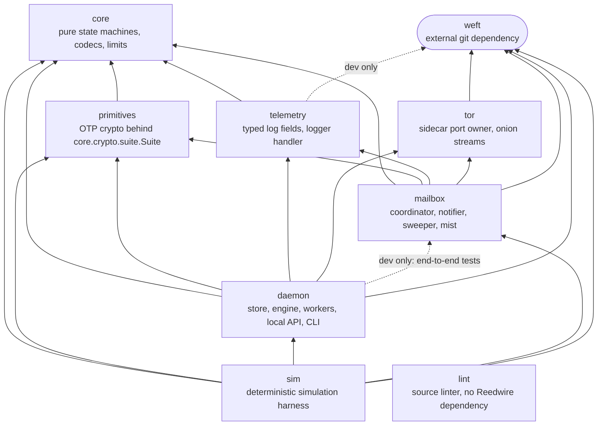
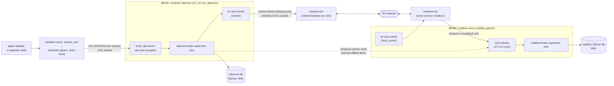
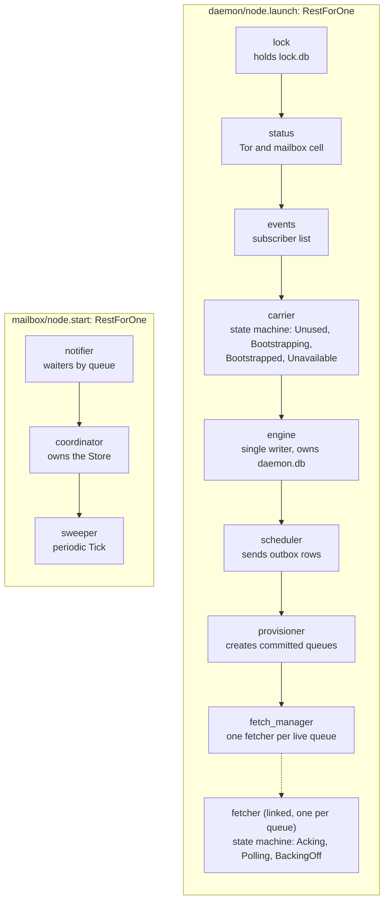
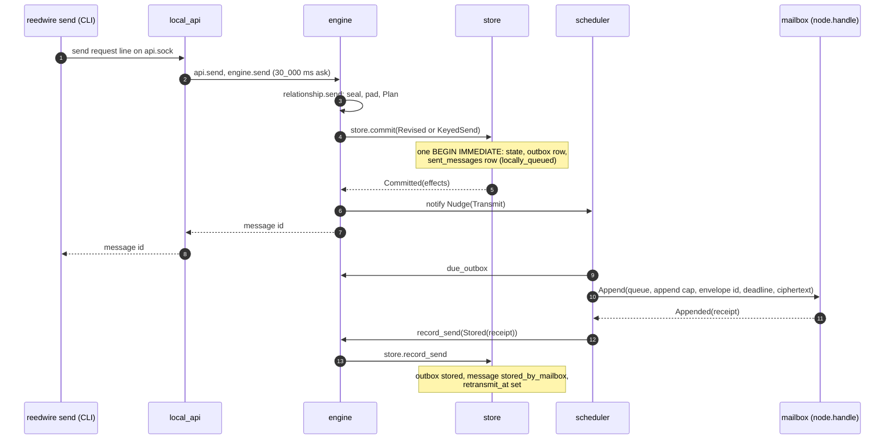
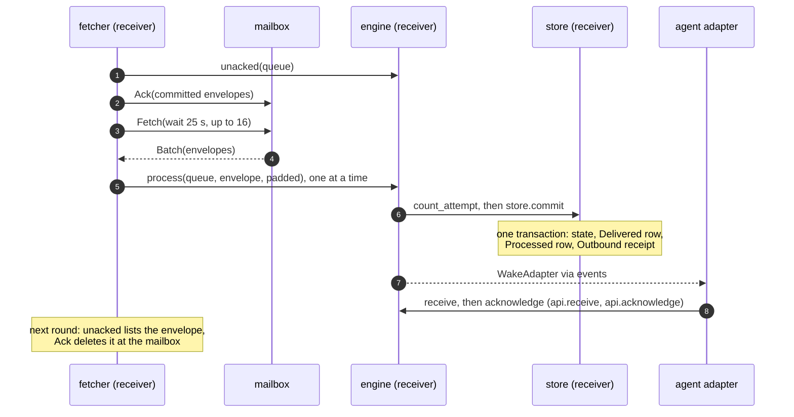
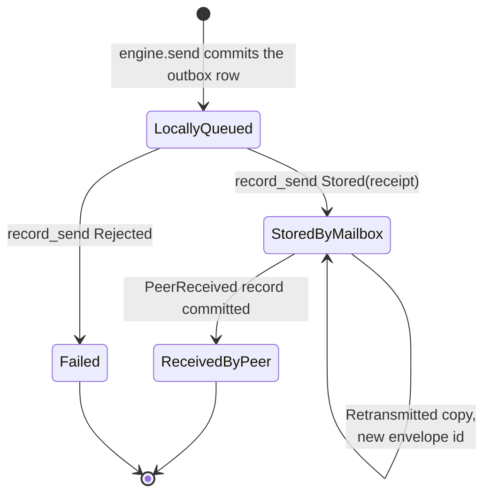

# System Architecture

Reedwire moves an end-to-end encrypted message from one agent's daemon to
another's through a mailbox that stores only padded ciphertext. This
document shows how the packages and operating-system processes fit
together, how one message travels from the local API of the sender to the
local API of the receiver and back as a receipt, and which mechanism
makes each step survive a crash. It reflects the code at `632db2f`.

The protocol itself is in [../spec.md](../spec.md), the reasons for it in
[../design-intent.md](../design-intent.md), and the mailbox service in
detail in [mailbox.md](mailbox.md). The weft process primitives that every
actor and state machine here is built on are in [../weft.md](../weft.md).
A simulation of the whole arrangement is described in
[sim.md](sim.md). Each package has a README:
[core](../../packages/core/README.md),
[primitives](../../packages/primitives/README.md),
[telemetry](../../packages/telemetry/README.md),
[tor](../../packages/tor/README.md),
[daemon](../../packages/daemon/README.md),
[mailbox](../../packages/mailbox/README.md),
[lint](../../packages/lint/README.md) and
[sim](../../packages/sim/README.md).

## Packages

The packages form a layered graph. `core` is pure and depends on nothing
but `gleam_stdlib`; every effect lives in a package above it. The edges
below are the `[dependencies]` entries of each `gleam.toml`, plus the one
`[dev_dependencies]` edge that matters.

An arrow points from a package to one it depends on. Three properties
follow from the graph.

- `core` cannot perform I/O, so `transition(model, event)` is testable
  without processes ([../spec.md](../spec.md) §10.1). Time, randomness,
  crypto and storage reach it as arguments. `primitives` is the only package that
  fills `core/crypto/suite.Suite` with real functions, and `tor` has no
  `core` dependency at all; `tor/address` mirrors `core/endpoint` so that it
  stays that way.
- `daemon` and `mailbox` do not depend on each other at runtime. They meet
  only over HTTP, in the TLV encoding of `core/mailbox/codec`. The dev edge
  from `daemon` to `mailbox` exists so that tests can run a real mailbox
  node.
- `sim` is the only package that depends on both, and no production package
  depends on `sim` (its fake crypto stays out of any release, spec §13.3).
  `lint` checks the source of the others and is not linked into them.

## Operating-system processes

A running system has up to five kinds of operating-system process. Two are
BEAM virtual machines, which are long-lived: the client daemon and the mailbox. The
Tor sidecar is a Rust binary started as a child by whichever BEAM needs
Tor. The CLI is a short-lived BEAM that talks to a running daemon.

The daemon dials the mailbox through `transport.dial`, which admits an
endpoint only if the daemon's `CarrierPolicy` allows it: a `TorOnly` policy
refuses a loopback endpoint before opening any socket, and an onion
endpoint goes through the onion dialer that `daemon/carrier` provides. The
mailbox never sees a client address, because its only listener is bound to
`127.0.0.1` and the sidecar forwards every stream to it
([ADR-001](../adr/001-tor-sidecar.md)).

The `daemon` command runs the daemon tree and the local API in one BEAM.
Every other `reedwire` command is a client: it connects to `api.sock` in the
state directory, sends one request line and prints the reply
(`daemon/cli_run.gleam`, `daemon/local_api_client.gleam`). The state
directory is mode `0700` and the socket `0600`; a scoped credential
separates the agent from the operator inside that boundary
(`daemon/credential.gleam`).

Two daemons never share a state directory: `daemon/lock` holds an exclusive SQLite transaction on
`lock.db`, which the operating system releases when the process dies.

## Process trees

Each BEAM runs one supervisor tree whose children are weft actors or state
machines addressed by `Name`, so a restarted child is found again without
anyone passing a new address around.

Arrows in each subgraph show start order, which is also restart order
under `RestForOne`: a crash restarts the crashed child and every child
after it. An engine crash therefore restarts the scheduler, provisioner
and fetch manager, which hold no state that outlives a restart; each reads
committed rows back from the engine on its first scan
(`daemon/node.gleam`, module doc). `start_offline` builds the same tree
without the scheduler, provisioner and fetch manager, so local commands
commit and nothing touches the network.

The engine reaches the workers through exactly one function. It calls
`notify` after each commit, and `route_notice` (`daemon/node.gleam:457`)
maps a notice to a nudge: `Transmit` to `scheduler.nudge`, `CreateQueue` to
`provisioner.nudge`, `Topology` to `fetch_manager.nudge`, and
`WakeAdapter` and `Changed` to the `events` list. Every nudge is advisory,
because each worker also scans on a timer: the scheduler every
`tick_ms` (1000), the provisioner every `tick_ms` (1000) and the fetch
manager every `tick_ms` (2000). A lost nudge costs latency only.

## Lifecycle of one message

A message passes through two daemons and one mailbox in each direction.
The sender's half runs from the local API to a stored envelope.

The mailbox side of the `Append` in step 10 of the diagram is the Append pipeline in [mailbox.md](mailbox.md).

1. **Request.** `local_api.handle` checks the line, the version, the
   credential and the scope, in that order, before it decodes arguments. The
   send payload becomes a `Secret` at `local_api.parse_send` and stays one
   until the engine seals it.
2. **Plan.** `engine.send` (`daemon/engine.gleam:782`) runs the job inside
   the engine actor: it loads the relationship, calls the pure
   `relationship.send` with the real `Suite` and the injected clock, and
   receives a `Plan` of records. The ciphertext in the plan is final; no
   later step encrypts again.
3. **Commit.** `store.commit` (`daemon/store.gleam:634`) writes the new
   relationship state with a version check, the `Outbound` record as an
   `outbox` row with status `queued`, and the `sent_messages` row in one
   `BEGIN IMMEDIATE` transaction. `engine.commit_change`
   (`daemon/engine.gleam:1575`) calls `notify` only after the commit
   returned. An idempotency key (`KeyedSend`, ADR-011) commits its
   `send_keys` row in the same transaction, so a retry after a lost answer
   queues nothing new.
4. **Dispatch.** The scheduler's `dispatch` (`daemon/scheduler.gleam:443`)
   reads due rows through `engine.due_outbox`, skips rows already in
   flight, and starts one weft run for the batch with `limit`
   `max_in_flight` (8) and `deadline` `send_deadline_ms` (130_000). The
   run is relayed to the scheduler, so the scheduler never blocks on a
   mailbox.
5. **Send.** `send_row` offers the retention deadlines from
   `core/retention.offers`; a `BadDeadline` answer moves to the next, shorter
   offer in the same attempt (ADR-008). Each offer is one `mailbox_client.call`
   with an `append_timeout_ms` of 120_000. The call opens one connection,
   writes one `POST /v1/mailbox` and closes it, whatever the outcome
   (`daemon/mailbox_client.gleam:100`).
6. **Classify.** `scheduler.classify` turns the answer into a verdict. An
   `Appended` receipt that names the row's envelope and the SHA-256 of the
   bytes sent is `Accepted`. `Conflict`, `Unauthorized`, `TooLarge`,
   `Malformed` and `UnsupportedVersion` are `Refused`. A transport error,
   `QuotaExceeded`, `Unavailable` and `BadDeadline` are `Transient`, retried
   with `backoff_seconds` (base 2, cap 300).
7. **Record.** `finish` calls `engine.record_send`, which sets the row to
   `stored`, advances the message from `locally_queued` to
   `stored_by_mailbox`, and sets `retransmit_at` from `retransmit.due_at`.
   If the engine cannot record, the row stays `queued` and is held out of
   dispatch until the next tick.

The receiver's half runs from the mailbox to the agent and then back to the
sender as a receipt.

8. **Fetch.** A fetcher is a `weft/state_machine` with states `Acking`,
   `Polling` and `BackingOff`. `begin_round` (`daemon/fetcher.gleam:250`)
   first runs `ack_pending`, which acknowledges exactly the envelopes that
   `store.unacked` lists, and then, if the queue is still live, long-polls
   with `wait_seconds` `limits.long_poll_seconds` and `max_envelopes`
   `limits.fetch_batch_envelopes`. Each step is a one-task relayed run with
   a 120_000 ms deadline (`ack_deadline_ms`, `poll_deadline_ms`). A failure
   enters `BackingOff` with `backoff_ms` between 500 and 30_000.
9. **Process.** `process_batch` hands each envelope to `engine.process`
   (`daemon/engine.gleam:1018`). `handle_envelope` treats an envelope as a
   repeat only when its identifier and digest both match its `Processed`
   row; a repeat marks the row unacknowledged and delivers nothing. Any
   other envelope is counted (`store.count_attempt`), quarantined if the
   count passes `limits.max_process_attempts` (5), and otherwise opened by
   `relationship.open` and decided by `relationship.receive`.
10. **Commit and wake.** The resulting plan carries a `Delivered` record,
    a `Processed` record and an `Outbound` receipt, and `store.commit`
    writes all of them in one transaction. The receipt is an ordinary outbox
    row, so it travels back through the receiver's scheduler and the sender's
    fetcher by the same path as any message.
11. **Consume.** The local API's `receive` reads ready deliveries through
    `engine.deliveries`; `acknowledge` calls `engine.consume`, which marks a
    delivery consumed. This is separate from the mailbox acknowledgement in
    step 8, which concerns the envelope and not the delivery.
12. **Receipt.** When the sender's fetcher processes the receipt,
    `relationship.receive` emits `PeerReceived`, which moves the message to
    `received_by_peer` and clears `retransmit_at`.

Message state, as an agent sees it through `api.status`, follows the sender's
records.

A transient failure does not appear: the outbox row stays `queued` with a
later `next_attempt_at` while the message stays `LocallyQueued`.
`StoredByMailbox` is not delivery; only a receipt from the peer proves
arrival (ADR-006). When `retransmit_at` passes with no receipt, the
scheduler's tick calls `engine.retransmit`, which commits a copy of the
stored row under a fresh envelope identifier with an `INSERT ... SELECT`,
so the retransmit's bytes come from the committed row. The first window is
`limits.receipt_window_seconds` (3600), each later window doubles it, and a
schedule ends after `limits.max_retransmits` (5) copies.

## Pairing and provisioning

A message needs a relationship, and a relationship needs queues. Pairing is
outside the message path but uses the same machinery.

- `api.invite` and `api.accept` exchange an invitation file, and
  `api.invite_ticket` and `api.accept_ticket` exchange a short ticket whose
  sealed invitation is held by the inviter's mailbox as a blob
  ([ADR-009](../adr/009-invitation-tickets.md)). The ticket calls are the
  only API calls that reach a mailbox from the caller's own process.
- A queue is first a committed inbox row. The provisioner (a one-state
  `weft/state_machine`) sends `CreateQueue` for committed inboxes using the
  provisioning capability read from `--provision-file`, then calls
  `engine.provisioned`. The mailbox operator creates that capability with
  `mailbox grant`.
- The fetch manager starts a fetcher for every live inbound queue, and for a
  retired queue that still holds committed unacknowledged envelopes, and
  stops fetchers whose queue is gone.

## Where crash safety comes from

Three rules carry the recovery story, and each is enforced by structure
rather than by a recovery routine.

- **Commit before effect.** The engine never touches the network and the
  workers receive no bytes from a plan. The scheduler sends only rows it read
  back from `store.due`, and the fetcher acknowledges only what
  `store.unacked` returns. Sending or acknowledging earlier is not
  expressible without changing the worker's inputs.
- **Idempotence at the receiving end.** The mailbox answers a retry of the
  same envelope identifier and bytes with the original receipt, even after
  acknowledgement (tombstones, [mailbox.md](mailbox.md)). The daemon treats an
  envelope as new only if its identifier and digest do not match a
  `Processed` row.
- **One writer per file.** `engine` owns `daemon.db` and `coordinator` owns
  the mailbox file. Each runs a command to completion inside one transaction
  and never holds a transaction across a message
  (spec §8.4).

Both SQLite files use `journal_mode=WAL`, `synchronous=FULL`, `fullfsync=ON`
and `checkpoint_fullfsync=ON` (`daemon/store.gleam:502`,
`mailbox/store.gleam:271`), so a commit that returned is on disk. The table
lists where a crash can land and what finds the work afterwards.

| Crash or loss point | Durable state at that moment | What resumes the work |
| --- | --- | --- |
| Before `store.commit` of a send | Nothing; the caller got no message id | The caller retries; with an idempotency key the retry is safe whether or not the commit landed |
| After the send commit, before any append | Outbox row `queued` | Scheduler tick (1000 ms) reads it through `store.due` |
| Mailbox stored the envelope, daemon died before `record_send` | Outbox row still `queued` | Same bytes, same envelope id; mailbox returns the original receipt |
| Mailbox stored it, then lost or damaged it | Outbox row `stored` with `retransmit_at` | `engine.retransmit` commits a copy after the receipt window; the peer's `resend_receipt` answers a copy it already stored |
| Receiver fetched, died before `store.commit` | Envelope still at the mailbox | Next fetch returns it; `count_attempt` bounds repeated failures at 5 and then quarantines it, with an incident |
| Receiver committed, died before `Ack` | `Processed` row with `acked` unset | Next fetcher round acknowledges `store.unacked` |
| Mailbox serves an envelope again after `Ack` | `Processed` row exists | `engine.process` answers `Repeat`, marks the row unacknowledged, and the next round names it again |
| Mailbox coordinator crashes | WAL file with every committed row | The node supervisor restarts coordinator and sweeper; a request in flight gets `Refused(Unavailable)` and is retried |
| Mailbox BEAM killed | The SQLite file | `mailbox serve` on the same `--db` replays the WAL; clients retry the same envelope ids |
| Tor sidecar dies | None needed | The `tor` port owner restarts it up to `max_restarts`; `carrier` bootstraps again on `SidecarRestarted` and settles `Unavailable` on `SidecarGaveUp` |
| Daemon killed | `daemon.db`; `lock.db` released by the OS | Next start migrates the schema, workers rescan, `draining_inboxes` covers retired queues owing acknowledgements |

The sender's missing receipt and the receiver's repeated delivery are two
sides of one design: the sender may resend any number of times, and the
receiver commits each distinct envelope once. The formal models that check
these interleavings are in [../formal/README.md](../formal/README.md), and
the deterministic simulation of the same code is in [sim.md](sim.md).

## Concurrency summary

| Process | Owns | Reached by |
| --- | --- | --- |
| `engine` | `daemon.db` connection and every state transition | `mail.ask` jobs, 30_000 ms timeout; replies `Unavailable` on timeout |
| `scheduler` | in-flight table of outbox sends | `Nudge`, `Tick`, run outcomes |
| `fetcher`, one per queue | the round state of that queue | `Begin`, run outcomes, state timeout |
| `fetch_manager` | the map of running fetchers | `Nudge`, `Tick` |
| `provisioner` | the next-scan timeout | `Nudge`, `scan` timeout |
| `carrier` | the Tor handle and bootstrap state | dial requests, sidecar events |
| `lock`, `status`, `events` | the lock connection, the reachability cell, the subscriber list | their own messages |
| `coordinator` (mailbox) | the mailbox `Store` | `mail.ask`, 30_000 ms timeout |
| `notifier` (mailbox) | waiters by queue | `Wait`, `Notify`, `Forget` |
| connection process (mist, local API) | one request or one client connection | the socket |

A timeout on an ask does not mean the callee left its state unchanged. The
engine or coordinator may still commit a command after its caller gave up,
which is why `Unavailable` means outcome unknown and why every retry path
above rests on idempotence.

## Known gaps

- Nothing here was run. Timeouts, tick periods and limits are read from
  constants in the code, and no behavior was confirmed by executing it.
- The Rust sidecar (`native/reedwire-tor`) is shown only as a process; its
  internals and the exact frame format are in `tor/internal/codec` and
  `native/reedwire-tor/src/frame.rs`.
- The core state machines (`core/relationship`, `core/offer`, `core/frame`)
  and the crypto layer are described by their module docs and the spec, and
  are not diagrammed here.
- The onion path with a real sidecar is tested only with
  `REEDWIRE_TOR_NETWORK=1` and was not exercised by this document.
- `packages/*/README.md` pages are written separately; links to them depend
  on those files existing.
