# core Architecture

`core` is the pure protocol package of Pondline. It defines the domain
types, the wire and storage codecs, the cryptographic protocols, and the
state machines for invitations, relationships, retention deadlines and
retransmission. Every state machine is a function from the current value and
its inputs to a result, with time and randomness passed as arguments. This
document describes the modules, each state machine with its transitions, and
how the shell (`packages/daemon`) drives them. It reflects the code at
commit `632db2f`.

For the purity rule see `docs/spec.md` §10.1 and `docs/gleam-style.md`
Part IV §5. For the byte-level cryptography see
[crypto-profile-v1.md](../../docs/crypto-profile-v1.md). The package
contract (key types, invariants) is in [CLAUDE.md](CLAUDE.md). The mailbox
service that consumes `core/mailbox` is described in
[mailbox.md](../../docs/architecture/mailbox.md).

## Components

The modules fall into four layers. The state machines at the top import the
wire layer and the cryptographic protocols; everything imports the
foundation. The only dependency in `gleam.toml` is `gleam_stdlib`
(`packages/core/gleam.toml`), and lint R6 rejects `@external`, `gleam_erlang`
and `gleam_otp` in this package.

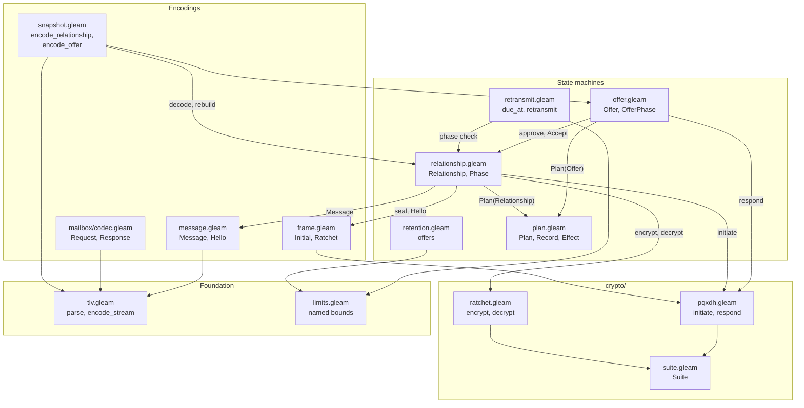

The package has 32 source files (`packages/core/src/core`). The table lists
each group, what it owns, and what it leaves to other code.

| Module | Owns | Does not own |
| --- | --- | --- |
| `relationship` | The phase of one pairing, its `Link` (ratchet state, peer route, peer identity) and its inbound `Budget`; every transition on them. | Storage, the clock, the network, the message-identifier history (the shell answers `IdHistory`). |
| `offer` | The inviter's stored invitation, its prekey secrets, and the single decision of who consumes it. | The invitation file format (`invitation`), and the relationship transitions after redemption (`relationship`). |
| `plan` | The shape of a transition result: `Plan`, `Record`, `Effect`, `EnvelopeRef`, `Fingerprint`. | Committing a plan or acting on an effect. |
| `retransmit` | The retransmission schedule (`due_at`) and the decision on a due row (`retransmit`). | Reading rows, copying their bytes, or the timer that fires. |
| `retention` | The list of retention deadlines one append offers a mailbox. | Sending the append or backing off after the last offer. |
| `message`, `frame`, `envelope` | The plaintext message and `Hello`, the tag byte that separates a handshake from a ratchet message, and bucket padding. | Encryption, which is `crypto/ratchet` and `crypto/pqxdh`. |
| `invitation`, `route`, `ticket`, `codex32` | The invitation file, the `Route` and `Inbox` credentials, the invitation ticket text and its checksum. | Fetching the sealed invitation from a mailbox. |
| `snapshot` | The durable encoding of a `Relationship` and an `Offer`. | The SQLite schema and transactions. |
| `mailbox/protocol`, `mailbox/codec`, `http1` | The typed mailbox commands, their TLV bytes, and HTTP/1.1 framing. | Sockets, handling a request, or the mailbox store. |
| `crypto/*` | Typed keys, hybrid identity, HKDF, PQXDH and the Double Ratchet. | The primitive implementations, which `packages/primitives` supplies through `Suite`. |
| `id`, `capability`, `secret`, `endpoint`, `time`, `field`, `limits`, `tlv` | The domain types and the single place each bound or encoding is defined. | Any I/O. |

## The transition contract

Every state machine transition takes the current value plus its inputs and
returns either a `Plan` or a refusal. A `Plan` holds the new state, the
records to commit with it, and effects to run after the commit
(`packages/core/src/core/plan.gleam:66`). A refusal changes nothing, because
no new state exists to commit. The contract that follows from this type is
that ciphertext exists in one place, an `Outbound` record: the scheduler sends
only rows read back from the committed store, and acknowledges to the mailbox
only envelopes with a committed `Processed` record.

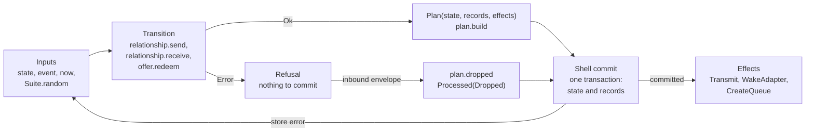

1. **Transition.** The function reads the state value and its arguments. It
   draws identifiers through `field.fresh_id`, which calls `Suite.random`, and
   returns `NoRandomness` if the source returns the wrong number of bytes
   (`packages/core/src/core/relationship.gleam:1173`).
2. **Plan.** `plan.build` derives the effects from the records:
   `Transmit` when any record is an `Outbound`, and `WakeAdapter` when a record
   is a `Delivered` with status `Ready` or a `Released`
   (`packages/core/src/core/plan.gleam:296`). `CreateQueue` is added by the
   transitions that need a queue (`relationship.join`, `offer.create`).
3. **Commit.** The shell writes the state and every record in one
   transaction. A crash before the commit leaves the old state, because no
   ciphertext has left the process. A `Remembered` or `Processed` record
   commits with the delivery it describes.
4. **Effects.** The shell runs the effects after the commit. An effect carries
   no data the store lacks, so losing one is harmless: the scheduler and the
   adapter work from the store, and the queue is created again on restart from
   persisted state.
5. **Refusal.** For an inbound envelope the core refused, the shell writes
   `plan.dropped` itself and acknowledges the envelope once the drop is
   durable.

The records a plan can carry are listed once here.

| Record | Written when | Consumed by |
| --- | --- | --- |
| `Outbound` | A transition seals a message: `Handshake`, `ApplicationOut`, `ReceiptOut` or `ControlOut`. | The delivery scheduler. |
| `Processed` | An inbound envelope is handled (`Applied`) or refused (`Dropped`). | The scheduler's acknowledgment, and the shell's duplicate check on identifier and digest. |
| `Delivered` | An application message is stored, with status `Ready` or `Held`. | The agent adapter. |
| `Released` | `relationship.raise_budget` admits held messages. | The agent adapter. |
| `PeerReceived` | A `Receipt` arrives on an `Active` relationship. | The outbound message state. |
| `Remembered` | A message is first stored, and each time its receipt is regenerated. | The shell's fingerprint lookup. |
| `RepeatedMessage` | An authenticated message reuses a used identifier (ADR-010). | The operator's incident view. |
| `Audit` | An application message is sent or stored. | The plaintext audit log. |

## Offer states

An offer is the inviter's side of one invitation. It is the single
serialization point for consumption: the first valid `Hello` moves it from
`Open` to `Consumed` and produces the only relationship
(`packages/core/src/core/offer.gleam:1`). The prekey secrets live in
`Stock`, which only `Provisioning` and `Open` hold, so `Consumed` and
`Expired` have no field that could keep them.

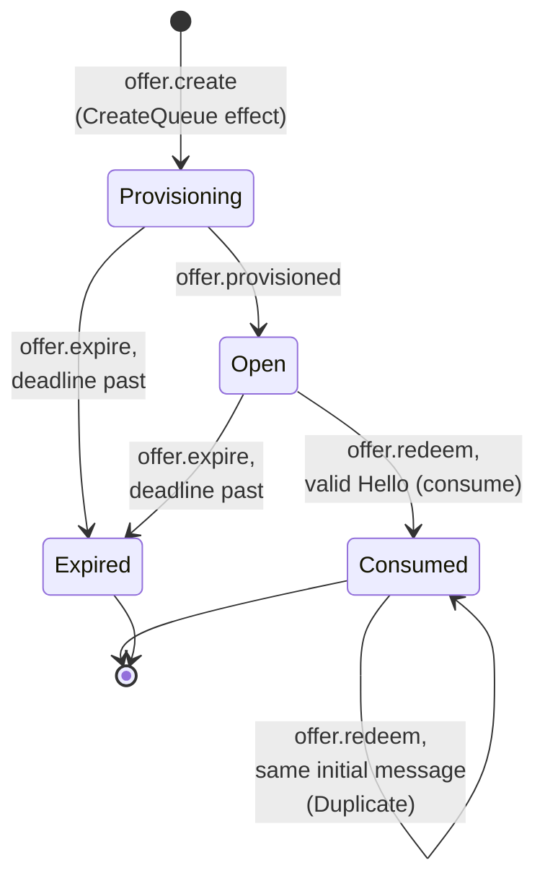

`offer.redeem` has results the diagram does not show as transitions
(`packages/core/src/core/offer.gleam:307`). A `Provisioning` offer refuses
with `NotOpen`, an `Expired` offer or an `Open` offer past its deadline with
`OfferExpired`, and a `Consumed` offer refuses a different initial message
with `AlreadyConsumed`. Each refusal leaves the offer unchanged, so a hostile
initial message cannot spend an invitation.

A redemption on an `Open` offer runs these checks in `consume`
(`packages/core/src/core/offer.gleam:332`), in order:

1. **Handshake.** `pqxdh.respond` checks the bundle commitment, verifies the
   joiner's hybrid transcript signature, and decrypts the first ratchet
   message.
2. **Hello.** `message.decode_hello` parses it, `check_names` requires the
   offer's own invitation identifier, and `check_not_ours` refuses a reply
   route equal to the offer's inbox route.
3. **Carrier.** `endpoint.admit` checks the reply endpoint against the
   `CarrierPolicy`, so a joiner cannot direct the daemon to a loopback port
   the operator did not allow.
4. **Relationship.** A `PendingApproval` relationship is built. Under
   `AutoApprove`, `approve_as_agreed` calls `relationship.approve` and the
   result is `Active` with an `Accept` queued. Under `OperatorApproves` it
   stays `PendingApproval`.

`Redeemed` returns the consumed offer and the relationship plan together, so
the shell commits both in one transaction. `Consumed` keeps the SHA-256 of
the initiator's identity and of the initial message
(`recognise_retry`); a retry with the same bytes is `Duplicate` and the shell
only acknowledges it.

## Relationship states

A relationship is one pairing from this side. It holds a session only in the
three middle phases, and the peer identity lives in the same `Link`, so a
closed relationship has no keys to send or receive with by construction
(`packages/core/src/core/relationship.gleam:156`). The module's doc comment
carries the full phase-by-operation table and lint checks it against the
code (`<!-- transitions: relationship.Phase -->`).

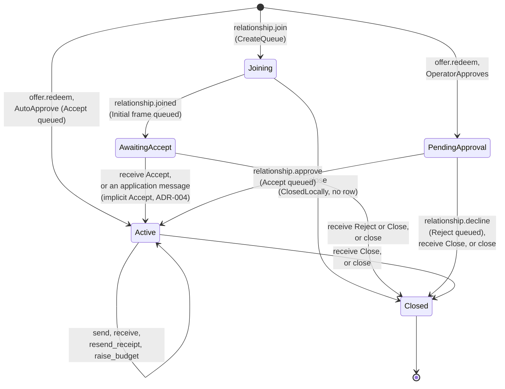

`Closed` carries a `CloseReason`: `Declined` for `decline`, `RejectedByPeer`
for a received `Reject`, `ClosedByPeer` for a received `Close`, and
`ClosedLocally` for `close`. When the state advances because of an inbound
message, `stay` keeps the phase with the advanced session and `finish` drops
the session with the phase (`packages/core/src/core/relationship.gleam:1077`
and `:1090`).

Four rules apply across the whole machine and are not visible in the diagram.

- **Control messages are queued before the session is dropped.** `decline`
  and `close` seal the `Reject` or `Close` from the live session, then move
  to `Closed`. The `Outbound` row exists in the plan although the new state
  has no keys.
- **Only `Active` sends application messages.** `send` calls `active_link` and
  returns `NotActive` in every other phase. `AwaitingAccept` becomes `Active`
  when it stores its first application message, so a joiner never sends
  before it is `Active` either.
- **Nothing reaches the agent before authorization.** In `PendingApproval`,
  `in_pending` advances the session for an application message and stores
  nothing (spec §4.3). In `AwaitingAccept`, a receipt is ignored because a
  joiner sends no message that could be receipted.
- **A decrypt failure consumes nothing.** `open` returns a refusal and the
  caller still holds the old ratchet state, so a forged envelope cannot burn
  a message key (spec §8.3).

### Receiving an envelope

Receiving a ratchet message takes two core calls with a store lookup between
them. The identifier of a message is known only after decryption, and only the
store knows which identifiers were used, so `open` decrypts into an opaque
`Opened`, the shell reads the identifier with `opened_message`, and `receive`
takes the answer as an `IdHistory` (ADR-010).

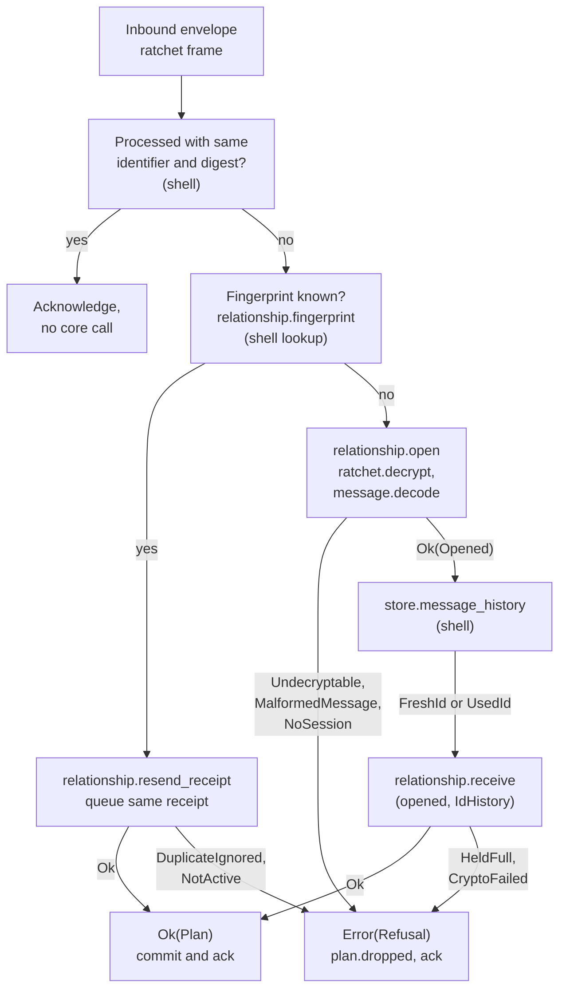

1. **Duplicate check.** The shell skips an envelope only when both its
   identifier and its digest match a `Processed` record, so a corrupted copy
   that was dropped cannot cause a good retransmit under the same identifier
   to be dropped (`packages/core/src/core/plan.gleam:30`).
2. **Fingerprint.** `relationship.fingerprint` is SHA-256 of the ratchet bytes
   inside the padding, so a copy damaged only in the zero tail still matches
   (`packages/core/src/core/relationship.gleam:732`). A known fingerprint goes
   to `resend_receipt`, which queues a fresh `Receipt` for the remembered
   message and rewrites the `Remembered` record with `receipts + 1`. It
   refuses with `DuplicateIgnored` once the message has expired or
   `known.receipts` exceeds `limits.max_retransmits`
   (`check_answerable`, `:790`).
3. **Open.** `open` matches the phase once and picks `in_active`,
   `in_awaiting` or `in_pending`; `Joining` and `Closed` give `NoSession`
   (`:651`). `arrive` decrypts and decodes before anything else is built.
4. **Receive.** `receive` applies the phase's reading of the body (`:714`).
   `store_application` ignores an expired message and a `UsedId` message, and
   passes a fresh one to `deliver`, which admits it against the budget,
   queues a `Receipt`, and writes `Delivered`, `Audit` and `Remembered`
   records.
5. **Drop.** A refusal commits nothing from the core. The shell writes
   `plan.dropped` and acknowledges, and after `limits.max_process_attempts`
   failed attempts at one envelope it quarantines the envelope instead
   (ADR-010).

## Message states

A message has two lifecycles, one for each direction. The core produces the
records for both and the shell stores the state.

An inbound application message is `Ready`, `Held` or ignored. `deliver` calls
`admit` (`packages/core/src/core/relationship.gleam:1013`), which compares
`used` with `granted` in the `Budget` and then the held list with
`limits.max_held_messages` (256).

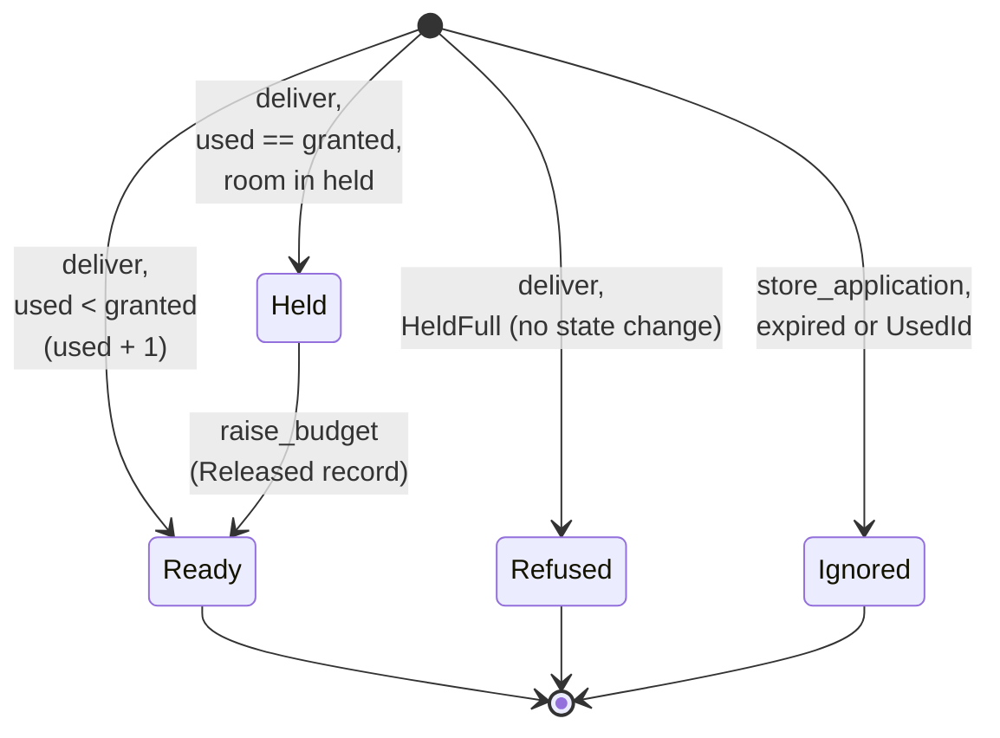

`Ready` and `Held` are `DeliveryStatus` values stored in a `Delivered`
record. `Refused` and `Ignored` are not stored states. A refused message
leaves the ratchet unadvanced, so the sender gets no receipt, which is
accurate because the message was not durably stored. An ignored message
advances the session and commits only `Processed`, plus `RepeatedMessage` in
the `UsedId` case, with no delivery, receipt or budget use.
`raise_budget` clamps the grant at `limits.max_budget_messages` and releases
held messages oldest first.

An outbound message moves through the states the daemon stores as `SentState`
(`packages/daemon/src/daemon/store.gleam:311`, spec §7.2). The core decides
when a row is created, when it is copied, and what a receipt means.

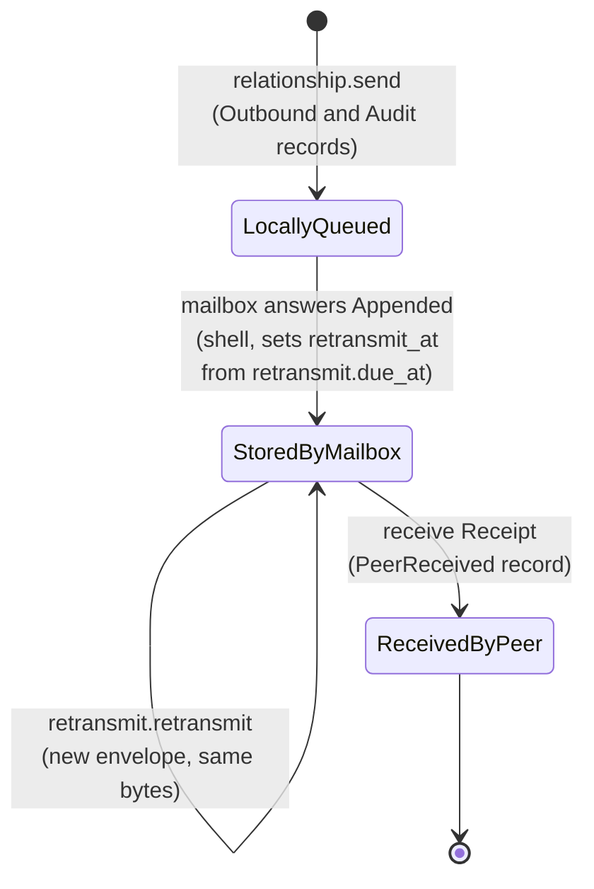

`SentState` also has a `Failed` variant. Nothing in `core` produces it, and
this document does not cover what sets it.

## Retention deadlines

A mailbox accepts an `Append` only when the retention deadline is in the
future and at most its own clock plus `limits.message_retention_seconds`
(604,800). `retention.offers` computes the deadlines a sender offers, in
order, from the row's deadline and the sender's clock
(`packages/core/src/core/retention.gleam:60`). It is a pure function of
`expires_at` and `now`, so nothing new is stored, and the offered deadline
travels in the `Append` request beside the unchanged ciphertext.

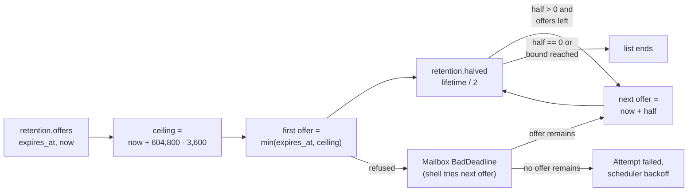

The first offer sits `limits.retention_slack_seconds` (3,600) below the
mailbox maximum, so a sender whose clock runs up to an hour ahead is accepted
on the first try. After a `BadDeadline` refusal the sender offers the next
deadline, which halves the lifetime of the one before. At most
`limits.max_deadline_offers` (4) offers are made, so `halved` produces at most
three shorter deadlines, and fewer when a half would be zero seconds, which
is a deadline of `now` that the mailbox refuses as past. The list is finite by
construction. What happens after the last offer is the scheduler's policy
(`packages/daemon/src/daemon/scheduler.gleam:543`); ADR-008 records the
rationale.

## Retransmission

A mailbox `Appended` answer shows that the mailbox accepted an envelope, not
that the peer received it. The peer's receipt is the only evidence of arrival,
so a stored message with no receipt is sent again after a window. A
retransmit is the committed padded ciphertext under a new envelope
identifier, never a new encryption (ADR-006). `retransmit.due_at` is the
schedule and `retransmit.retransmit` is the decision on a due row.

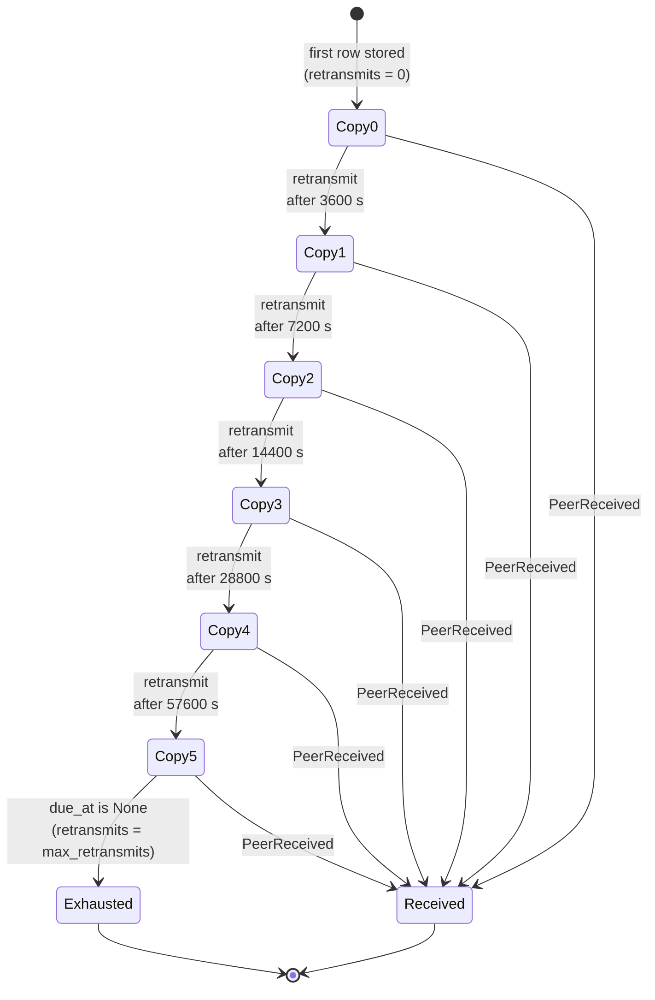

A row with `retransmits = n` is due `limits.receipt_window_seconds` (3,600)
shifted left by `n` after the mailbox stored it
(`packages/core/src/core/retransmit.gleam:131`). Five copies follow the
original (`limits.max_retransmits`), and the last leaves 31 hours after the
first copy was stored, inside the 7-day retention. `due_at` returns `None`
for a kind that is never retransmitted (`Handshake`, `ReceiptOut`), for a row
that already has `max_retransmits` copies, and for a due instant past the
row's deadline.

When the shell runs a due row, `retransmit.retransmit` checks what may have
changed since scheduling and returns a `Retransmission` or a `Stop`
(`packages/core/src/core/retransmit.gleam:156`).

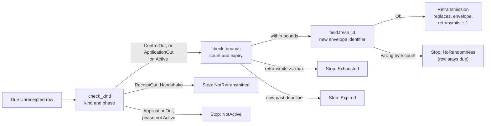

1. **Kind.** An application message is sent again only while the relationship
   is `Active`, the one phase that can receive the receipt that ends the
   schedule. `Accept`, `Reject` and `Close` are sent again in any phase,
   because they earn no receipt and the session that sealed them may be gone.
   Receipts and the handshake are never sent again.
2. **Bounds.** The copy count and the message's own expiry are checked
   against `now`, because the clock moves between scheduling and running.
3. **Identifier.** A new envelope identifier is needed because the mailbox
   keeps a tombstone for every acknowledged envelope and would answer the old
   identifier without storing anything.
4. **Commit.** The shell copies the replaced row's bytes, route, deadline and
   kind in one transaction. The receiver answers the copy with
   `resend_receipt` when it already stored the message, so the message is
   delivered once.

Every `Stop` except `NoRandomness` is final, and the shell stops considering
the row.

## Encodings

All bytes that are signed, hashed, sent or stored are TLV streams in the BOLT
#1 form (`core/tlv`), except the fixed-layout cryptographic encodings, which
`core/crypto/wire` reads. The decoders are total: an unknown even type fails
closed, an unknown odd type is skipped and never readable, and an error holds
type numbers only, never value bytes. `tlv.parse` accepts only strictly
increasing types and minimal BigSize values, so anything it accepts
re-encodes to the same bytes (`packages/core/src/core/tlv.gleam:222`).

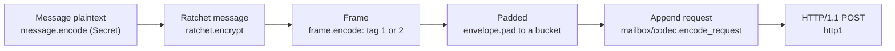

- **Frame.** The tag byte is 1 for the joiner's `Initial` PQXDH message and 2
  for a `Ratchet` message (`packages/core/src/core/frame.gleam:54`). The shell
  routes `Initial` to the offer that owns the queue and `Ratchet` to the
  relationship that owns it.
- **Padding.** `Padded` is built only by `pad` or `from_wire`, and both check
  the size is one of `limits.padding_buckets` (4096, 16,384, 65,536, 262,144).
  The largest equals `limits.max_ciphertext_bytes`.
- **Snapshot.** `snapshot.encode_relationship` and `encode_offer` return a
  `Secret`, because they hold identity keys, prekey secrets, capabilities and
  the ratchet state. The decoders rebuild every nested value through its smart
  constructor and re-check `used <= granted` and the held-list invariant, so a
  row that could not have been written is not trusted
  (`packages/core/src/core/snapshot.gleam:111`).
- **Mailbox.** `mailbox/codec` checks the version in TLV type 0 before any
  other field and has seven request kinds and eight response kinds. The type
  tables are in its module doc.

## Cryptography

`core` calls cryptography only through `core/crypto/suite.Suite`, a record of
byte-level primitive functions that the shell builds from
`packages/primitives`. The typed layer above it (`keys`, `identity`, `hkdf`)
wraps each key in its own opaque type. `pqxdh.initiate` and `pqxdh.respond`
run the handshake, and `ratchet.encrypt` and `ratchet.decrypt` return
`#(State, output)` without changing the state they were given. The algorithms,
the byte layouts, the domain-separation strings and the stated guarantees are
in [crypto-profile-v1.md](../../docs/crypto-profile-v1.md), and the decisions
behind them are `docs/adr/002-pq-crypto-over-otp.md` and
`docs/adr/005-hybrid-authentication.md`. The invitation ticket derivations
are in section 11 of the profile.

## What purity gives and how the shell uses it

`core` starts no process, sends no message and holds no mutable state. Every
state machine is a function, so a test enumerates states, interleavings and
crash points by calling functions in sequence. The daemon (`packages/daemon`)
supplies everything effectful, and its single-writer engine is the caller of
each transition.

| Concern | In `core` | In the shell |
| --- | --- | --- |
| Time | `time.Instant` arguments; `is_past` treats the deadline itself as still valid. | The clock the engine reads (`state.clock()`). |
| Randomness | `Suite.random`, through `field.fresh_id`. | The `Suite` built from `packages/primitives`. |
| Storage | `snapshot` encodings and the `Record` types. | The SQLite store and its transactions. |
| Network | `Outbound` rows and `Effect` nudges. | The delivery scheduler, fetchers and mailbox client. |
| Cross-step knowledge | `IdHistory` and `Fingerprint` as parameters. | `store.message_history` and the fingerprint table. |

Three properties follow.

- **Atomic transitions.** Because a transition returns a value, the shell
  either commits the whole `Plan` or discards it. There is no partially
  applied state to recover from.
- **Replay.** The ratchet is a value, and encryption is deterministic in its
  state. A ciphertext must not leave the process before the state that
  produced it is committed, which the `Plan` type enforces by putting the only
  copy in an `Outbound` record. After a crash, the scheduler resends the
  committed bytes.
- **Test substitution.** A `Suite` can be a deterministic fake, and
  `fake_suite.seeded(n)` draws identifiers from a seeded counter, so a run
  depends only on its seed. The fake lives under `test/` only, so it cannot be
  compiled into a release (spec §13.3).

A caller must observe two rules that the types do not enforce. A `Plan`'s
effects are not a delivery guarantee, so work must be recoverable from the
store alone. A refusal from `open` or `receive` changes nothing in the core,
so the shell must still record the envelope as processed or the mailbox will
serve it again.

## Tests

The pure simulation in `packages/core/test/core/world.gleam` models three
parties, a mailbox and a scheduler over committed stores, and applies each
plan atomically or discards it on a `Crash`. It offers nine fault classes
(`world.Fault`). Seeds in `packages/core/test/core/swarm.gleam` fix a whole
run (a mode byte, a two-byte fault mask, then three-byte ops, at most
`max_ops` = 160 ops), and a heal phase turns faults off and lets time pass
before the audits run. The replay command is in `CLAUDE.md`. The Lean proofs
of `core/tlv`, `limits.padded_size`, `envelope.pad`, `retention.offers` and
`retransmit.due_at` are in `docs/formal/lean.md`.

## Known gaps

- Nothing was compiled or run to write this document. Every claim comes from
  reading the source, and no test result is asserted.
- `DeliveryStatus.Expired` is retained in `core/plan` and mapped in `daemon/store`
  (`packages/daemon/src/daemon/store.gleam:2154`), though `relationship` drops
  expired application messages without emitting a `Delivered` record.
- `packages/core/CLAUDE.md` Key Types does not list `offer`, `message`,
  `frame`, `invitation`, `route`, `snapshot` or `field`, which this document
  covers.
- The shell side of each flow (the engine, the store, the scheduler) is
  described from its doc comments and call sites, not read in full. The
  trigger for `SentState.Failed`, the shell's fingerprint pruning and the
  scheduler's backoff after the last retention offer are not covered.
- The cryptographic modules are summarized from their module docs and linked,
  not re-derived. `core/tlv` internals, `core/http1` bounds and the mailbox
  codec's field tables are left to their module docs.
