# Daemon Architecture

The `daemon` package is the part of Pondline that runs on an agent's machine. It keeps the agent's durable relationship state in step with the mailboxes that carry its ciphertext: it commits every protocol transition to SQLite first, and only then sends, acknowledges or announces anything. This document describes the processes that do that work, who owns which state, and how a command or an envelope moves from its entry point to a durable result. It reflects the code at `632db2f`.

The protocol itself is pure and lives in `packages/core` (`transition(model, event)`, [spec §10.1](../../docs/spec.md)). This package supplies the effects the core may not have: sockets, SQLite, clocks and processes. Process primitives (`weft/actor`, `weft/state_machine`, `weft/poll`, `weft` runs) are described in [weft.md](../../docs/weft.md). The mailbox service on the other end of every call is in [architecture/mailbox.md](../../docs/architecture/mailbox.md). Package-level invariants and the test that checks each one are in [CLAUDE.md](CLAUDE.md). Two of the processes here, the scheduler and the fetcher, have exhaustively checked models; see [formal/tla.md](../../docs/formal/tla.md).

## Components

A running daemon is a `static_supervisor` tree of eight children (`node.launch`, `node.gleam:275`) plus a local API server that the `daemon` command starts beside it. One process, the engine, holds the SQLite connection. Everything else either reads committed rows back through the engine or talks to a mailbox, and none of the network workers receives ciphertext from a transition.

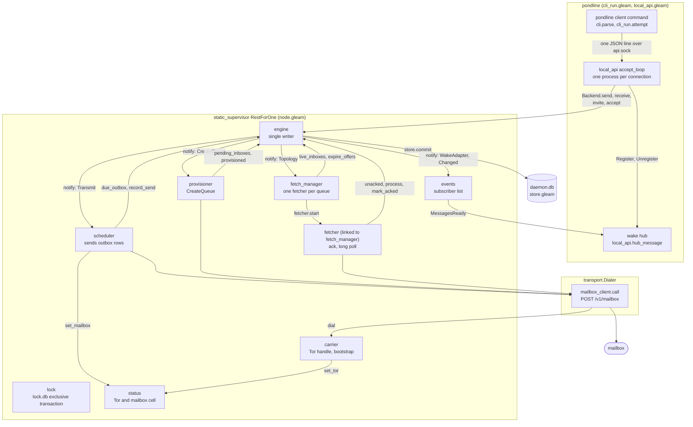

The engine never calls a worker. It is given one `notify` function and calls it after a commit, and `route_notice` (`node.gleam:457`) is the only place that says which commit result nudges which worker. A nudge is advisory: the scheduler, provisioner and fetch manager each also scan on a timer, so a nudge lost to a restart costs latency only. The local API server is not a child of the tree. It is started by `cli_run.run_daemon` after `node.start` returns, as plain processes that talk to the runtime through `daemon/api` (see [Local API and CLI](#local-api-and-cli)).

| Package or type | Owns | Does not own |
| --- | --- | --- |
| `engine` | The SQLite connection (`store.Store`), the injected clock and `Suite`, every state transition, and the order "load, transition, commit, notify". The one writer. | Any network call, any timer, any queue lifecycle. It does not send, fetch, acknowledge or create a queue. |
| `store` | The schema, the durability pragmas, every statement, and `Committed`, the only proof that a `Plan` is durable. | Which transition to run. It holds no process and is used only from inside the engine. |
| `scheduler` | Which outbox rows are being sent now (`in_flight` claims), retry timing, and the retransmit tick. | The bytes of a row. They come from `store.due` and are resent unchanged. |
| `fetcher` | One queue's acknowledge-then-poll round, its backoff count, and its two run deadlines. | What to acknowledge. The list comes from `store.unacked`. |
| `fetch_manager` | The map from queue to fetcher pid, and the periodic expiry of unused offers. | Fetcher behaviour. A fetcher ends itself when its queue is no longer live. |
| `provisioner` | The scan loop and its failure count for creating queues at the mailbox. | The queue's identifier and capabilities, which the engine chose and committed before any call. |
| `carrier` | The `tor.Tor` handle, the bootstrap run, and the four carrier states. | Dial policy. `transport.dial` checks `endpoint.admit` before any carrier is asked. |
| `lock` | The exclusive transaction on `lock.db`. | The database. It is a separate file. |
| `status`, `events` | The last Tor and mailbox observation; the list of subscriber subjects. | Any decision. Nothing reads `status` to decide behaviour, and `events` carries no data, only which contact changed. |
| `mail` | Soft `tell` and `ask` to named processes, and the optional interceptor. | Replies to an `ask`, self-sends, and weft timers. |
| `api` | The `Daemon` handle (names, suite, policy, dialer) and the contract types. Pairing by ticket, which calls mailboxes from the caller's process. | A process of its own. |
| `local_api` | The Unix socket, one process per connection, the wake hub, and the order of request checks. | The runtime. It serves a `Backend` record (`local_api_types`), and `local_api_backend` maps `api` onto it. |

## Startup and supervision

`node.start` checks what needs no process, prepares the state directory, probes the two failures an operator can cause, and then starts the tree. The probe exists because a supervisor that fails to start takes its linked starter down with it (`node.probe`, `node.gleam:199`): a held lock and an unopenable database are found by trying them first.

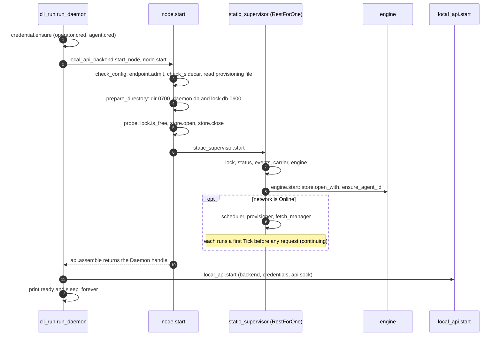

The children start in dependency order and the supervisor is `RestForOne`, so a crash restarts the crashed child and every child after it. An engine crash restarts the scheduler, provisioner and fetch manager; a crash of the lock, status, events or carrier restarts the engine and the workers as well. Nothing a worker holds has to survive: each begins by reading committed state through the engine, and every child is addressed by a `process.Name`, so a restarted process is found again without handing out its new address (`Names`, `node.gleam:127`).

`start_offline` builds the same tree without the scheduler, provisioner and fetch manager (`Network`, `node.gleam:99`). Commands still commit and nothing is sent or fetched, which is how crash recovery is exercised.

The engine opens the store in its initialiser and not in a `continuing` message (`engine.start`, `engine.gleam:295`). A database that cannot be opened or migrated therefore fails the start, and a daemon that cannot reach its state never accepts a command. The engine traps exits, and `on_shutdown` closes the store; that callback cannot run on a kill, which is acceptable because every commit is already durable.

`node.stop` unlinks and kills the supervisor, then polls `lock.is_free` every 20 ms for up to `stop_wait_ms` (10,000 ms, `node.gleam:96`) so that a new daemon can start on the same directory at once.

## The engine and the commit

Every operation is one job that the engine runs to completion before it reads the next message. A job is a closure over its arguments, executed against the actor's own state, so the connection never leaves the process and no transaction spans a message. Callers use the typed functions in `engine.gleam` through `run` (`engine.gleam:405`), which asks the engine with a 30,000 ms timeout (`call_timeout_ms`, `engine.gleam:148`). No answer in time is reported as `Unavailable`.

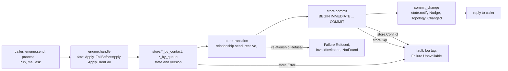

`commit_change` (`engine.gleam:1575`) calls `state.notify` only after `store.commit` has returned. It sends the plan's effects first, then `Topology`, so a fetcher for a new queue starts before the adapter hears that the relationship changed, and then `Changed(contact)` when the commit names a contact. A caller that sees `Unavailable` cannot tell whether the job ran. `ApplyThenFail` is the simulation fate that makes this case reachable: the job commits and notifies, and only the reply is lost. This is why every operation behind an ask is either idempotent (`accept`, a keyed `send`, `provisioned`) or a read of committed state.

`store.commit` writes the new state blob with a version check, every record of the plan, and the `Processed` row in one `BEGIN IMMEDIATE` transaction (`store.atomically`, `store.gleam:595`). An `UPDATE ... WHERE version = ?` that touches no row is a `Conflict` and rolls the whole commit back. Because the engine is the only writer, a conflict means a second process on the same file or a bug. The `Commit` variants (`store.gleam:219`) are the complete list of ways durable state changes: `Dropped`, `Started`, `Revised`, `KeyedSend`, `Redeemed`, `OfferStarted`, `OfferRevised`, `Retransmitted`, `RetransmitStopped` and `Quarantined`.

## Send pipeline

A send returns once the ciphertext and the advanced session are durable. Reaching a mailbox is a later, separate step, and `status` is how the caller learns how far the message got. The path crosses three processes: the engine commits the message, the scheduler sends it, and the engine records the mailbox's answer.

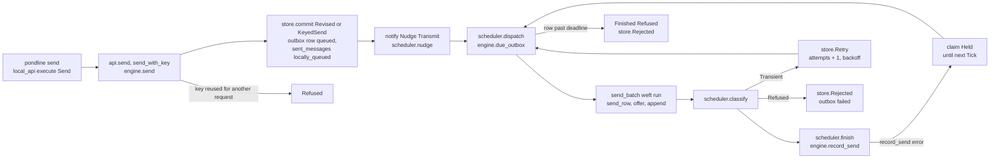

1. **Commit.** `engine.send` (`engine.gleam:782`) exposes the payload `Secret` only inside the job, for the core to seal and digest. An unkeyed send is always new. With an idempotency key, `keyed_send` first checks the key against `limits.max_send_key_bytes` (128 bytes) and looks it up with `store.send_by_key`. A remembered key answers with its first message when the SHA-256 request digest matches (constant-time comparison) and is `Refused` when it does not. A new key is written by the `KeyedSend` commit in the same transaction as the message ([ADR-011](../../docs/adr/011-idempotent-accept-and-send.md)).
2. **Nudge.** The commit's `Transmit` effect reaches `scheduler.nudge` through `route_notice`. The scheduler also dispatches on every `Tick`, so a lost nudge delays the send by at most `tick_ms` (1,000 ms, `scheduler.gleam:130`).
3. **Dispatch.** `scheduler.dispatch` (`scheduler.gleam:443`) leaves room for `max_in_flight` (8) sends minus the claims it holds, asks the engine for `2 * max_in_flight` due rows (`store.due`, oldest first), drops rows already claimed, and takes as many as there is room for. Rows past their deadline are sent a `Finished(Refused)` to the scheduler itself and are never dialled.
4. **Send.** `start_batch` starts one `weft` run for the live rows, relayed to the scheduler, with `limit` `max_in_flight` and `deadline` `send_deadline_ms` (130,000 ms). `send_row` takes the deadlines from `retention.offers` and appends the committed bytes under the first. A `BadDeadline` answer moves `offer` to the next, shorter deadline within the same attempt, up to `limits.max_deadline_offers` (4); the envelope and bytes do not change, and nothing about the offers is stored ([ADR-008](../../docs/adr/008-deadline-slack.md)). One append has `append_timeout_ms` (120,000 ms) including the dial.
5. **Classify.** `classify` is a pure function of the answer. A receipt must name the row's envelope and the digest of the bytes sent, or it is a `Refused`. `Conflict`, `Unauthorized`, `TooLarge`, `Malformed` and `UnsupportedVersion` are final. A transport error, `QuotaExceeded`, `Unavailable` and a `BadDeadline` to the last offer are `Transient`.
6. **Record.** `finish` turns a verdict into `store.Stored`, `store.Rejected` or `store.Retry`. A retry waits `backoff_seconds(attempts)`: 2 seconds doubled per failure, capped at 300 (`scheduler.gleam:137`, `scheduler.gleam:140`), computed against the injected clock and stored in `next_attempt_at`. `store.record_send` runs in one transaction, so a row never says `stored` while its message says `locally_queued`.

The states of a row and of the message it carries are separate columns that move together. A message moves out of `locally_queued` only through `AdvanceMessage`, which updates a row only while the state is still `locally_queued`, so a peer's receipt that overtakes the scheduler's report is not overwritten.

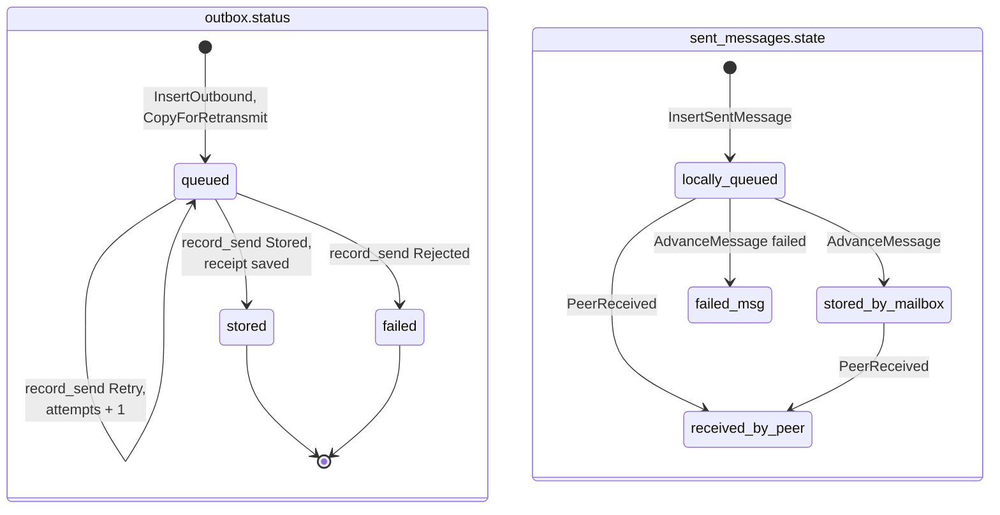

Both columns are checked by SQL `CHECK` constraints (`sql/001_initial.sql`). Receipts, handshakes and control messages have an outbox row but no `sent_messages` row; only application messages have a state the agent can ask about (`store.put_outbound`, `store.gleam:1070`).

### The scheduler's claims

The scheduler keeps a map from envelope to `Claim` (`scheduler.gleam:221`). A row is claimed from the moment `dispatch` chooses it until something ends the claim, and the claim names who may end it. The rule that the diagram cannot show is that a run's end marker releases only the claims of its own run. A row whose outcome the engine could not record is still `queued` and due, and a newer run may have started it again before the older run's end marker arrives. Releasing it from the old marker would start a third send while the second is still going.

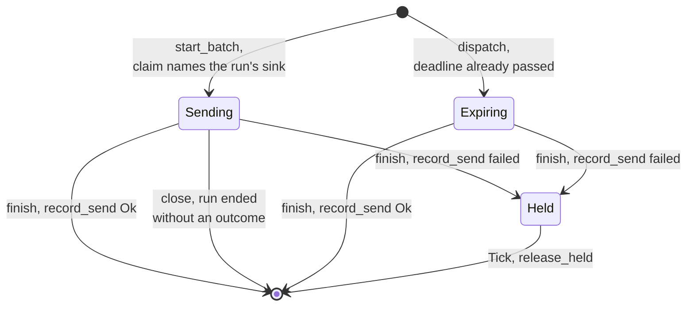

`Held` pacing bounds a failing store to one resend per `tick_ms` instead of one per message the scheduler handles. `Unattempted` outcomes (`weft.NeverStarted`) delete the claim and leave the row queued without moving its attempt count. All seven `weft.Outcome` variants are written out in `settlement`, so a run that gains an owner is a compile error and not a catch-all.

## Receive pipeline

A fetcher acknowledges only what the store has committed as processed. Each round therefore starts with an acknowledgement run, and a batch fetched in one round is acknowledged at the start of the next. The same step is the restart path: an envelope committed before a crash and never acknowledged is just another unacknowledged row.

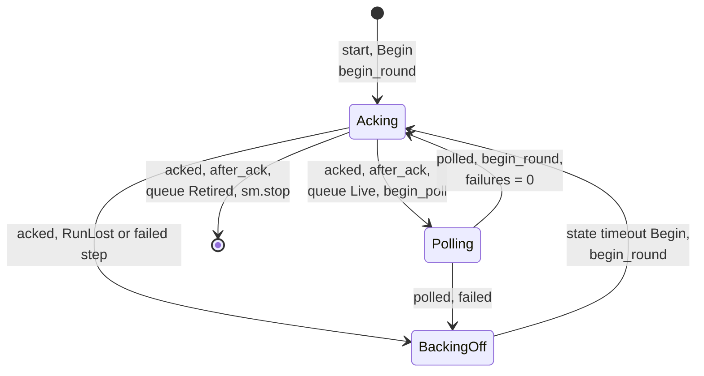

A fetcher is a `weft/state_machine` with the states `Acking`, `Polling` and `BackingOff`. Each network step is a one-task `weft` run, relayed to the machine on its own subject (`Acked` or `Polled`) and bounded by `ack_deadline_ms` or `poll_deadline_ms` (120,000 ms each, `fetcher.gleam:92`, `fetcher.gleam:98`). A failure enters `BackingOff` and arms a state timeout of `backoff_ms(failures)`: 500 ms doubled per failure, capped at 30,000 ms (`fetcher.gleam:85`, `fetcher.gleam:88`). The failure count lives in the machine's data and not in the state, so entering `BackingOff` arms the timeout once. Only a finished poll resets it. A fetcher whose acknowledgement keeps failing keeps backing off and retrying, even for a retired queue, so a committed envelope is never abandoned on the mailbox.

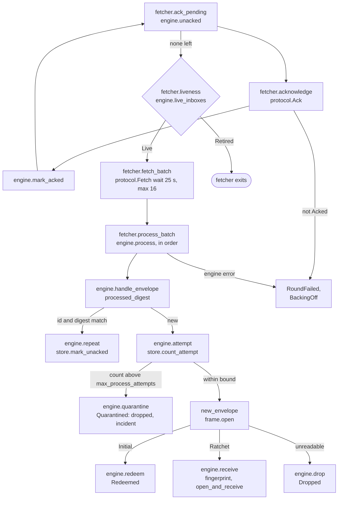

1. **Acknowledge first.** `ack_pending` asks the engine for the committed, unacknowledged envelopes of its queue, names exactly those in one `Ack`, and records `Acked` with `mark_acked`. It repeats until none are left. Only a `protocol.Acked` answer counts; any other leaves the rows unacknowledged and the next round names them again.
2. **Check liveness.** `after_ack` runs after the acknowledgements, never before. A retired queue (a closed relationship, a consumed or expired offer) ends the machine with nothing committed left unacknowledged on the mailbox. An engine that does not answer reads as `Live`.
3. **Long poll.** `fetch_batch` sends a `Fetch` with `wait_seconds` `limits.long_poll_seconds` (25) and `max_envelopes` `limits.fetch_batch_envelopes` (16). `mailbox_client.effective_timeout` raises the call's budget to the wait plus `long_poll_margin_ms` (10,000 ms). An empty batch is an ordinary poll that saw nothing.
4. **Process in order.** `process_batch` hands each envelope to `engine.process` and stops at the first one the engine cannot commit. `Ok` means the outcome is durable. An error means nothing was committed, and the next round fetches the same envelope again.
5. **Duplicate check.** An envelope is a `Repeat` only if its identifier and its SHA-256 digest both match its `Processed` row. A repeat is not processed or delivered again and no attempt is counted. Its row is marked unacknowledged, so the fetcher's next round names it again. This covers an envelope that a mailbox restored from backup or stored again after its acknowledgement ([ADR-010](../../docs/adr/010-dedup-and-quarantine.md), addendum).
6. **Attempt count.** `store.count_attempt` increments the envelope's count in its own transaction before the core sees it. Past `limits.max_process_attempts` (5) the envelope is quarantined: its `Processed` row is written as dropped, so the fetcher acknowledges it, and an incident is recorded. The count survives an engine crash, and a `Processed` row clears it, so a crash loop on one envelope ends in quarantine.
7. **Frame.** `frame.open` decides the route. An `Initial` frame goes to `redeem`, which looks up the offer that owns the queue. A `Ratchet` frame goes to `receive`, which first looks up the ciphertext's fingerprint: a known one goes to `relationship.resend_receipt` and is never decrypted. Anything else is `relationship.open`ed, its message identifier's history is read from `deliveries` (`store.message_history`), and `relationship.receive` decides with it. A repeated identifier from an authenticated peer is ignored and recorded as an incident, not delivered. A history that cannot be read is `Unavailable`; guessing either way could deliver twice or lose a message.
8. **Drop.** Whatever the core refuses is committed as processed-and-dropped, so the mailbox can still be acknowledged once the drop is durable.

The fetch manager supplies the fetchers. Every `tick_ms` (2,000 ms, `fetch_manager.gleam:47`) and on every `Topology` nudge, `reconcile` starts a fetcher for each live inbox that has none running, and for each retired inbox that still owes acknowledgements (`engine.draining_inboxes`, the restart case). The tick first calls `engine.expire_offers`, so an expired offer's queue leaves the live set in the same reconcile. Fetchers are linked to the manager and are not supervised individually. A crashing fetcher takes the manager down, the supervisor restarts it, and the first reconcile starts the fetchers again from committed state.

The scheduler and fetcher have TLA+ models checked with TLC, each property paired with a mutant that reintroduces the hazard it guards against. [formal/tla.md](../../docs/formal/tla.md) maps each model step to a function here, lists the abstractions, and says what the models do and do not cover.

## Pairing by file

An invitation file is created by the inviter, carried to the joiner by any channel the operator chooses, and accepted. Both sides create a queue at their own mailbox before anything else can happen, because a joiner's first message needs a reply route and an offer cannot be handed out before its queue exists. The provisioner makes this safe to retry: the daemon chooses a queue's identifier and all three capabilities and commits them before any network call (`core/route.new_inbox`), so a repeated `CreateQueue` is the same queue.

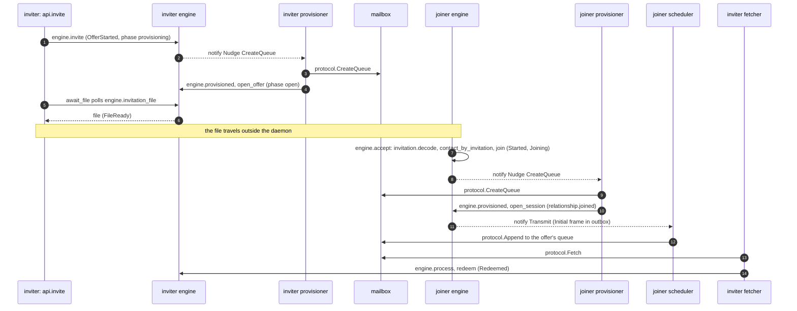

1. **Offer.** `engine.invite` commits an `Offer` in phase `Provisioning` with a fresh inbox (`OfferStarted`). Its `CreateQueue` effect reaches the provisioner. After the mailbox creates the queue, `engine.provisioned` finds the offer by queue and `open_offer` revises it to `Open`; any other phase is left alone, which makes the call idempotent.
2. **Wait.** `api.invite` is the one call that waits. `await_file` polls `engine.invitation_file` with `weft/poll` every `invite_poll_ms` (50) for at most `invite_wait_ms` (30,000). `FileNotYet` retries, `FileGone` fails with `NotFound`, and a spent wait is `Unavailable`. A timed-out offer still opens later, unexported.
3. **Accept.** `engine.accept` decodes the file and checks `store.contact_by_invitation`. An invitation redeemed once returns the relationship it started and starts no second joiner until that one is closed ([ADR-011](../../docs/adr/011-idempotent-accept-and-send.md)). Otherwise `join` commits a relationship in phase `Joining` with a fresh inbox and the daemon's `accept_budget` (`config.default_accept_budget`, 1,000).
4. **Join queue.** The joiner's provisioner creates its queue. `engine.provisioned` finds a `Joining` relationship by queue and `open_session` calls `relationship.joined`, which encrypts the `Initial` frame and commits the new phase with the frame in the outbox. If the invitation expired while the queue was being created, the relationship is closed locally, since nothing can move it forward.
5. **Redeem.** The scheduler sends the frame to the offer's queue. The inviter's fetcher passes it to `engine.process`, `redeem` calls `offer.redeem`, and the `Redeemed` commit replaces the offer and inserts the relationship in one transaction. The operator approves the relationship (`engine.approve`) unless the offer was created with `AutoApprove`.

[ADR-004](../../docs/adr/004-implicit-accept.md) and [spec §4](../../docs/spec.md) cover the handshake; this package only drives it.

## Pairing by ticket

A ticket is a short string that replaces carrying the file. The sealed invitation is stored at the inviter's mailbox under keys derived from the ticket, and the joiner fetches and opens it before anything is committed ([ADR-009](../../docs/adr/009-invitation-tickets.md)). These two calls are the only ones in `daemon/api` that reach a mailbox themselves, from the caller's process and through the tree's dialer, which `api.Daemon` carries.

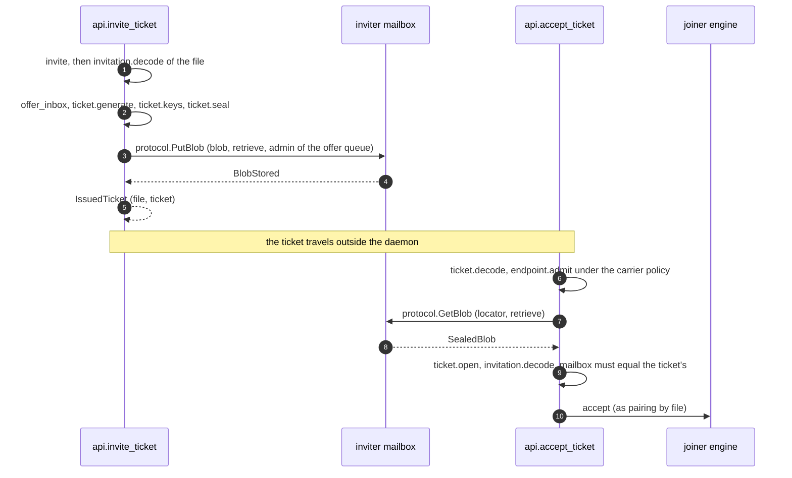

1. **Issue.** `invite_ticket` runs the whole file path first, so the offer is open. It then derives keys from a fresh ticket, seals the file, and stores it with `PutBlob`, paid for by the offer queue's admin capability. The blob's retention deadline is the invitation's own expiry. The ticket is returned only after `BlobStored`, so a ticket that exists always names a stored blob.
2. **Redeem.** `accept_ticket` ignores surrounding whitespace, admits the ticket's endpoint under the carrier policy before any connection, fetches the blob with `GetBlob`, opens it (AEAD, then commitment), and checks that the invitation's route names the ticket's own mailbox. Only then does it call `accept`. A mailbox that answers with another ticket's invitation is refused.
3. **Retries.** `ticket_call` retries with `weft/poll` every `ticket_retry_ms` (1,000) for at most `ticket_wait_ms` (60,000), each call bounded by `ticket_call_ms` (30,000), because a first onion connection can fail while circuits build. `store_blob` ends on `BlobStored`, retries `Unavailable`, and fails on `BadDeadline` and `QuotaExceeded` with an explicit reason. `fetch_blob` treats `Unauthorized` as final: the mailbox has no live blob for the ticket.
4. **No durable state.** Neither call writes state of its own. A ticket whose store failed leaves an offer that was never handed out, as a timed-out `invite` does.

## Retransmission

A mailbox's `Appended` receipt proves storage and not arrival. A stored message is sent again under a fresh envelope identifier, from the committed ciphertext, until the peer's own receipt names it ([ADR-006](../../docs/adr/006-end-to-end-retransmit.md)). The schedule is committed state, so it survives a restart, and the bytes of a copy come from a row and from nowhere else.

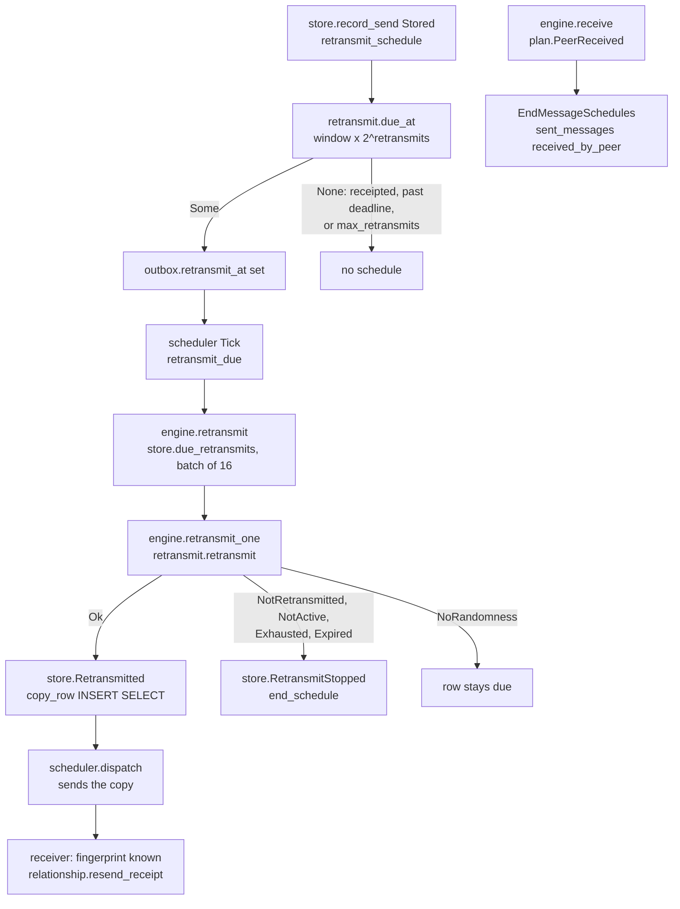

1. **Schedule.** When `record_send` stores a row, `retransmit_schedule` asks `retransmit.due_at` with `limits.receipt_window_seconds` (3,600), the row's kind, the copies so far and its deadline. The next copy is due after the window doubled per copy. No schedule is set for a message the peer already receipted (a receipt can overtake the scheduler's report), for a copy that could not go out before the deadline, or past `limits.max_retransmits` (5). Receipts and handshakes are never retransmitted.
2. **Tick.** Every scheduler `Tick` first calls `engine.retransmit` (`retransmit_due`), then dispatches. The copies are ordinary queued rows that the same tick's dispatch sends. An engine that cannot answer is asked again next tick, and the rows stay due.
3. **Decide.** `engine.retransmit` reads at most `retransmit_batch` (16, `engine.gleam:1502`) due rows. `retransmit_one` re-reads the relationship as it is now and asks `retransmit.retransmit`. A copy is committed as `Retransmitted`: an `INSERT ... SELECT` from the replaced row, which fails with `Conflict` if the replaced row's schedule already ended. Every refusal other than `NoRandomness` ends the schedule with `RetransmitStopped`.
4. **Receipt.** The receiver has the first copy's ciphertext fingerprint in `fingerprints`, so a later copy goes to `resend_receipt` and queues the same logical receipt again without decrypting or delivering. A `PeerReceived` record marks the message `received_by_peer` and clears the schedule of every row that carries it.

## Carrier and transport

`transport` is carrier-neutral: a `Dialer` is a `CarrierPolicy` plus an injected `dial_onion` function, and a `Connection` is three functions over one open byte stream (`send`, `receive`, `close`). `dial` checks `endpoint.admit` first, so a loopback endpoint under `TorOnly` opens no socket. Loopback is a `mug` TCP connection to `127.0.0.1`. `mailbox_client.call` is one request per connection: dial, write `POST /v1/mailbox` with `Connection: close`, read until the HTTP parser says the response is complete, close, decode. One deadline covers the dial, the send and every read. There are no retries and no redirects, and the client reads no proxy setting. A non-200 status is a `ClientError`, and a mailbox refusal is a `Response` inside a 200, so a caller can tell "the mailbox said no" from "the transport failed". The isolation group is the queue id in hex, one circuit group per queue.

`carrier.dialer` supplies `dial_onion`. It asks the carrier process for the `tor.Tor` handle on every dial (`mail.ask` with a 1,000 ms timeout), so a restart that replaces the carrier does not leave a stale handle in a dialer other processes hold. With no handle, every onion dial fails as `ConnectFailed`, which the workers treat like an unreachable mailbox.

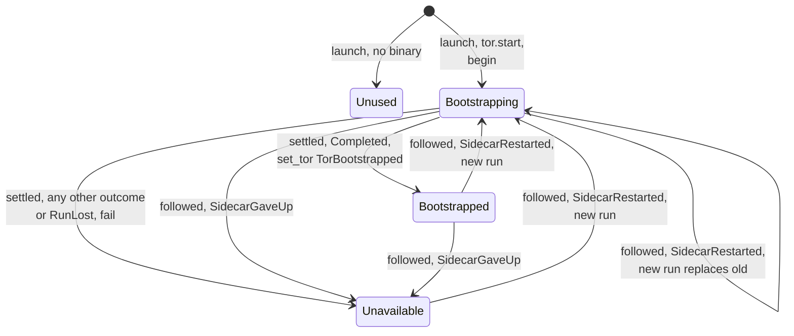

The bootstrap is a one-task `weft` run relayed to the machine, bounded by `bootstrap_deadline_ms` (190,000 ms). The client's own timeout, `bootstrap_timeout_ms` (180,000 ms), decides first and the run's deadline is the backstop for a call that never returns. The machine reports each decision to `status` (`TorStarting`, `TorBootstrapped`, `TorUnavailable`, `TorNotUsed`). `tor` restarts a crashed sidecar by itself, and the replacement is not bootstrapped, so `SidecarRestarted` starts a new run and returns the machine to `Bootstrapping` from any state with a sidecar. The selector is rebuilt around the new run's subject, so a stale outcome or end marker of the old run is never read. A settled machine ignores the `Bootstrap` message, which at that point is only the end marker of the run that settled it. `SidecarDied` and `ServiceStateChanged` change nothing. An onion stream write has `send_timeout_ms` (60,000 ms).

## Local API and CLI

The local API is a Unix socket, `api.sock`, in the state directory. The directory is `0700` and the socket `0600`, which keeps other users out. Two credentials separate an agent from the operator inside that boundary. `credential.ensure` creates `operator.cred` and `agent.cred` with 32 random bytes each, by exclusive create, and reads them back on a restart. The agent file is what an operator copies into an agent's sandbox.

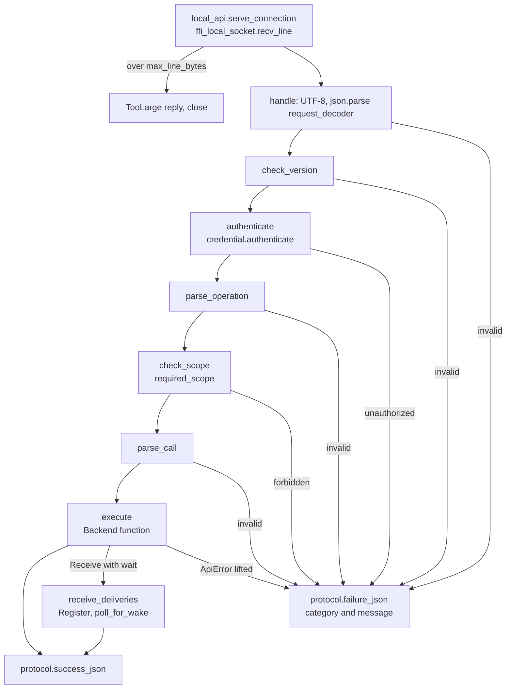

The server is plain processes. `start` binds the socket, starts the wake hub, and spawns the acceptor with `process.spawn_unlinked`. The acceptor blocks in `accept`, which no message can interrupt, so an actor would add nothing there. `accept_loop` spawns one process per connection, so a slow or crashing client stalls neither the others nor the acceptor. A connection process serves requests until the client leaves or `idle_timeout_ms` (60,000 ms, `local_api.gleam:83`) passes between them. A deadline over the whole connection would cut a client that is still using it, which is why this is an idle timeout on the blocking read and not a `weft` run.

The request is one JSON line `{"v":1,"credential":b64,"op":...,"args":{...}}` and the answer is one line, either `{"ok":true,"result":...}` or `{"ok":false,"error":{"category","message"}}`. The categories are `unauthorized`, `forbidden`, `not_found`, `invalid`, `refused`, `unavailable` and `too_large` (`local_api_protocol.gleam`). The order of checks in `handle` is fixed (`local_api.gleam:359`): parse, version, credential, operation, scope, arguments, backend. A forbidden operation never has its arguments read and never reaches the backend. `required_scope` gives the agent scope `contacts`, `send`, `receive`, `acknowledge`, `status` and `health`; `invite`, `accept`, `approve`, `decline`, `close`, `raise_budget`, `audit` and `incidents` are operator-only.

Line framing is `recv_line` in the Erlang shim (`daemon_local_ffi.erl`), because the built-in line mode truncates a long line instead of refusing it. A line over `max_line_bytes` (262,144) gets `too_large` and the connection closes, since the stream cannot be resynchronized. A response carries at most `max_response_payload_bytes` (131,072) of payload, at least one entry, and the rest waits for the next call; `receive` returns at most `max_receive` (64) deliveries and waits at most `max_wait_ms` (30,000).

A `receive` with a wait registers with the wake hub before its first read. The hub (`hub_message`) holds the list of waiters and the daemon's single `api.subscribe` subscription, and wakes every waiter on `MessagesReady`. A waiter re-reads and decides for itself whether the event was for its contact. `poll_for_wake` is `poll.until_on` with a clock whose rest is a wait on the waiter's subject, so a delivery announced between the read and the wait leaves a wake in the waiter's mailbox and is not lost. A wait that expires with nothing ready is an empty answer, not a failure.

`local_api_backend.from_daemon` is the only module that maps `daemon/api` onto the `Backend` record. `start_node` turns the CLI's options into a runtime `Config`: `--carrier tor` selects `TorOnly` with the sidecar binary, and `--carrier loopback` selects `TorOrLoopback` with no sidecar. The CLI is three modules and an entry point. `cli` is pure: it parses arguments into a `Command`, builds the request, and defines the exit codes (0 ok, 1 local failure, 2 usage, 3 unauthorized or forbidden, 4 not found, 5 refused, invalid or too large, 6 unavailable). `cli_run` does the effects, `cli_render` prints, and `pondline.main` installs the `telemetry` handler before anything else runs. A client command reads its credential from `--credential-file`, `PONDLINE_CREDENTIAL_FILE` or `<state-dir>/operator.cred`, and a payload or ticket only from `--file` or `--stdin`, so no secret reaches argv. `invite create` and a ticket accept wait `invitation_timeout_ms` (130,000 ms, `cli.gleam:813`), at least the daemon's own bounds. `invite create --out` refuses an existing file before the daemon is asked and writes the invitation with mode `0600`.

## Storage

The daemon has one SQLite file, `daemon.db`, held by one connection in the engine. `lock.db` is a separate file whose exclusive transaction proves ownership of the directory. SQL text is generated ([ADR-007](../../docs/adr/007-parrot-sql-codegen.md)): the migrations are `sql/NNN_*.sql`, embedded into `daemon/schema` by `dev/embed_schema.gleam`, and the statements are named queries under `src/daemon/sql/*.sql`, generated into `daemon/sql`. Only the pragmas, the transaction statements and the migration runner are hand-written in `store.gleam`.

| Concern | Setting |
| --- | --- |
| Journal | `journal_mode=WAL` (`store.configure`, `store.gleam:499`) |
| Durability | `synchronous=FULL`, `fullfsync=ON`, `checkpoint_fullfsync=ON` |
| Contention | `busy_timeout=5000` ms (`store.busy_timeout_ms`, `store.gleam:132`); only an outside process can contend with the engine |
| Migrations | `user_version`, one migration per version, applied in a transaction with the version bump. A file written by a newer build is refused with `FutureSchema`. |
| Files | State directory `0700`, `daemon.db` and `lock.db` `0600` (created before SQLite touches them) |
| Foreign keys | `foreign_keys=ON`, but no table declares one (see below) |

```mermaid
erDiagram
    meta {
        text key PK "agent_id"
        blob value
    }
    relationships {
        blob contact PK
        int version "optimistic lock"
        text phase "joining awaiting pending active closed"
        blob inbox_queue UK
        blob invitation "partial UK, not closed"
        blob blob "core snapshot"
    }
    offers {
        blob invitation PK
        int version
        text phase "provisioning open consumed expired"
        int deadline
        blob inbox_queue UK
        blob file "invitation file"
    }
    outbox {
        blob envelope PK
        blob contact
        text status "queued stored failed"
        int attempts
        int next_attempt_at "outbox_due index"
        int retransmits
        int retransmit_at "partial index"
        blob padded "ciphertext, written once"
    }
    processed {
        blob queue PK
        blob envelope PK
        blob digest
        int acked
    }
    attempts {
        blob queue PK
        blob envelope PK
        int count
    }
    deliveries {
        int seq PK
        blob contact UK
        blob message_id UK
        text status "ready held expired consumed"
    }
    sent_messages {
        blob message_id PK
        blob contact
        text state "locally_queued stored_by_mailbox received_by_peer failed"
    }
    fingerprints {
        blob contact PK
        blob digest PK
        blob message_id
        int expires_at
    }
    send_keys {
        blob contact PK
        text key PK
        blob message_id
        blob digest
        int expires_at
    }
    incidents {
        int seq PK
        text kind "repeated_message quarantined"
        blob queue
        blob envelope
        int attempts
    }
    audit {
        int seq PK
        blob contact
        text direction
        blob payload
    }
```

The schema has no foreign keys. `relationships` and `offers` keep the `core/snapshot` blob as the truth and a few plain columns (phase, queue, inbox) so the shell can find work without decoding every blob; the rows that refer to them (`outbox.contact`, `deliveries.contact`, `sent_messages.contact`) are written by the same commit that writes the state, so the engine's single transaction is what keeps them consistent. `processed` and `attempts` are keyed by queue and envelope and not by contact, because an envelope can arrive on a queue that has no relationship (it is then dropped). `incidents` rows record kinds, identifiers, counts and times and never a payload; `contact` is optional because a quarantined envelope may belong to no relationship.

One transaction covers one `Commit`: the state blob with its version check, every record of the plan, and the `Processed` row, which also deletes the envelope's `attempts` row. `record_send`, `count_attempt` and `mark_acked` are each their own transaction. There is no cache; every read goes to SQLite. A `deliveries` insert is a plain `INSERT` with `UNIQUE (contact, message_id)`, so a second delivery of a message fails the commit and rolls it back, which exposes state and store divergence instead of hiding it. The fault hook `Config.store_faults` is consulted once per transaction after the migrations: `Down` fails before `BEGIN`, and `AckLost` commits and then fails.

Schema versions: 1 initial; 2 retransmission (`outbox.retransmits`, `outbox.retransmit_at`, `fingerprints`); 3 `incidents`; 4 `attempts`; 5 `relationships.invitation` and `send_keys`. A shipped migration never changes: a schema change is a new file, and `test/daemon/sql_drift_test.gleam` pins each shipped file's SHA-256.

## Concurrency

| Process | Owns |
| --- | --- |
| `engine` (`weft/actor`, traps exits) | The SQLite connection, the clock and `Suite`, and every transition. The only caller of `store`. |
| `lock` (`weft/actor`, traps exits) | The open exclusive transaction on `lock.db`; released in `on_shutdown`. |
| `status`, `events` (`weft/actor`) | One observation record; the subscriber list. |
| `carrier` (`weft/state_machine`) | The `tor.Tor` handle, the state, and the current bootstrap run's subject. |
| `scheduler` (`weft/actor`) | `in_flight` claims and the table of running batches. Each batch is a relayed `weft` run linked to it. |
| `provisioner` (`weft/state_machine`, one state `Watching`) | The scan failure count and the named `scan` timeout. |
| `fetch_manager` (`weft/actor`) | The queue-to-pid map. Its fetchers are linked to it. |
| `fetcher`, one per queue (`weft/state_machine`) | The round state, the failure count and the backoff timeout. |
| `local_api` acceptor and connection processes (`spawn_unlinked`) | The listening socket; one connection each. |
| wake hub (`weft/actor`) | The list of waiting `receive` subjects and the runtime subscription. |
| `api.invite`, `invite_ticket`, `accept_ticket` callers | Their own `weft/poll` loops; ticket mailbox calls run in the caller's process. |

Only the engine touches the database. Every other process reads and writes durable state through an engine job, and the network workers hold no ciphertext they did not read back from a committed row. The engine's reply and its `notify` run in the engine process, so a `notify` function must not block: `route_notice` only posts messages.

Timers post messages and never touch state. Each is armed in one place: the scheduler's `periodic` tick (`tick_ms`), the fetch manager's `periodic` tick, the provisioner's named `scan` timeout (re-armed by its `Tick` arm with `delay_ms(failures)`: 1,000 ms doubled per failure, capped at 60,000 ms), the fetcher's backoff state timeout, and each run's deadline. A nudge reconciles or scans without touching the timer. The first `Tick` of the scheduler, fetch manager and provisioner is handled before any request (`continuing`), so rows committed before a restart are acted on at once.

An ask timeout does not mean the engine left its state unchanged. `mail.ask` returns `Error(Nil)` after the timeout or when the target is missing, and `engine.run` maps that to `Unavailable`; the job may still run later and commit. Callers must treat every operation as repeatable, which is why `accept`, `provisioned`, `mark_acked` and keyed sends are idempotent. `mail.tell` to a name with no process does nothing, and `mail.ask` answers `Error(Nil)`, so a restarting peer produces `Unavailable` and not a crash in the sender.

The simulation seams (`Config.timer`, `poll_clock`, `dialer`, `database`, `store_faults`, `engine_faults`, `interceptor`) are `None` or production values in `config.new` and are built only under `test/`. With an interceptor, every cross-actor `tell` and `ask` becomes a `Parcel(from, to, label, deliver)` that a runner releases in a seeded order. Ask replies, self-sends, weft timers and run outcomes, the event registry's fan-out, Tor port events and the network are not intercepted. [docs/dst/plan.md](../../docs/dst/plan.md) is the plan that uses them.

## Known gaps

- Nothing in the state directory is encrypted. Protection is file permissions only, and the blobs, `deliveries` and `audit` hold keys and plaintext.
- `invite` waits at most 30,000 ms for the queue, and a timed-out offer opens later unexported. Queue rotation at accept is not implemented, and there are no metrics.
- The local API's acceptor and connection processes are not supervised. A connection process that crashes leaves its socket open until the acceptor exits, and a Unix socket path is limited to about 100 bytes, so a long state directory fails at `listen`.
- `mailbox_client` opens one connection per call with no keep-alive pool, and the loopback carrier cannot bound a single read by `max_bytes`.
- The `TorOnly` path with the real sidecar runs only under `PONDLINE_TOR_NETWORK=1` and was not exercised in preparing this document.
- This document was written from the source without building or running it. Every constant is quoted from the code at `632db2f`, but behavior that depends on weft internals (run `limit`, `NeverStarted` and `Abandoned` ordering, `start_relayed` end markers) is described as the code in this package relies on it, not re-derived from weft.
- `docs/formal/tla.md` gives line numbers for `scheduler.gleam` and `engine.gleam` against `48bdacb`; some of them are a few lines off at `632db2f` (for example `dispatch` is at `scheduler.gleam:443`, and the table says 440).
- The fetch manager's `periodic` tick and `node.wait_for_lock`'s `Retry` arm have no test, as `CLAUDE.md` records.
