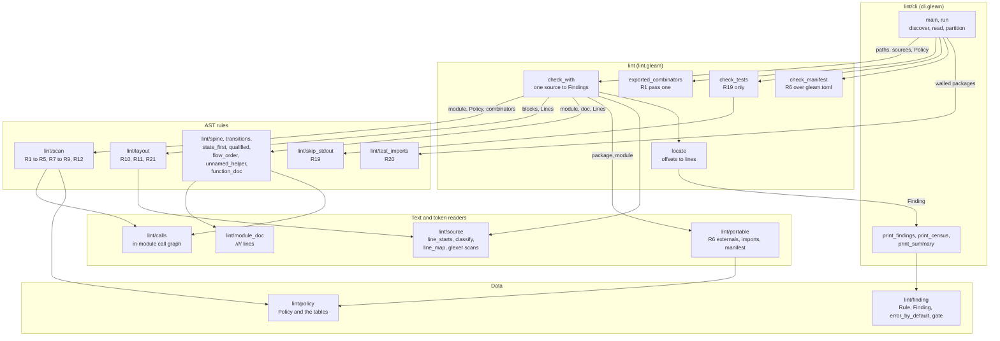
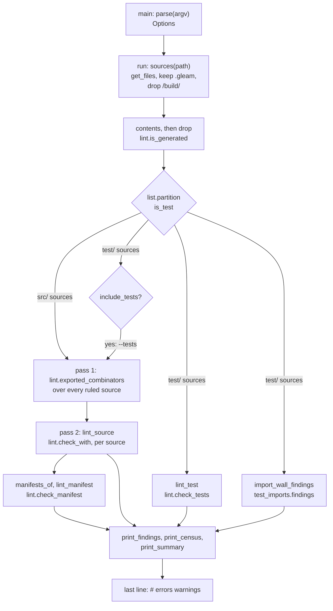
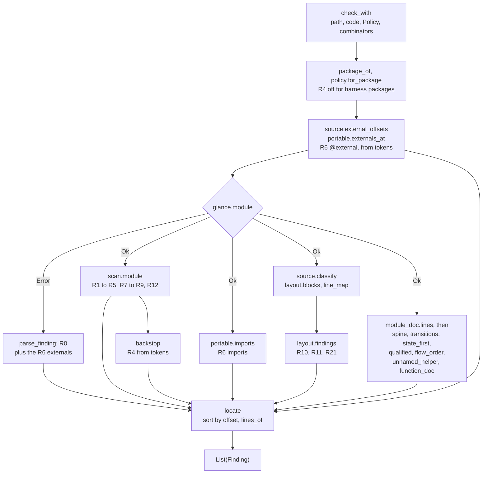
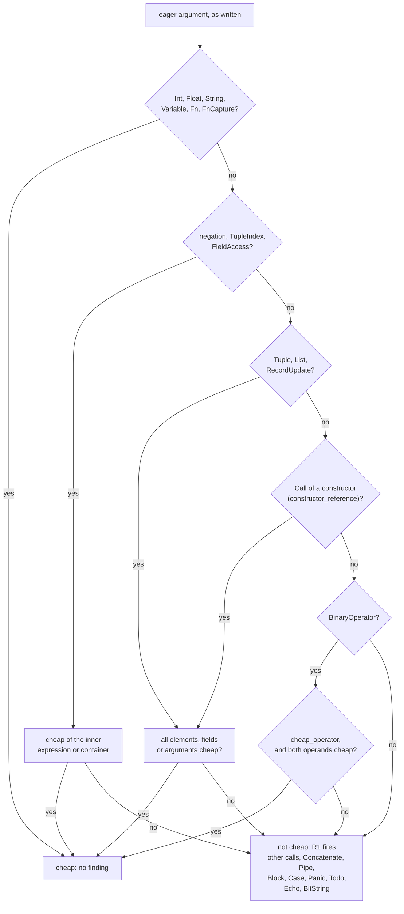
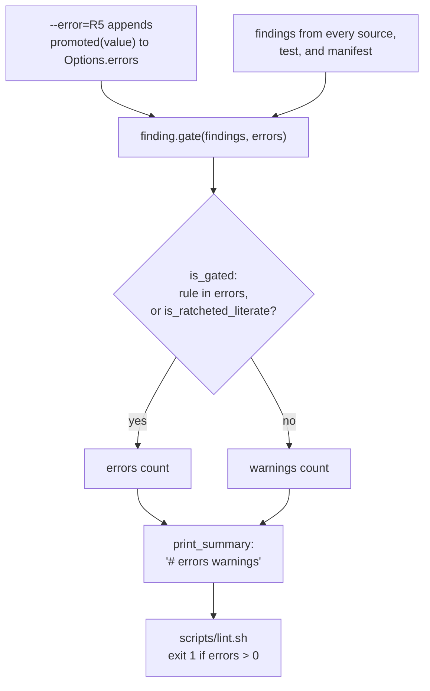

# lint

Reedwire's own lint: the house rules that `gleam check` and `gleam format`
do not know about. Gleam ships no lint command. The compiler checks types,
the formatter lays out bytes, and neither has an opinion on whether an
eagerly evaluated fallback is expensive, how deep a `case` may nest,
whether a `_ ->` arm hides a sibling variant, whether `panic` belongs in
`src/`, or whether a comment has a blank line above it.

This document describes how a lint run is built: which module owns which
decision, how one file moves from source text to a finding, how findings
become an exit code, and which tables hold the policy. It reflects the code
at commit `632db2f`. The per-rule reference, with each narrowing and its
census, is in [`CLAUDE.md`](CLAUDE.md). Repository conventions are in
[`docs/gleam-style.md`](../../docs/gleam-style.md), and the mailbox
architecture document in [`docs/architecture/mailbox.md`](../../docs/architecture/mailbox.md)
is the format reference for this one.

The package is a developer tool, not part of any plane. It depends on no
Reedwire package and no Reedwire package depends on it.
[`scripts/lint.sh`](../../scripts/lint.sh) runs it, and `make lint` and
`make check` call that script. Nothing here is a security control.

## Usage

```
scripts/lint.sh [options] [path...]     # default: every packages/*/src
make lint                               # the same, as part of make check
make lint-core                          # one package's src
```

Options are parsed by `lint/cli` (`apply`, `cli.gleam:104`):

| Option | Effect |
| --- | --- |
| `--depth=N` | Sets R2's `nesting_threshold` (default 3). |
| `--error=R1,R5` | Adds rules to the error tier for this run. Accepts `R5`, `r5`, or the rule name. |
| `--tests` | Also lints `test/` sources with every rule (R4 and R7 are off for them). |
| `--limit=N` | Lists at most N findings per rule (default 25, 0 means all). |
| `--quiet` | Prints the census only. |
| `--multi-subject` | Lets R3 examine `case` expressions with more than one subject. |
| `--help`, `-h` | Prints usage. |

The last line of output is `# <errors> <warnings>`. `scripts/lint.sh` reads
the first number and exits 1 when it is positive. A missing or malformed
last line is read as zero errors (`scripts/lint.sh`, the `case $tail` block).

## The rules

`lint/finding.Rule` has one constructor per rule, and `finding.id` prints
them as `R0` to `R22`. The tier column is membership in
`finding.error_by_default` (`finding.gleam:360`), which
`the_gating_rules_are_pinned_test` fixes. The thresholds quoted below are
the values in `policy.default` (`policy.gleam:169`).

| Rule | Name | What fires | Tier |
| --- | --- | --- | --- |
| R0 | `unparseable` | a file `glance` could not parse | error |
| R1 | `eager-fallback` | an eager combinator whose eagerly evaluated argument is not trivially cheap | error |
| R2 | `nesting-depth` | `case` nesting deeper than 3, measured on the AST | error |
| R3 | `catch-all` | a final `_ ->` or bare-variable arm beside flat constructor patterns | warning |
| R4 | `panic-in-src` | `panic` or `let assert` outside `test/` and outside a harness package | error |
| R5 | `bounded-length` | `list.length` or `string.length` compared against a bound | warning |
| R6 | `portable-purity` | an `@external`, a BEAM-only import or a BEAM-only dependency where the package may hold none | error |
| R7 | `assert-without-message` | a `let assert` outside `test/` with no `as "..."` message | error |
| R8 | `lone-caller-arity` | a private function with more than 7 parameters and one caller | warning |
| R9 | `naked-bool` | a `Bool` in a function parameter or a record field | warning |
| R10 | `comment-stanza` | a `//` comment between two siblings with code on the line directly above it | error |
| R11 | `dense-stanza` | a function whose longest unbroken run of statements exceeds 8 | error |
| R12 | `broad-closure-capture` | a returned, assigned or constructor-stored closure that uses an outer binding only to read its fields | warning |
| R13 | `flow-spine` | a module of 1000 lines or more with no `//// ## Flow` section, or a Flow section naming a function the module lacks | error |
| R14 | `transition-table` | a `<!-- transitions: ... -->` table whose rows differ from the named type's constructors | error |
| R15 | `state-first` | a state-space type defined after the module's first function | error |
| R16 | `qualified-domain-call` | an unqualified value import from one of Reedwire's own modules | error |
| R17 | `flow-order` | a module where more than 50 per cent of at least 10 private helpers sit above their first caller | warning |
| R18 | `unnamed-helper` | a one-caller private function of at most 6 lines whose name the module doc never uses | warning |
| R19 | `stdout-skip` | a `SKIP` diagnostic printed to stdout from a test | error |
| R20 | `test-import-wall` | a test whose import graph reaches a module its package forbids | error |
| R21 | `case-stanza` | a `case` statement in a multi-statement body with no comment above it, or welded to a neighbour | error |
| R22 | `function-doc` | a public function (in a documented module) or a long referenced private helper with no `///` doc | error |

Sixteen rules are errors and seven are warnings. R3, R8, R17 and R18
over-report by construction, because deciding them needs types or a
reader's judgement, and they stay warnings. R5, R9 and R12 are warnings
for reasons given under [Staging and the gate](#staging-and-the-gate).

## Components

Every module under `src/` is a pure function of its arguments except
`lint/cli`. The flowchart shows who calls whom for one file. Edges are
labeled with what crosses them.



`lint/cli` owns everything outside the process: argument parsing, file
discovery, reading, and printing. `lint` owns the per-file pipeline and the
conversion from byte offsets to lines. The rule modules return `Raw`
values (`scan.gleam:48`), which carry a rule, a byte offset, an enclosing
function name and a detail string, and never a line.

| Module | Owns | Does not own |
| --- | --- | --- |
| `lint/cli` | Argument parsing, file and manifest discovery, the generated-source skip, partition into `src/` and `test/`, the report, the census, the final `# <errors> <warnings>` line. The only module that reads files or writes output. | Any rule logic, the staging decision (`finding.error_by_default`), the exit code (`scripts/lint.sh`). |
| `lint` | `check_with`, `check_tests`, `exported_combinators`, `check_manifest`, `locate`, `package_of`, `is_generated`, and R4's token backstop. | Parsing (`glance`), rule judgements, file access. |
| `lint/scan` | The AST walk for R1 to R5, R7 to R9 and R12, R1's `cheap` predicate, and R1's structural combinator rows. | Line numbers, layout, anything in the module doc. |
| `lint/layout` | R10, R11, R21: where each sibling begins and ends, and the judgement over the line table. | Parsing, comment lexing (`lint/source`). |
| `lint/source` | Line index, `classify`, `line_map`, and the `glexer` scans for R4's backstop, R6's `@external`, and custom-type variant heads. | Any rule judgement. |
| `lint/portable` | R6's three halves and the text of the finding. | Which packages are portable (`lint/policy`). |
| `lint/module_doc` | The `////` lines of a module with offsets, a named section, and backtick spans. | What a span must resolve to. |
| `lint/calls` | What "caller" means for R8, R17 and R18. | The thresholds. |
| `lint/spine`, `lint/transitions`, `lint/state_first`, `lint/qualified`, `lint/flow_order`, `lint/unnamed_helper`, `lint/function_doc` | One orientation rule each (R13 to R18, R22). | Aggregation: `lint.check_with` joins them. |
| `lint/skip_stdout`, `lint/test_imports` | R19 and R20, the two rules about `test/`. | Reading `src/` for the R20 walk (`lint/cli` supplies it). |
| `lint/policy` | `Policy`, the thresholds, and the data tables. | Any code that reads them. |
| `lint/finding` | `Rule`, `Finding`, report rendering, `error_by_default`, `gate`. | Anything that decides a finding. |

## One run

A run reads every source once, derives one cross-file table from all of
them, then lints each source against that table. R1's structural half needs
the table because a `use`-compatible combinator defined in one module is
called from others, and a table built one file at a time cannot see those
calls.



1. **Discover.** `sources` (`cli.gleam:324`) lists `.gleam` files under each
   path, or takes the path itself when it is a file. `is_gleam` drops any
   path containing `/build/`. Files are de-duplicated and sorted
   (`cli.gleam:154`).
2. **Read and drop generated files.** `contents` reads each file; a file that
   cannot be read is skipped without a finding. `lint.is_generated`
   (`lint.gleam:324`) drops a source whose first 400 bytes (`header_prefix`,
   `lint.gleam:298`) include a `//` line containing `DO NOT EDIT`. These
   files are produced by `scripts/gen-sql.sh` (ADR-007), so a finding in one
   asks for an edit the next generation discards.
3. **Partition.** `is_test` is `string.contains(path, "/test/")`. Test
   sources go to `lint_test` (R19) and `import_wall_findings` (R20). They go
   through the full rule set only under `--tests` (`cli.gleam:178`).
4. **Pass one.** `lint.exported_combinators` parses each ruled source and
   returns the rows for its public `use`-compatible functions, keyed by the
   defining module's path (`lint.gleam:228`). A source that does not parse
   exports nothing.
5. **Pass two.** `lint_source` calls `lint.check_with` per source with the
   whole table. A test source under `--tests` gets `policy.for_tests_like`,
   which turns off R4 and R7 (`policy.gleam:200`).
6. **Manifests.** `manifests_of` derives each touched package's `gleam.toml`
   from the first `/src/` or `/test/` segment in a source path and lints it
   with `lint.check_manifest`. Manifests are found this way because `make
   lint` names `packages/*/src` and never a manifest.
7. **Report.** `print_findings` groups by rule in `finding.rules()` order and
   truncates to `--limit`. `print_census` prints one row per package and a
   `TOTAL` row. `print_summary` calls `finding.gate` and prints the
   `# errors warnings` line (`cli.gleam:500`).

`scripts/lint.sh` adds each `src` directory's sibling `test` directory to the
paths before running, so R19 and R20 see test sources without the caller
naming them.

## One file

`lint.check_with` (`lint.gleam:122`) is the whole per-file pipeline. It is
total given that `glance` returns: a file that does not parse is one R0
finding, and rules the parser cannot serve still run where they read tokens.



1. **Scope the policy.** `policy.for_package` turns off R4 for a package in
   `policy.harness_packages` (`lint.gleam:135`). The answer is applied
   here and not in `lint/cli`, so `lint.check` gives the same verdict for a
   path as `make lint` does.
2. **Lex first.** `source.external_offsets` runs before the parse
   (`lint.gleam:141`). R6 is a policy rule, so a parse failure must not
   silence its `@external` half.
3. **Parse.** On `Error`, `parse_finding` builds an R0 at the error offset
   and the R6 externals are located and returned. No other rule runs.
4. **Walk.** On `Ok`, `scan.module` returns the AST rules' findings. It
   joins the file's own combinator rows (`local_eager_rows`) to the imported
   ones and drops imported rows keyed under the file's own path, so a
   combinator called where it is defined yields one finding and not two
   (`scan.gleam:91`).
5. **Backstop R4.** `backstop` (`lint.gleam:349`) counts `panic` and
   `let assert` tokens and compares the count with the R4 findings the walk
   produced. When the counts differ, the lexed offsets the walk did not
   report become R4 findings. Equal counts report nothing. It is skipped
   when `policy.allow_panic` is true.
6. **Layout.** `source.classify` lexes the file once into a line table.
   `layout.blocks` collects sibling offsets from the tree, and
   `source.line_map` resolves all of them to lines in one merged pass
   (`lint.gleam:158`). `layout.findings` then judges in line numbers.
7. **Orientation.** `module_doc.lines` lexes the `////` block once, and the
   seven orientation rules share it (`lint.gleam:166`). Each takes the
   module, the doc or code, the line table, the policy and the module's own
   path.
8. **Locate.** `locate` (`lint.gleam:262`) sorts all `Raw` values by offset
   and converts them to lines with `source.lines_of`, which walks the line
   index once. The walks never see a line number, so the conversion cost is
   the file size and not the finding count times the file size.

`check_tests` (`lint.gleam:208`) is the separate entry for test sources. It
returns an empty list unless the text contains `SKIP`, and parses only in
that case; a test file with `SKIP` that does not parse is one R0.
`check_manifest` (`lint.gleam:247`) passes the file to `portable.manifest`
and locates the result.

## R1: what makes an argument cheap

R1 applies to a call whose callee is a known eager combinator. Gleam
evaluates every call argument before the call, so a fallback built for a
branch that is rarely taken costs time on the common path. The rule fires
when that argument is not cheap. `scan.cheap` (`scan.gleam:1684`) is the
single predicate, and `eager` (`scan.gleam:1562`) reports when it returns
false.



`Concatenate` and `Pipe` are the two operators `cheap_operator` rejects
(`scan.gleam:1733`). `<>` allocates a binary proportional to its operands
and `|>` is a call. A nullary constructor is a `Variable`, so it is cheap.
A field read or tuple index is cheap only when its container is cheap,
because `cheap` recurses into the container.

R1 finds the combinator two ways, and both feed this predicate.

- **Named rows.** `policy.eager_combinators` (`policy.gleam:48`) lists
  `bool.guard`, `result.replace_error`, `result.unwrap`, `option.unwrap`,
  `result.or`, `option.or`, and `tools/fs.require`, which takes no
  continuation and so cannot be found by signature.
- **Structural rows.** `combinator_rows` (`scan.gleam:1145`) synthesizes a
  row for every function in the run whose last parameter is a continuation.
  A continuation (`is_continuation`, `scan.gleam:1290`) is a `fn(...)` whose
  return type is spelled the same as the function's own return type, and no
  other parameter may have a function type. The leading parameter is exempt
  because it is the subject. `decision` (`scan.gleam:1191`) requires the body
  to branch on that subject, either in a leading single-subject `case` or in
  the first argument of a leading `use`, and a parameter named in that
  decision is not a fallback. An unrecognized body shape yields no rows.

The structural half cannot prove an argument is wasted, because a callee's
other branches may use it. R1 can therefore over-report, and the census
that argues for its tier is in `finding.error_by_default`.

## Staging and the gate

A rule is an error only if it appears in `finding.error_by_default`
(`finding.gleam:360`). Everything else is reported and counted without
failing the run. `finding.gate` (`finding.gleam:399`) splits a run's
findings into `#(errors, warnings)`, and that pair is the `#` line.



`is_gated` (`finding.gleam:407`) has two conditions. The first is
membership in the `errors` list, which starts as
`finding.error_by_default()` (`cli.gleam:88`) and grows with `--error`. The
second is `is_ratcheted_literate`, which gates an R21 or R22 finding in any
package listed by `policy.literate_packages`. Both R21 and R22 are in
`error_by_default`, so the second condition adds nothing today; it keeps
those two rules gating in the swept packages if they were ever removed from
the default list.

The tier is data, not a flag. A promotion is a one-line change to
`error_by_default` beside the argument for it in that function's doc comment.
The rule for promotion, written in `finding.gleam` and
`docs/gleam-style.md`, is that a census is zero, the rule is decidable
without types, and promotion protects something. A test that a rule fires
is not a test that it gates, so the gating tests assert the `gate` pair
(`lint_test.gleam:36`, `lint_test.gleam:2454`).

## Layout rules

R10, R11 and R21 ask where blank lines and comments are, which `glance`
discards. `lint/layout` collects sibling positions from the tree, and the
judgement is made against the file's own line table.

`layout.blocks` (`layout.gleam:196`) returns three kinds of sibling list:
`Statements` (a body), `Branches` (the arms of a `case`) and `Variants` (the
variants of a custom type). Variant heads come from a token scan
(`source.variant_offsets`) because `glance.Variant` has no span.

- **R10** (`orphan_comments`, `layout.gleam:296`) walks the gap between each
  pair of siblings. A comment block with code directly above it is a
  finding. The first sibling of a block is exempt, and so are comments
  between constructor fields and inside wrapped literals, because
  `gleam format` deletes a blank line in those places and a rule must not
  ask for one.
- **R11** (`dense_functions`, `layout.gleam:372`) takes each function's
  longest run of statements with no blank line or comment between them
  (`longest_run`, `layout.gleam:419`) and reports when it exceeds
  `dense_stanza_run`. `Weight` has three values: `Ordinary` counts one,
  `Compound` (a statement embedding a `case` or a multi-statement body)
  counts two, and `Binding` (a flat `use`) counts none and does not break
  the run. It counts statements, not lines, so a wrapped literal is one
  statement.
- **R21** (`case_stanzas`, `layout.gleam:483`) reads `StepShape`: a `case`
  statement in a multi-statement body must have a comment above it and a
  blank line from adjacent statements.

Do not add a sibling kind without checking the formatter first. The check
is `gleam format --stdin` on the shape in question.

## The tables

The policy that is data rather than code lives in `lint/policy`,
`lint/finding`, and two small tables in the orientation rules. The tests
pin the contents, so a change to any of them is a visible policy change.
The grouping below is by what each table decides.

**Staging.** `finding.error_by_default` lists the 16 gating rules.
`policy.literate_packages` (`policy.gleam:274`) lists eight packages
(`core`, `daemon`, `lint`, `mailbox`, `primitives`, `sim`, `telemetry`,
`tor`), the packages whose R21 and R22 censuses were swept; it is read only
by `is_ratcheted_literate`. Tests:
`the_gating_rules_are_pinned_test` (`lint_test.gleam:2193`) and the
`policy.literate_packages` assertion at `lint_test.gleam:2267`.

**Package scope.**

| Table | Value | Read by | Effect |
| --- | --- | --- | --- |
| `policy.harness_packages` (`policy.gleam:225`) | `["sim"]` | `policy.for_package` | R4 is off for that package's `src/`. R7 still applies. |
| `policy.portable_packages` (`policy.gleam:262`) | `["core"]` | `lint/portable` | No `@external`, BEAM-only import or BEAM-only dependency. |
| `policy.beam_only_dependencies` (`policy.gleam:295`) | `gleam_erlang`, `gleam_otp` | `lint/portable` | What counts as BEAM-only, by dependency name and import prefix. |
| `policy.import_walls` (`policy.gleam:320`) | `[]` | `lint/cli`, `lint/test_imports` | Packages whose tests may not reach given modules (R20). Empty, so R20 reports nothing today. |

Tests: `lint_test.gleam:2457`, `2513` and `2516`. `import_walls` has no
direct pin, and `test_scope_test.gleam` exercises the R20 walk with a
fixture wall.

**Detection.**

| Table | Rows | Read by | Test |
| --- | --- | --- | --- |
| `policy.eager_combinators` (`policy.gleam:48`) | 7 | R1 named half | none by name |
| `policy.counted_calls` (`policy.gleam:104`) | `gleam/list.length`, `gleam/string.length` | R5 | `lint_test.gleam:967` |
| `state_first.step_names` | `update`, `step`, `transition`, `handle_message`, `handle` | R15 | `orientation_ast_test.gleam:227` |
| `qualified.project_roots` | 9 module roots | R16 | `orientation_ast_test.gleam:332`, compared with `packages/*/src` on disk |
| `qualified.allowed` | empty | R16 | the mechanism via `findings_allowing` |

The `project_roots` test reads the tree, so a new package without a row
fails it. Thresholds are in `Policy` (`policy.gleam:126`):
`nesting_threshold` 3, `lone_caller_arity` 7, `dense_stanza_run` 8,
`spine_lines` 1000, `flow_order_min_helpers` 10, `flow_order_percent` 50,
`unnamed_helper_lines` 6, `function_doc_lines` 6.

## R6 and the portable subset

R6 has three halves, and each looks where a miss would be least likely.

- **`@external`** is found in the token stream (`source.external_offsets`),
  so it is reported even in a file that does not parse, and the word inside
  a string or comment never matches.
- **Imports** are read from the AST (`portable.imports`). A path matches a
  BEAM-only prefix when it equals the prefix or starts with the prefix and
  a `/`, so `gleam/erlangish/thing` does not match `gleam/erlang`.
- **Dependencies** are found by a line scan of `gleam.toml`
  (`portable.manifest`). A line matches when the text before the first `=`
  equals the dependency name. The scan does not distinguish
  `[dependencies]` from `[dev_dependencies]`, and a commented-out line does
  not match.

The rule names no target. An Erlang external ends portability, a JavaScript
one breaks the BEAM build, and a matched pair still puts unchecked foreign
code where the purity claim is. For a package that is not portable,
`externals_at` applies a second check: an `@external` must sit in a module
whose path is `internal/ffi_*` or contains `/internal/ffi_`, with two named
exceptions in `is_confined_ffi_module` (`host/bootstrap` and
`tui/internal/workspace_file`).

## Why it parses rather than greps

A column counter and an AST walk disagree about depth in both directions.
`gleam format` gives a wide call or literal one argument per line, so a
nested constructor literal indents as far as a `case` staircase and means
nothing of the kind. R2 measures `case` nodes, `statements_depth` and
`depth` (`scan.gleam:2288`, `scan.gleam:2306`), so a wrapped literal adds
none. R11 counts statements for the same reason.

R3 stays a warning for a different reason. A final catch-all arm may be
genuine variant dispatch, where a new constructor would compile silently
past the wildcard, or an idiomatic two-arm predicate. Telling them apart
needs the subject's type, and `glance` resolves none. `case_`
(`scan.gleam:2005`) skips a `case` that has a guarded arm, a literal or
primitive pattern, or a pattern that is not a flat constructor, and says in
the finding text which shape it saw.

## Concurrency

There is none. The package starts no BEAM process, uses no `gleam_otp` or
`gleam_erlang`, and declares no `@external`. A run is a sequence of list
traversals in one process: `lint/cli` reads files with `simplifile`, the
rest are pure functions, and the output is written to stdout in order. The
package passes its own R6 and R4 for the same reason it has no state.

| Owner | State |
| --- | --- |
| `lint/cli` `run` | The file list, the source texts, the combinator table, and the findings list, all immutable values threaded through the call. |
| `lint.check_with` | Nothing between calls. |

Two properties follow from that.

- **Order is deterministic.** `run` sorts paths with `string.compare`,
  `locate` sorts findings by offset, and `print_findings` iterates
  `finding.rules()`. The same tree produces the same report.
- **Totality has one hole.** `lint` is total given that `glance` returns.
  `glance` has `panic` paths in its parser, and one reached by a source
  would propagate out of `glance.module` and end the run. The package adds
  no `rescue` at the boundary.

## Tests

`make check-lint` runs the package gate: format check, warning-free build,
the EUnit suite, and the lint over `packages/lint/src`. `make test-lint`
runs the tests alone, and `make lint-lint` runs the tool over this package.
Tests are in `test/`:

| File | Covers |
| --- | --- |
| `lint_test.gleam` | R0 to R12, R6 negative shapes, the gate, and the pinned tables. |
| `orientation_doc_test.gleam` | R13 and R14, through `lint.check` with real sources. |
| `orientation_ast_test.gleam` | R15 and R16, and the `project_roots` tree comparison. |
| `orientation_census_test.gleam` | R17 and R18, and `lint/calls` edges. |
| `test_scope_test.gleam` | R19 and R20, including the `#(errors, warnings)` pair. |

Every rule has a positive and a negative case, and every gating rule has a
test through `finding.gate`.

## Known gaps

- Nothing was compiled or run to write this document. The rule counts, the
  tier of each rule, and every table value come from reading the sources and
  tests at `632db2f`. The census numbers in `CLAUDE.md` were not re-measured
  and are not repeated here.
- Rule behavior is described from the code of `scan`, `layout` and
  `portable`. The orientation rules (R13 to R18, R22) are described from
  their module docs and entry points, not traced line by line.
- `CLAUDE.md` and several module docs disagree with the code in places. This
  document follows the code. The differences are listed in the report that
  accompanied it and include: the `lint/affected*` modules `CLAUDE.md`
  describes are not in `src/`; the module docs of `lint`, `lint/cli`,
  `lint/portable` and `scripts/lint.sh` list a smaller gating set or other
  portable packages than the tables above; `CLAUDE.md` names `conformance` as
  the harness package where the code names `sim`; and `gleam.toml` declares
  `tom`, `gleam_regexp` and `filepath`, which no source or test imports.
- `is_confined_ffi_module` names `host/bootstrap` and
  `tui/internal/workspace_file`; no package in `packages/` has those modules.

## Reading further

- [`CLAUDE.md`](CLAUDE.md): per-rule reference and invariants.
- [`src/lint/finding.gleam`](src/lint/finding.gleam): `error_by_default` and
  its doc comment.
- [`src/lint/portable.gleam`](src/lint/portable.gleam): R6 in full.
- [`src/lint/layout.gleam`](src/lint/layout.gleam): R10, R11 and R21 in full.
- [`scripts/lint.sh`](../../scripts/lint.sh): the wrapper and the exit-code
  contract.
- [`docs/gleam-style.md`](../../docs/gleam-style.md): the style rules these
  checks enforce.
