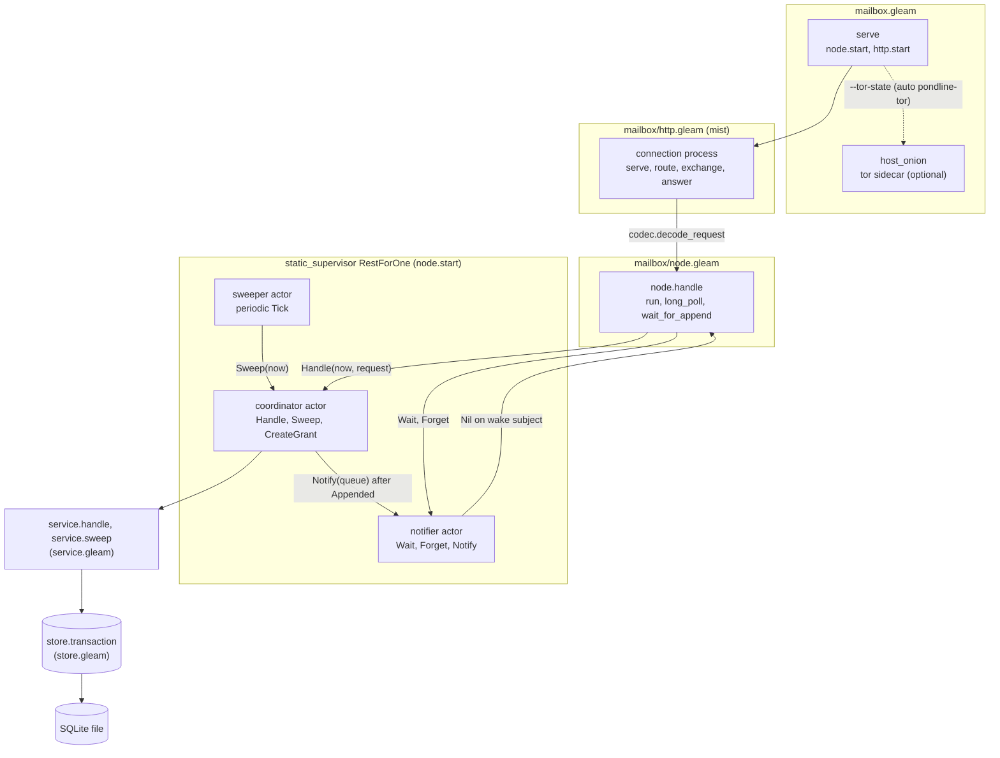
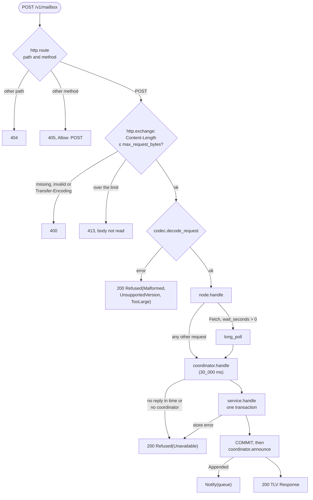

# mailbox

The `mailbox` package stores padded ciphertext for recipients who are offline and returns it when they ask (`docs/spec.md` §2.2, §6). It keeps queues, envelopes, sealed ticket blobs, the SHA-256 hashes of the capabilities that authorize each operation, and tombstones for acknowledged envelopes. It never sees plaintext. This README is the short map of the package at commit `49a51b3`; the full walk-through of the append and long-poll paths, the state machines and the schema is [docs/architecture/mailbox.md](../../docs/architecture/mailbox.md). The per-package contract (key types, traffic, invariants) is in [CLAUDE.md](CLAUDE.md).

The wire format is `core/mailbox/codec` and the request and response types are `core/mailbox/protocol`, both in `packages/core`. The Tor sidecar that forwards an onion service to the mailbox's loopback port is described in [ADR-001](../../docs/adr/001-tor-sidecar.md). Actor mechanics come from [weft](../../docs/weft.md).

## Components

One HTTP connection is one BEAM process (a mist connection). It decodes the body, calls `node.handle`, and encodes the answer. All durable work happens in a single `coordinator` actor that owns the SQLite connection. Two further actors sit beside it: the `notifier` records which connection processes wait on which queue, and the `sweeper` asks the coordinator to delete expired rows on a timer.

The connection process does all waiting, so a parked long poll blocks only its own connection. The coordinator waits on nothing except SQLite, and the notifier never touches SQLite. The supervisor is `RestForOne` with the children in the order notifier, coordinator, sweeper (`node.gleam:180`), so a notifier crash restarts all three. The mist listener is linked to `main` and is not under this supervisor.

| Module | Owns | Does not own |
| --- | --- | --- |
| `mailbox.gleam` | Argument parsing, `serve`, `grant` (raw capability or `plg1` token), `status`, sidecar discovery, the optional onion service | Any request handling |
| `mailbox/http` | Framing: the `413`, `404`, `405` and `400` decisions, the per-request log line | Protocol semantics; durable state |
| `mailbox/node` | The `rest_for_one` supervisor, `Names`, and the long-poll sequence run in the caller's process | The waiter table; the database |
| `mailbox/coordinator` | The one `Store`, and the order commands run in | What a request means |
| `mailbox/service` | Authorization, idempotency, quota, deadlines, tombstones, blobs | The connection and the SQL text; time (passed in as `now`) |
| `mailbox/store` | Pragmas, migrations, `transaction`, every SQL statement | Protocol rules; which process calls it |
| `mailbox/notifier` | The table from queue to waiting wake subjects | Envelopes; timers |
| `mailbox/sweeper` | Its periodic tick | The sweep itself, which runs in the coordinator |
| `mailbox/mail` | `tell`, `ask` and the simulation interception seam | Message types of the actors |

`mailbox/schema` and `mailbox/sql` are generated from `sql/*.sql` and `src/mailbox/sql/*.sql` and are not edited by hand (ADR-007).

## Request path

A request reaches the coordinator through `node.handle`, which sends a `Fetch` with a positive `wait_seconds` to `long_poll` and every other request straight to `run` (`node.gleam:228`). Every protocol answer, refusals included, is HTTP `200` with a TLV `Response`. HTTP statuses are only for transport failures.

1. **Frame.** `http.route` selects by path and then method (`http.gleam:197`). `http.exchange` refuses a declared `Content-Length` over `codec.max_request_bytes()` before reading the body, and answers `400` for a missing or invalid length or any transfer coding (`http.gleam:216`, `http.gleam:241`). `max_request_bytes()` is 263_168 (`codec.gleam:131`).
2. **Decode.** `http.answer` runs `codec.decode_request`; a failure becomes `Refused(codec.refusal(error))` so the client reads one kind of answer (`http.gleam:259`).
3. **Dispatch.** `node.handle` reads the clock and calls `coordinator.handle` with a 30_000 ms call timeout (`node.gleam:138`). A timeout or a missing coordinator is `Refused(Unavailable)`, and the command may still commit afterwards, so a client treats `Unavailable` as outcome unknown.
4. **Apply.** `coordinator.handle_message` runs `service.handle` to completion before reading the next message (`coordinator.gleam:197`). Each write is one `store.transaction`, which issues `BEGIN IMMEDIATE` (`store.gleam:347`). A storage error becomes `Refused(Unavailable)` without the error text.
5. **Wake.** After the commit, `announce` sends `Notify(queue)` for an `Appended` response only, then the reply goes to the caller (`coordinator.gleam:229`).
6. **Long poll.** `wait_for_append` registers a wake subject with the notifier before its last look at the database, then waits `min(wait_seconds, limits.long_poll_seconds)` (25) seconds, fetches once more, and calls `notifier.forget` (`node.gleam:284`). The step-by-step sequence is in [docs/architecture/mailbox.md](../../docs/architecture/mailbox.md#pipeline-a-long-poll-fetch).

The sweeper sends `Sweep(now)` to the coordinator on a fixed-delay `actor.periodic` tick every `sweep_period_ms` (60_000, set at `mailbox.gleam:71`), with a 30_000 ms reply timeout (`sweeper.gleam:55`). It drops the result; the next tick retries.

## Startup

`pondline-mailbox serve --db <path> [--port <n>] [--tor-state <dir> [--tor-bin <path>]]` resolves any requested Tor sidecar before starting the node, and starts the node before the listener, so no request arrives before the database is open and migrated (`mailbox.gleam:553`). `--port` defaults to `0` (ephemeral loopback port). The coordinator opens the store in its initialiser with a 5000 ms start timeout, so a bad file fails the start (`coordinator.gleam:109`). The server binds `127.0.0.1` only. With `--tor-state`, `host_onion` starts the resolved `pondline-tor` sidecar, hosts an onion service named `mailbox` that forwards to the bound port, writes `<tor-state>/onion` (`0600`), and prints `onion <host>.onion:80` after the `listening` line ([ADR-015](../../docs/adr/015-grant-tokens-and-daemon-config.md)). `pondline-mailbox status --db <path>` queries `store.status` (`store.gleam:899`) directly in one read transaction without booting the supervisor.

## Storage

One SQLite file, opened by `store.open_with` with WAL, `synchronous=FULL`, `fullfsync` and `foreign_keys` on, and a 5000 ms busy timeout (`store.gleam:227`). The schema is at version 2 (`schema.gleam:6`): `sql/001_initial.sql` creates `grants`, `queues`, `envelopes` and `tombstones`, and `sql/002_blobs.sql` adds `blobs`. `store.migrate` applies the list through `PRAGMA user_version` and refuses a file written by a newer build (`store.gleam:298`). Table detail and the missing foreign keys are explained in [docs/architecture/mailbox.md](../../docs/architecture/mailbox.md#storage).

## Where to go next

| Question | Read |
| --- | --- |
| How an `Append` is authorized and de-duplicated | [docs/architecture/mailbox.md](../../docs/architecture/mailbox.md), "Pipeline: an Append"; `docs/spec.md` §6.4 |
| How the long poll avoids a missed append | [docs/architecture/mailbox.md](../../docs/architecture/mailbox.md), "Pipeline: a long-poll Fetch" |
| Sealed ticket blobs | [ADR-009](../../docs/adr/009-invitation-tickets.md); `service.store_blob`, `service.fetch_blob` |
| Why SQL is generated | [ADR-007](../../docs/adr/007-parrot-sql-codegen.md) |
| Log fields and crash reports | [ADR-012](../../docs/adr/012-logging-and-crash-reports.md) |
| Simulation seams (`timer`, `interceptor`, `store_faults`) | `node.Config` (`node.gleam:111`), `docs/dst/plan.md`, [CLAUDE.md](CLAUDE.md) |

## Known gaps

- Nothing here was confirmed by running code. Restart behaviour under `RestForOne`, and whether mist stops a handler when a client disconnects mid long poll, are not checked.
- The onion path is exercised only with `PONDLINE_TOR_NETWORK=1` (see `CLAUDE.md`); it is not described step by step here.
