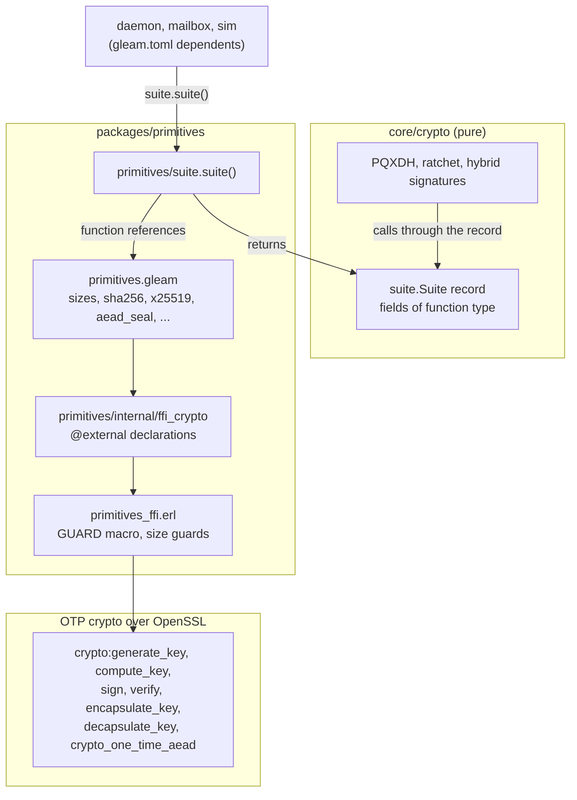
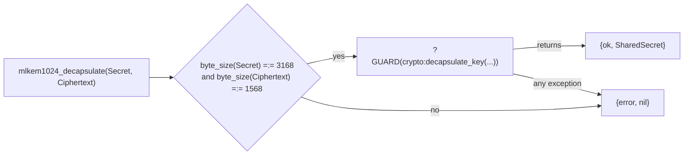
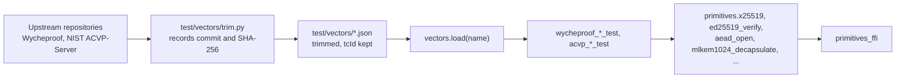

# Primitives Architecture

The `primitives` package is the only place Pondline calls OTP's `crypto` application. It exposes X25519, Ed25519, ML-KEM-1024, ML-DSA-65, ChaCha20-Poly1305, SHA-256, HMAC-SHA-256, constant-time comparison and the OS random source as byte-level functions, and it packages them as the `Suite` record that the pure `core/crypto` modules take as input. This document describes the binding boundary, why every fallible shim catches exceptions, and how the vector tests exercise the binding. It reflects the code at `632db2f`.

The algorithms, byte layouts and guarantees are fixed in [crypto-profile-v1.md](../../docs/crypto-profile-v1.md); this package implements none of them beyond calling the library. The choice of OTP over OpenSSL, and not a Rust crate, is [ADR-002](../../docs/adr/002-pq-crypto-over-otp.md). The symbolic proof and the account of each vector suite are in [formal/crypto.md](../../docs/formal/crypto.md). The package's short reference is [CLAUDE.md](CLAUDE.md).

## Components

Three Gleam modules and one Erlang module sit between the protocol code and OpenSSL. No process is involved: every call is a synchronous function call in the caller's process.

`core` depends on no foreign code, so it cannot call this package. The shell builds the record once with `primitives/suite.suite()` (`src/primitives/suite.gleam:22`) and passes it in. The fake suite used by `core`'s own tests lives under `core`'s `test/` directory, outside anything a release build compiles, so it cannot be selected in production (spec §13.3). `daemon`, `mailbox` and `sim` depend on this package by path (`packages/daemon/gleam.toml:17`, `packages/mailbox/gleam.toml:16`, `packages/sim/gleam.toml:20`).

| Module | Owns | Does not own |
| --- | --- | --- |
| `primitives` | The Gleam name and signature of each primitive, and the byte sizes as named constants (`x25519_bytes` 32, `mlkem1024_public_bytes` 1568, `mldsa65_signature_bytes` 3309, `aead_tag_bytes` 16, and the others at `src/primitives.gleam:19` to `56`). | Key types. A secret and a public key are both `BitArray`, so `core/crypto` adds the typed layer that stops one being passed as the other. |
| `primitives/suite` | The one place the `Suite` record is filled with real implementations. | The test suite, which lives in `core`. |
| `primitives/internal/ffi_crypto` | The `@external(erlang, "primitives_ffi", ...)` declarations, confined here by the FFI rule. | Any logic. |
| `primitives_ffi` (Erlang) | Argument size guards and exception handling for each call into `crypto`. | Algorithm choice. Key and signature sizes come from the profile. |
| HKDF | Not here. HKDF-SHA-256 is built from `hmac_sha256` in `core/crypto/hkdf`; the Wycheproof HKDF suite reaches it through the `Suite` (`test/primitives/wycheproof_hkdf_sha256_test.gleam`). | |

## Calling convention

A fallible operation returns `Result(_, Nil)` and a verification returns `Bool`. Neither ever raises. The Gleam signature fixes the shape and the Erlang shim fixes the behaviour: the shim returns `{ok, X}` or `{error, nil}`, which Gleam reads as `Ok(X)` or `Error(Nil)`, and returns `true` or `false` for `ed25519_verify` and `mldsa65_verify`.

Each shim has the same structure, shown here for ML-KEM decapsulation (`src/primitives_ffi.erl:85`):

1. **Size guard.** A function clause matches only the sizes in the profile (`src/primitives_ffi.erl:43`, `50`, `58`, `62`, `78`, `85`, `99`, `117`, `124`). A wrong-sized input falls to the catch-all clause and returns the error value without calling `crypto`.
2. **Guarded call.** The `?GUARD` macro (`src/primitives_ffi.erl:20`) wraps the `crypto` call in `try ... catch _:_`. The two verifiers use an explicit `try` that returns `false` on any exception (`src/primitives_ffi.erl:68`, `108`).
3. **Normalised result.** `aead_seal` appends the 16-byte tag to the ciphertext (`src/primitives_ffi.erl:119`). `aead_open` splits it off and returns the plaintext or `{error, nil}` for any forgery, truncation or wrong key (`src/primitives_ffi.erl:124`).

## Why every shim catches exceptions

OTP's `crypto` raises errors whose arguments include the key material it was given. An uncaught `badarg` from `crypto:sign` would put a private key into the crash report that a supervisor prints. The module header states this as a security property (`src/primitives_ffi.erl:4`), and spec §12.4 forbids secrets in logs. [ADR-012](../../docs/adr/012-logging-and-crash-reports.md) describes the case it reproduced: a failing `crypto_one_time_aead` call printed its full argument list. The guard in this package closes that path for the calls made here. The telemetry formatter closes it for exceptions raised elsewhere (see [telemetry](../telemetry/README.md)).

The catch is paired with the size guard because the library's behaviour on a wrong-sized key differs by call: some raise and some return a value. The guard makes the answer the same for all of them. An ML-DSA verify with a wrong-sized public key raises in `crypto:verify`, and the size clause plus the catch turn that into `false` (`src/primitives_ffi.erl:103`).

Not every function is wrapped, and the reason is stated in the source. These functions have no `?GUARD`:

| Function | Reason in the source |
| --- | --- |
| `sha256`, `hmac_sha256` (`src/primitives_ffi.erl:30`, `32`) | They raise only for a non-binary or non-byte-aligned bitstring, which no caller passes, and an HMAC key of any length is valid. The comment at line 24 gives the reason: the Gleam API stays a plain `BitArray`. |
| `random_bytes`, `equal`, `openssl_version` | Total over their guarded inputs, or no secret in a raised error. `equal` returns `false` on a length mismatch instead of calling `crypto:hash_equals` (`src/primitives_ffi.erl:36`). |
| `x25519_keypair`, `ed25519_keypair`, `mlkem1024_keypair`, `mldsa65_keypair` | They take no input, and a raised error would carry no caller-supplied key. |

## Behaviour a caller must know

- **ML-KEM uses implicit rejection.** Decapsulating a well-sized but forged ciphertext returns an unrelated shared secret, not an error. The only error is a malformed key or ciphertext size. Authentication comes from what the secret later keys (`src/primitives.gleam:234`).
- **ML-DSA signing is hedged.** OpenSSL mixes fresh randomness into every signature, so two signatures of one message differ and both verify (`src/primitives.gleam:265`). Signing uses an empty context string. The secret key is OpenSSL's 4032-byte expanded form, because OTP 29 cannot rebuild a key from a seed through `generate_key/3` (`src/primitives_ffi.erl:90`).
- **X25519 refuses a zero shared secret.** OpenSSL rejects the all-zero output of a low-order public key, and the guard turns the rejection into `Error(Nil)` (`src/primitives_ffi.erl:47`).
- **Ed25519 is pure Ed25519.** `crypto:sign(eddsa, none, ...)` with a 32-byte secret (`src/primitives_ffi.erl:63`).
- **The OpenSSL version.** ML-KEM needs OpenSSL 3.5 or newer. `openssl_version` returns the string `crypto:info_lib` reports (`src/primitives_ffi.erl:134`). The function's comment says a release checks it at startup; no module outside this package calls it.

## Vector tests

The tests run the standard vector suites through the `primitives` API and never call `crypto:` directly, so a passing vector is a statement about the function the protocol uses, including the shim's size guards and exception handling. The loader `test/primitives/vectors.gleam` reads a trimmed file from `test/vectors/`, keeps the upstream `tcId`, and uses `let assert` on every lookup, so a malformed fixture stops the test and cannot pass vacuously (`vectors.gleam:1` to `10`).

Each suite asserts the case count it loaded before asserting outcomes, so a regenerated file with fewer cases fails. The counts, from the assertions in `test/primitives/`:

| Suite | Cases | What is asserted |
| --- | --- | --- |
| Wycheproof X25519 | 518 | 31 zero shared secrets refused; 264 valid cases agree; 223 acceptable cases return the RFC 7748 output. |
| Wycheproof Ed25519 | 210 | 117 valid verify; 64 invalid refused; 29 acceptable cases pinned as accepted. |
| Wycheproof ChaCha20-Poly1305 | 325 | 256 valid seal and open; 60 modified tags refused; 9 wrong nonce sizes refused. |
| Wycheproof HMAC-SHA-256 | 174 | 66 valid tags match; 108 modified tags differ. |
| Wycheproof HKDF-SHA-256 | 86 | 83 valid derive the expected output; 3 oversize requests refused. |
| ACVP ML-KEM-1024 | 24 | Key pairs, encapsulation, 10 decapsulations (5 with modified ciphertexts that must give the implicit-rejection secret), 4 encapsulation-key checks, 4 decapsulation-key checks. |
| ACVP ML-DSA-65 | 10 | 3 key pairs sign and verify through the binding; NIST signatures verify under an empty context and not under another. |

Three further groups complement the vectors. `known_answer_test.gleam` checks the RFC examples (4231, 7748, 8032, 8439, FIPS 180-4) and the size and low-order refusals. `mldsa_test.gleam` covers what ML-DSA-65 cannot be checked against without seeded key generation: sizes, round trips, hedging, and every rejection a verifier owes, including that garbage keys never raise. `protocol_test.gleam` and `hybrid_auth_test.gleam` run the handshake and ratchet over real primitives, and the second fails if any hybrid signature check verifies only its classical half. The two Ed25519 and X25519 acceptable-case behaviours are pinned so a change in OpenSSL is noticed (`docs/formal/crypto.md` records the sources, hashes and what each suite cannot reach).

## Concurrency

None. Every function runs in the calling process and holds no state. The one shared resource is OpenSSL's random state, which `crypto` manages. Because a call is synchronous, the error normalisation above is the entire failure model: a caller sees `Ok`, `Error(Nil)`, `True` or `False`, never an exception.

## Known gaps

- Not run: this document was written from the code without building or testing. The vector counts come from the assertions in the test files, not from a run.
- `openssl_version`'s comment promises a startup check for OpenSSL 3.5; no caller exists. The test that touches it only asserts the string starts with `OpenSSL 3.` (`test/primitives/known_answer_test.gleam:181`), which a 3.0 build would also satisfy. `CLAUDE.md` says every wrapper catches every exception, while the code leaves the functions in the table above unwrapped; the source comments explain why for the hash and HMAC pair only.
- Constant-time behaviour of `equal` rests on `crypto:hash_equals`; it was not measured.
- Side-channel and memory-zeroisation properties of OpenSSL are outside the package and were not examined.
