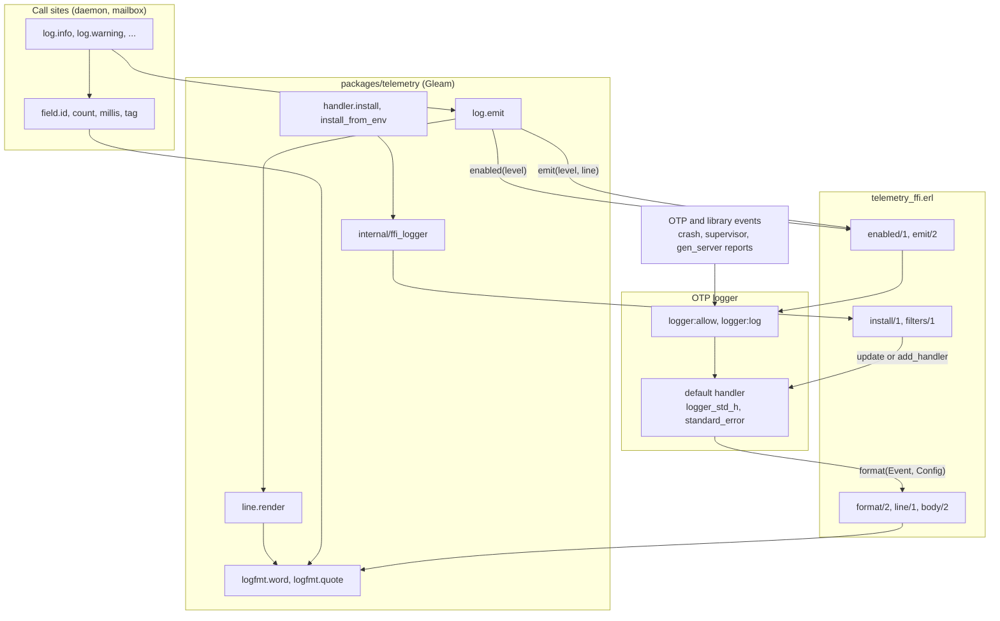
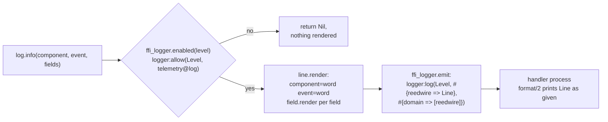
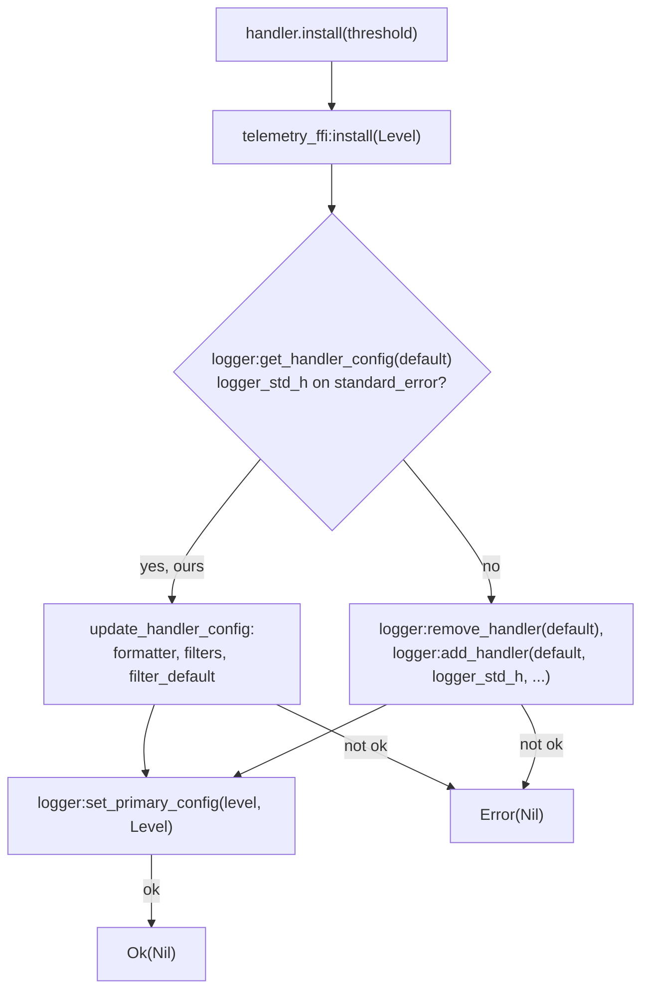
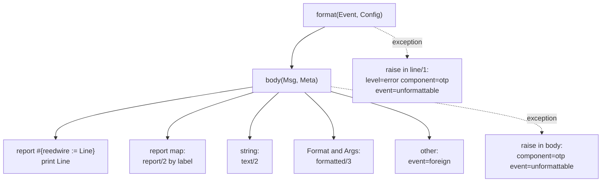

# Telemetry Architecture

The `telemetry` package is Reedwire's only logging layer, and it enforces the rule that no log line carries a secret (spec §12.4). It has two halves. A typed call path renders Reedwire's own lines from fields that cannot hold free-form text. A `logger` handler with a custom formatter rebuilds every line that OTP or a library writes into the same VM from the event's shape, never from its contents. Both halves write logfmt to standard error. This document describes the call path, the handler, and the formatter's rebuild rule. It reflects the code at `632db2f`.

The decision, the reproduction that motivated it and the list of covered report shapes are in [ADR-012](../../docs/adr/012-logging-and-crash-reports.md). The rule the package enforces is in [spec.md](../../docs/spec.md) §5.4 and §12.4 and in `docs/gleam-style.md` Part IV §4 and §7. The package's short reference is [CLAUDE.md](CLAUDE.md).

## Components

Reedwire's own lines and foreign events share one handler but take different paths into it. A call from Reedwire code is rendered to text in the caller's process before `logger` sees it. A foreign event reaches the formatter as an Erlang term and is rebuilt there.

| Module | Owns | Does not own |
| --- | --- | --- |
| `telemetry/field` | The four field kinds and their rendering. `Field` is opaque, so the constructors are the only way to build one (`src/telemetry/field.gleam:38`). | The component and event words, which are literals at call sites. |
| `telemetry/line` | The body of one line: `component=`, `event=`, then the fields in caller order (`src/telemetry/line.gleam:26`). | The timestamp and level, which the formatter adds. |
| `telemetry/log` | The four calls `debug`, `info`, `warning` and `error`, and the level gate. | Handler setup. A program that never installed the handler still logs through OTP's default handler. |
| `telemetry/logfmt` | The single escaping rule: `word` for keys and `quote` for values. | Which values are allowed. |
| `telemetry/level` | The four levels, their names, `parse`, and the policy for what goes at which level. | The threshold in force, which belongs to `logger`. |
| `telemetry/handler` | Installing the handler and reading `REEDWIRE_LOG_LEVEL`. Only an entry point calls it. | Formatting. |
| `telemetry/internal/ffi_logger`, `telemetry_ffi.erl` | The bindings to `logger`, `os:getenv` and the term-inspection primitives, and the formatter. | The wording of Reedwire's own lines. |

## The typed call path

A call site names a component, an event and a list of fields. Component and event are strings, but they are literals by convention at every call site (the convention is not enforced by the type; ADR-012 says so). The fields are where the type system acts. `Field` holds one of four values, and none holds a free-form string or bytes:

| Constructor | Argument | Rendered |
| --- | --- | --- |
| `field.id(key, id)` | A `core/id.Id(kind)` | `key=` and the first `id_prefix_chars` (8) hex characters (`field.gleam:34`, `67`). |
| `field.count(key, n)` | `Int` | `key=n` |
| `field.millis(key, n)` | `Int` | `key_ms=n`, with the unit in the key (`field.gleam:128`). |
| `field.tag(key, value)` | Any value | `key=` and the constructor's name only. `Refused(x)` is `refused`, a `Secret` is `secret`, a string or bit array is `<binary>` (`field.gleam:107`). |

`tag` is the one constructor that accepts any type, so its safety comes from what it reads. `ffi_logger.constructor_name` returns an atom's name, or the first element of a tuple when that element is an atom, and otherwise the value's shape in angle brackets (`src/telemetry_ffi.erl:87`). A Gleam custom type with fields compiles to a tuple whose first element is the constructor atom, so the fields are never read.

1. **Gate.** `log.emit` asks `logger` whether it would pass an event at this level before it renders anything (`src/telemetry/log.gleam:83`). The check is `logger:allow/2`, so it agrees with the handler's threshold.
2. **Render.** `line.render` joins `component=<word>` and `event=<word>` with the rendered fields (`src/telemetry/line.gleam:26`). `logfmt.word` replaces any character outside `[a-z0-9_]` with `_` (`src/telemetry/logfmt.gleam:25`), so a mistyped key cannot break the line. A tag value goes through `logfmt.quote`, which leaves a bare token as it is and otherwise quotes it, escaping `"`, `\` and control characters (`src/telemetry/logfmt.gleam:51`).
3. **Emit.** The line is sent as a report under the single key `reedwire` (`src/telemetry_ffi.erl:83`), so nothing between the call and the formatter can reinterpret it as a format string. The call runs in the caller's process; the handler process does the writing.
4. **Format.** `body/2` matches `{report, #{reedwire := Line}}` and prints `Line` unchanged (`src/telemetry_ffi.erl:130`). The line carries no timestamp of its own: `format/2` adds `time=` from `logger`'s event time and `level=` (`src/telemetry_ffi.erl:120`), so a log call reads no clock.

Levels are exactly `logger`'s atoms `debug`, `info`, `warning` and `error` (`src/telemetry/level.gleam:35`). `level.parse` accepts `warn` and `err` and ignores case and surrounding space (`level.gleam:77`). The module documentation of `telemetry/level` is the level policy that call sites follow.

## Installing the handler

Only a program's entry point installs the handler. The daemon calls `handler.install_from_env` first (`packages/daemon/src/reedwire.gleam:35`) and so does the mailbox (`packages/mailbox/src/mailbox.gleam:102`). A library that reconfigured `logger` would change the VM of whatever embedded it, and the simulation, which silences `logger` around its runs, would be undone by a node start.

`install` replaces OTP's `default` handler with `logger_std_h` writing to standard error (`src/telemetry_ffi.erl:42`). Standard output is a protocol channel in these programs: the mailbox prints `listening` and `onion` lines a launcher parses, and `reedwire receive --raw` writes payload bytes there (`handler.gleam:14`). `logger` cannot change a running handler's device, so a handler that is not already ours is removed and added again. One that is ours keeps running and has only its formatter and filters replaced, so a second install (a second test) loses no line.

`filters/1` always stops events from a remote group leader, as OTP's default does, and below `debug` also stops progress reports (`src/telemetry_ffi.erl:72`). `handler.install` returns `Error(Nil)` if `logger` refuses the handler, and the entry point should refuse to start, because the alternative is OTP's unscrubbed formatter. `install_from_env` reads `REEDWIRE_LOG_LEVEL` (`handler.gleam:34`) and falls back to `info` for a missing or unrecognised value (`handler.gleam:83`).

## The formatter's rebuild-from-shape rule

`format/2` is the callback `logger` invokes in the handler's process (`src/telemetry_ffi.erl:109`). For any event that is not one of Reedwire's own lines, it builds the output from the event's structure and does not print the event as given. OTP's own formatter prints a crashed process's mailbox and dictionary, the arguments in a stack frame, a `gen_server`'s state and last message, and the data inside every reason. A BIF or NIF that raises puts its whole argument list in the frame, which for `crypto` is the key and the plaintext. Any of these can hold a payload, a key or a capability, so none is read.

What a foreign line keeps comes from code, never from input. The header comment lists it (`src/telemetry_ffi.erl:13`):

- The report kind, as `event=`: `crash_report`, `supervisor_report`, `child_started`, `server_terminated`, `application_started`, `application_exited`, `process_crashed`, `discarded_message`, `weft_warning`, `foreign_report`, `foreign_text`, `foreign`.
- A process's registered name, its label's tag, or its initial call as `module:function/arity` (`call/1`, line 279; `crasher/1`, line 188).
- A reason's tag. An atom is itself, a tuple is its first atom, and a Gleam panic is its kind, module, function and line, with its `message` and `value` dropped because `let assert` puts the unmatched value there (`reason/1`, line 213). An exit reason of the form `{Reason, Stack}` is unwrapped once.
- Up to three stack frames as `module:function/arity:line`. A frame raised by a BIF or NIF holds the argument list where the arity belongs, and only the list's length is kept (`frames/1` and `frame/1`, lines 234 and 242).
- A format string with each argument replaced by its shape (`template/2`, line 337), and the literal prefix of a `weft` warning (`weft/1`, line 316).
- For a discarded message, the constructor that opens its inspected text, found with the pattern `^[A-Z][A-Za-z0-9_]*` (`discarded/2`, line 329).

Free text from a library is reduced to its byte count: `event=foreign_text bytes=N` (`text/2`, line 295). The package treats a library's own wording as untrusted because its source is unknown. The shape of a term is one of a fixed set of atoms (`binary`, `integer`, `list`, `map`, `tuple`, `pid` and others, `shape/1`, line 374) written in angle brackets. Atoms, module and function names and line numbers can be kept because they come from compiled code, so no untrusted byte becomes an atom (`docs/gleam-style.md` Part IV §2).

Every value passes through `telemetry@logfmt:quote/1` (`value/1`, line 403), the same escaping our own lines use, and `~n` in a format string becomes a space (`part/1`, line 351). A foreign value therefore cannot add a pair or a line. `pairs/1` builds each output (`src/telemetry_ffi.erl:400`).

The formatter must not raise. When a formatter raises, `logger_h_common:try_format` prints the event's raw message through OTP's own formatter, which is the leak the package exists to close (`src/telemetry_ffi.erl:104`). Two nested `try` expressions give a floor. If `body/2` raises, the line keeps its `time=` and `level=` and the body becomes `component=otp event=unformattable` (`line/1`, line 118). If everything raises, `format/2` returns a fixed line without a timestamp (`src/telemetry_ffi.erl:111`). `value/1` has clauses for atoms, integers, binaries and pids only, so a pair holding any other type raises into the first `try` and degrades the same way.

The shapes covered by a dedicated `report/2` clause are `proc_lib` crash reports, supervisor progress and child reports, `gen_server`, `gen_statem` and `gen_event` terminations, and application start and exit (`src/telemetry_ffi.erl:148` to `186`). Anything else with a `label` key becomes `event=foreign_report label=<tag>`.

## Tests

`test/telemetry/render_test.gleam` covers the pure side: field rendering, `logfmt.word` and `logfmt.quote`, and `line.render`. `test/telemetry/scrub_test.gleam` crashes real processes and checks the output. It uses a supervised `weft` actor crashed by a BIF raise and by a `let assert`, a `weft` run worker, a `proc_lib` process with a planted secret in its mailbox and dictionary, a raw `spawn`, a `gen_server` with the secret as state, last message and reason, a discarded message, a library's free text and a factory supervisor report. It checks that the secret is absent in text, decimal-byte-list and hex spellings, and that the line still names what failed. `every_line_is_one_line_test` checks that a report's newlines never reach the output. `daemon/test/daemon/crash_report_test.gleam` is the mutation check: it fails when OTP's `logger_formatter` replaces `format/2` (ADR-012; that file was not read for this document).

## Concurrency

The package has no processes of its own. A log call executes in its caller: `logger:allow/2`, then a pure render, then `logger:log/3`. `logger` forwards the event to the `default` handler, whose process (`logger_std_h`) calls `telemetry_ffi:format/2` and writes the line, so formatting and writing are serialised in that one process.

| Process | Owns |
| --- | --- |
| Caller of `log.*` | The gate check and the rendering of its own line. |
| `logger` and the `default` handler process | Event ordering, overload protection (stock `logger_std_h`), the formatter call and the write to standard error. |
| Entry point (`reedwire.main`, `mailbox.main`) | The decision to install the handler. |

Installing is a VM-wide change. A host that embeds the daemon without calling `handler.install` keeps OTP's formatter and loses the scrubbing; the `Secret` wrapping of values that cross processes is what remains then (ADR-012). Two paths bypass the handler entirely: the sidecar's stderr diagnostics reach the terminal directly from the Rust process, and a failure of the program's main process is printed by Gleam's generated entry module (ADR-012).

## Known gaps

- Not run: this document was written from the code without building or testing. Claims about what the tests assert come from reading their sources and names, not from a run.
- `daemon/test/daemon/crash_report_test.gleam` and `secrets_test` are cited from ADR-012 and `CLAUDE.md` and were not read.
- Which OTP report shapes appear in practice beyond those with a clause in `report/2` was not enumerated. An unlisted shape degrades to `foreign_report` or `foreign`, and this was read from the code, not observed.
- `logger_h_common:try_format` and `logger_std_h` behaviour is taken from the source comments and ADR-012, not from the OTP sources.
- The convention that component and event are literals is not checked by the compiler or by lint in this package.
