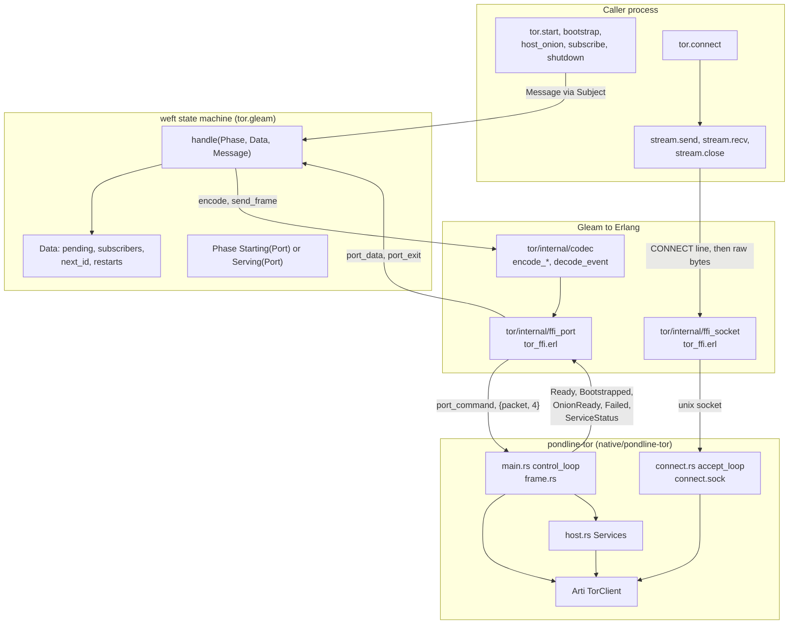
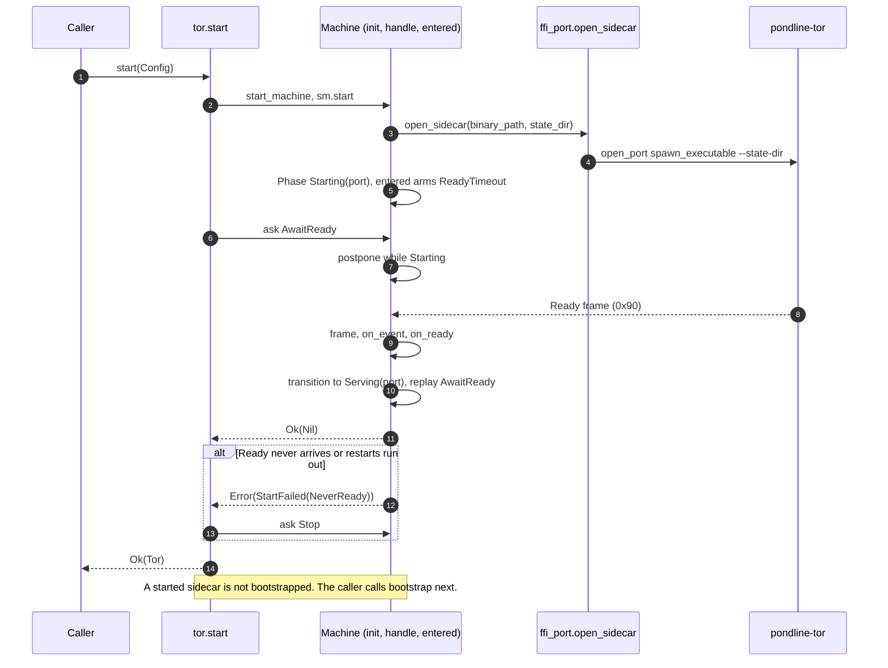
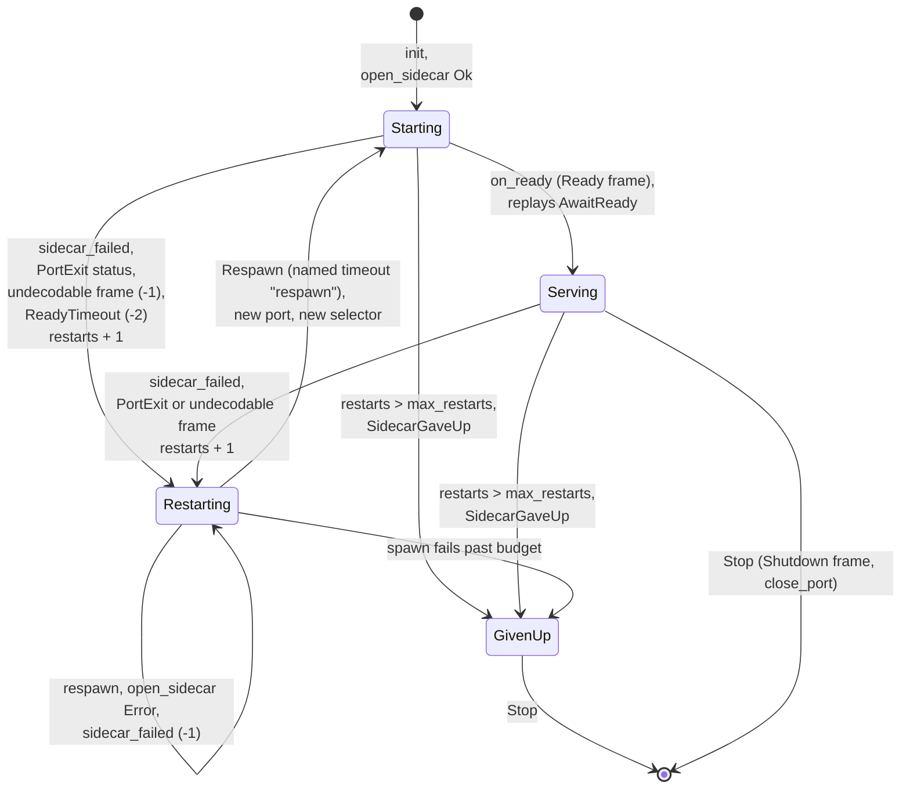
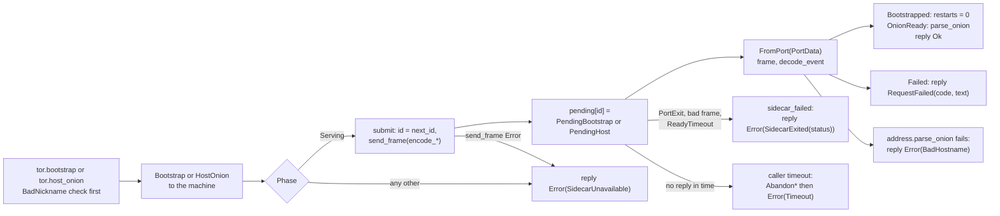
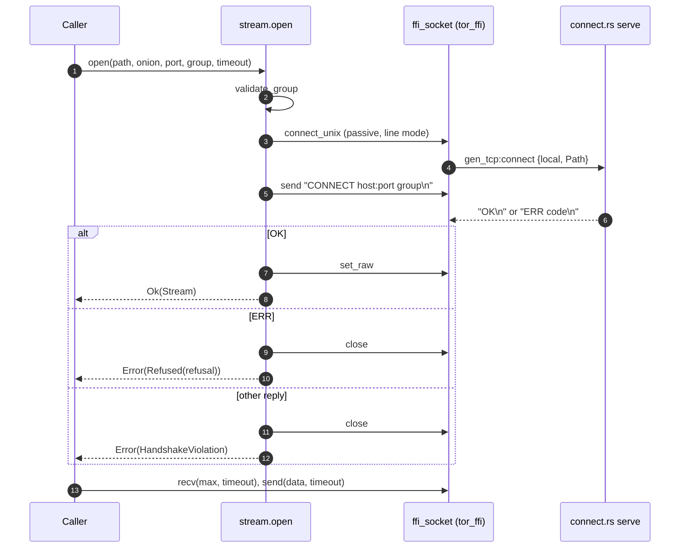
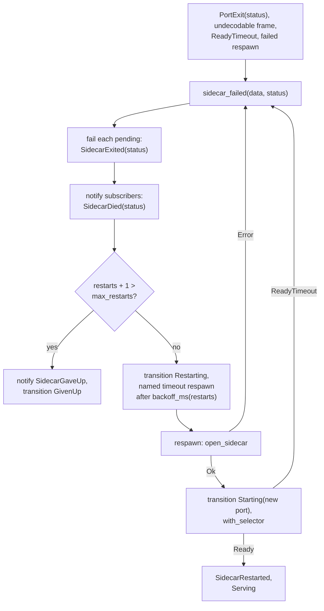

# Tor Architecture

The `tor` package gives the rest of Pondline outbound onion streams and onion-service hosting without linking Arti into the VM. Arti runs in `pondline-tor`, a separate OS process (`native/pondline-tor`). One `weft/state_machine` in this package owns that process's Erlang port, relays typed requests to it, and restarts it when it dies. This document describes who owns which state, how a request reaches the sidecar and comes back, and how an outbound stream bypasses the machine. It reflects the code at `632db2f`.

The decision and its measurements are in [ADR-001](../../docs/adr/001-tor-sidecar.md). The spec sections it implements are §6.1, §10.3 to §10.5 and §13.1 of [spec.md](../../docs/spec.md). The state machine library is described in [weft.md](../../docs/weft.md). The package's short reference is [CLAUDE.md](CLAUDE.md); this document is the longer map behind it. The Rust side is covered only where the boundary needs it.

## Components

Two channels join the BEAM and the sidecar. Control frames (bootstrap, host an onion service, shut down, and the replies) cross an Erlang port opened with `{packet, 4}` and are handled by one process. Outbound streams cross a unix socket and are handled by the process that opened them, never by the machine.

The machine never sees stream bytes. A slow stream cannot delay a control frame, and a control frame cannot delay a stream. The sidecar accepts streams only after it has sent `Ready` (`native/pondline-tor/src/main.rs:222`), so a caller that has seen `start` return can connect.

| Package or type | Owns | Does not own |
| --- | --- | --- |
| `tor` machine (`Phase`, `Data`) | The sidecar's Erlang port, the request id counter, the pending request table, the subscriber list, the consecutive restart count, and both deadlines (`ReadyTimeout`, `respawn`). | Reply deadlines (the caller waits on its own subject), stream sockets, any Arti state. |
| `Tor` (opaque handle) | The machine's `Subject(Message)` and a copy of `Config`. `connect` reads `state_dir` from the copy. | The machine itself. A `Tor` held after `shutdown` sends to a dead process. |
| `tor/stream` | The handshake on one socket and the `Stream` value that wraps it. | Retry. A stream that reports an error is finished (`src/tor/stream.gleam:11`). |
| `tor/address` | The only constructors for a destination: `OnionAddress` (v3 shape) and `Port` (1 to 65535). No constructor accepts a clearnet host. | Checksum or version verification, which Arti performs on connect. |
| `tor/internal/codec` | The control frame encoding and total decoding. | Request ids; the machine allocates them. |
| `tor/internal/ffi_port`, `ffi_socket`, `src/tor_ffi.erl` | The externals. Every exported Erlang function catches every exception and returns `{ok, X}` or `{error, Reason}`. | Policy. They decide nothing. |
| `pondline-tor` | Arti, the state directory contents, the `connect.sock` listener, onion service forwarding to `127.0.0.1:local_port`, and the sidecar's own limits. | Restart policy, request matching, the typed error model. |

## Startup

`start` builds the machine, then waits for the machine to report that the sidecar is listening. The initialiser runs inside the new process, so that process, and not the caller, opens the port and owns it (`src/tor.gleam:366`). Because the machine is linked to the caller, the caller's death closes the port.

The order matters because the ready deadline is a state timeout armed by `entered` for `Starting` (`src/tor.gleam:725`). It is armed on the initial entry as well as on every re-entry, so the first sidecar and every replacement get the same bound. `start` waits for the worst case of a sidecar that is silent every time, derived at `src/tor.gleam:312`: `ready_timeout_ms * (max_restarts + 1) + total_backoff_ms(max_restarts) + 1000`. With the defaults from `config` (`max_restarts` 3, `ready_timeout_ms` 10_000, `src/tor.gleam:288`) the backoffs are 200, 400 and 600 ms (`backoff_ms`, `src/tor.gleam:331`), so the wait is 10_000 * 4 + 1_200 + 1_000 = 42_200 ms. A start that fails therefore returns `NeverReady` and not the caller-side `Timeout`.

`supervised` (`src/tor.gleam:354`) returns the same machine as a child specification. A supervisor restart replaces the machine, so every `Tor` handle, subscriber and pending request is lost. `start` is the intended entry point.

## The sidecar's phases

The sidecar's life is the machine's state, so a request is judged by the phase it arrives in and not by a flag. `Phase` has four variants (`src/tor.gleam:179`). Data that changes without moving a deadline (`next_id`, `pending`, `subscribers`, `restarts`) lives in `Data` (`src/tor.gleam:196`), because replacing the phase would cancel the ready timeout and replay postponed requests.

`Stop` is accepted in every phase and ends the machine (`stop`, `src/tor.gleam:962`); the diagram shows it only from the two end states and `Serving` to stay readable. A failed spawn inside `respawn` re-enters `sidecar_failed`, so a binary that cannot start at all still reaches `GivenUp`: the restart count rises before the spawn is attempted (`src/tor.gleam:907`).

Four rules the arrows do not show:

- **`AwaitReady` waits inside the machine.** In `Starting` and `Restarting` it is postponed, and the next phase change replays it, so no waiter list exists. In `GivenUp` it is answered with `StartFailed(NeverReady)` (`src/tor.gleam:585` to `596`).
- **Requests are refused outside `Serving`.** `Bootstrap` and `HostOnion` in any other phase are answered at once with `SidecarUnavailable` (`src/tor.gleam:609`, `626`). That is the API's promise, not a missing case. The caller may retry.
- **One selector per port.** `selector_for` selects the machine's own subject and one port's messages (`src/tor.gleam:404`); `respawn` installs a new selector with `sm.with_selector` (`src/tor.gleam:948`). The last messages of a dead port are never read as the replacement's, and no frame needs a port tag check. A `FromPort` message that arrives in `Restarting` or `GivenUp` is dropped (`src/tor.gleam:686`).
- **Restart count.** `restarts` rises on every failure and returns to zero only when a `Bootstrapped` frame arrives (`src/tor.gleam:826`). A sidecar that crashes after a successful bootstrap gets a full budget again. A restarted sidecar is not bootstrapped and hosts no services: subscribers see `SidecarRestarted` (`src/tor.gleam:890`), and the owner calls `bootstrap` and `host_onion` again.

## Control requests

A control request is a message to the machine, a frame to the sidecar, and a frame back. `submit` allocates the request id, so replies are matched by the machine alone, and records who waits in `pending` (`src/tor.gleam:745`). The id counter wraps modulo 4_294_967_296 (`src/tor.gleam:761`), matching the `u32` on the wire.

1. **Validate.** `host_onion` rejects an empty nickname or one longer than `max_nickname_bytes` (64, `src/tor.gleam:106`) with `BadNickname` before any message is sent (`src/tor.gleam:479`).
2. **Submit.** `handle` in `Serving` calls `submit` with `codec.encode_bootstrap` or `codec.encode_host_onion` (`src/tor.gleam:600`, `617`). If `send_frame` fails, the port is already closed; the caller gets `SidecarUnavailable` and the port's exit message, which follows in the mailbox, fails everything else pending (`src/tor.gleam:754`).
3. **Reply.** `on_event` looks up the id. A `Bootstrapped` frame answers only a `PendingBootstrap`, an `OnionReady` frame only a `PendingHost`, and any other combination is treated as a late reply and ignored (`src/tor.gleam:830`, `851`). `OnionReady` carries a hostname string from the sidecar, which `address.parse_onion` re-validates before `OnionHost` is built.
4. **Failure.** A `Failed` frame becomes `RequestFailed(code, text)` with `code` one of the `codec.FailCode` variants. A code this version does not know is `UnknownFailure`, which still means failure (`src/tor/internal/codec.gleam:59`).
5. **Death.** `sidecar_failed` sends `SidecarExited(status)` to every pending caller and clears the table (`src/tor.gleam:907`). `stop` does the same with status -3 (`src/tor.gleam:978`).
6. **Timeout.** The caller waits on its own reply subject. On timeout it sends `AbandonBootstrap` or `AbandonHost`, and the machine drops the matching pending entry (`src/tor.gleam:443`, `635`). A timeout does not cancel work the sidecar already began: a bootstrap that times out for the caller still finishes in the sidecar.

`ServiceStatus` frames are not replies. `on_event` forwards them to every subscriber as `ServiceStateChanged` and changes nothing else (`src/tor.gleam:869`). ADR-001 records that Arti's service status stayed at `ServiceDegradedUnreachable` while the service was reachable, so reachability is established by connecting.

## The control protocol

`tor/internal/codec` defines seven message shapes after the VM strips the 4-byte length prefix: requests `0x01 Bootstrap`, `0x02 HostOnion`, `0x03 Shutdown`, and events `0x81 Bootstrapped`, `0x82 OnionReady`, `0x83 Failed`, `0x90 Ready`, `0x91 ServiceStatus` (module doc, `src/tor/internal/codec.gleam:17`). Integers are big-endian and a string is a `u16` length plus UTF-8. Decoding is total: every byte string gives an `Event` or a `DecodeError` (`EmptyPayload`, `UnknownTag`, `Malformed`, `BadUtf8`), and trailing bytes are `Malformed`.

The machine treats an undecodable frame as a protocol disagreement. It closes the port and takes the restart path with status -1 (`src/tor.gleam:807`). Status -2 means the ready timeout fired and -3 means an orderly `Stop`; real exit statuses come from `exit_status`. The Rust decoder is in `native/pondline-tor/src/frame.rs`, with `MAX_FRAME` of 64 KiB (line 51) and `MAX_TEXT` of 1024 bytes (line 54). Both ends are tested against the same golden vectors (`test/tor/codec_test.gleam`).

## Outbound streams

`tor.connect` takes an `OnionAddress` and a `Port`, so a clearnet destination cannot be expressed. It opens `<state_dir>/connect.sock` itself (`src/tor.gleam:523`). The stream belongs to the calling process, whose exit closes the socket.

1. **Validate.** `validate_group` accepts 1 to `max_group_bytes` (128) bytes of printable ASCII without space (`src/tor/stream.gleam:193`), so a bad group is `InvalidIsolationGroup` here and not `bad-request` from the sidecar. Streams with the same group may share Tor circuits; different groups never do.
2. **Handshake.** `handshake` sends the `CONNECT` line and reads one line (`src/tor/stream.gleam:146`). `OK\n` switches the socket to raw mode. `ERR <code>` maps through `refusal` to the closed set of `Refusal` variants, with `UnknownRefusal` for a code from a newer sidecar. Any other reply is `HandshakeViolation`. The socket is closed on every failure.
3. **Transfer.** The socket is passive (`{active, false}`, `src/tor_ffi.erl:78`), so bytes arrive only when `recv` is called. A reader that stops calling `recv` fills the kernel buffer, the sidecar's write waits, and Tor's flow control reaches the far end. This is why the package builds no read-credit protocol (spec §10.4). `send` bounds its wait with `send_timeout`; a `Timeout` means the reader is stalled, and some bytes may already be queued, so the caller should treat the stream as stalled and not resend (`src/tor/stream.gleam:219`).

The sidecar enforces its own limits, none stress-tested according to ADR-001: `MAX_LINE` 256 bytes for the handshake line (`connect.rs:43`), `MAX_STREAMS` 64 (line 47) answered `ERR busy`, `MAX_GROUPS` 1024 (line 51), `MAX_SERVICES` 4 and `MAX_INBOUND` 256 (`host.rs:39`, `43`). It refuses a non-onion target with `ERR not-onion` before touching Tor, so clearnet is unrepresentable in Gleam and refused in Rust (spec §13.1). A stalled stream holds a sidecar slot until closed, so a caller that abandons a stream must call `stream.close`.

## The sidecar's lifetime

The sidecar exits when its stdin reaches end of file (`native/pondline-tor/src/main.rs:20`). The port is owned by the machine, so a machine that dies closes the port and the sidecar exits. In the other direction, a sidecar that dies is reported as a `PortExit` message, and the machine restarts it itself rather than leaving that to a supervisor, which would drop subscribers and pending requests.

The backoff is linear: `200 * restarts` ms (`src/tor.gleam:331`), so a crash loop does not spin and the delays for the default budget are 200, 400 and 600 ms. The `respawn` named timeout is armed in `sidecar_failed` and nowhere else (`src/tor.gleam:923`). A timer fires only into `Restarting`; in any other phase `Respawn` and a late `ReadyTimeout` are ignored (`src/tor.gleam:700`, `711`).

## Process boundary and FFI

`src/tor_ffi.erl` is the one Erlang file. It exists because a port is opened with BIFs and option lists that `gleam_erlang` does not bind, and because a unix-domain socket needs `gen_tcp`'s `{local, Path}` address (module header, lines 1 to 12). Every function wraps its body in `try ... catch _:_` and returns `{ok, X}` or `{error, Reason}` with an atom matching a Gleam variant, so no Erlang exception and no term not built there crosses into Gleam.

- **Command line.** `open_sidecar` passes only `--state-dir` (`src/tor_ffi.erl:25`). No secret is ever an argument. The state directory holds Arti's keys and is the secret; the sidecar creates it with mode 0700 (`main.rs:58`) and `connect.sock` with mode 0600 (`main.rs:179`).
- **Port options.** `{packet, 4}`, `binary`, `exit_status` and `use_stdio`. The sidecar's stderr is inherited, so its diagnostics reach the VM's stderr outside the logfmt stream (ADR-012).
- **Classification.** `classify_message` names only the port's `data` and `exit_status` messages (`src/tor_ffi.erl:64`). Any other term is `{error, nil}`, which the machine ignores in `Starting` and `Serving` (`src/tor.gleam:689`).
- **State directory path.** It must be unique to one sidecar and short enough for a unix socket path (about 100 bytes on macOS).

## Concurrency

| Process | Owns |
| --- | --- |
| Machine (`weft/state_machine` started by `start`) | `Phase` and its port, `Data` (`pending`, `subscribers`, `next_id`, `restarts`), the `ReadyTimeout` state timeout and the `respawn` named timeout. The only process that writes to or reads from the control port. |
| Caller of `bootstrap` or `host_onion` | Its own reply `Subject` and its deadline. Sends `Abandon*` when it gives up. |
| Caller of `connect` | The `Stream` it opened, its socket and the handshake. |
| Subscriber | A `Subject(Event)`. Events are sent as they happen and are not replayed. |
| `pondline-tor` (OS process) | Arti, the state directory, `connect.sock`, forwarding to `127.0.0.1:local_port`. |

The machine is the only process that touches `pending`, so replies and abandons cannot race. A caller that times out cannot know whether the sidecar acted: `Timeout` means only that the caller stopped waiting. `shutdown` asks the machine to stop and returns once it has sent `Shutdown` and closed the port (`src/tor.gleam:566`); the OS process may take a moment longer to disappear. The `ask` helper used by `start`, `sidecar_pid` and `shutdown` has no abandon message because none of those requests leaves a pending entry (`src/tor.gleam:418`).

## Tests

`test/tor/codec_test.gleam` runs the golden vectors and a totality check over generated garbage. `test/tor/lifecycle_test.gleam` uses shell-script stand-ins for the sidecar: one that never reports ready, one that exits at once, and one that checks the `start` wait covers the backoff. `test/tor/sidecar_test.gleam` runs the real binary without the network: refusals, `Shutdown`, exit on port close, and recovery from `kill -9`. The live-network spike (`test/tor/network_spike_test.gleam`, run through `test/tor_slow_test.erl`) is gated by `PONDLINE_TOR_NETWORK`, and the binary is found through `PONDLINE_TOR_BIN` (`test/tor/support.gleam`).

## Known gaps

- Not run: this document was written from the code without building or testing anything. Behaviour claimed from tests (restart on `kill -9`, exit on port close) rests on the test sources and ADR-001's recorded measurements, not on a run at this commit.
- Onion address stability across a sidecar restart is expected from Arti's persisted keys. The source says the spike did not exercise it (`src/tor.gleam:465`).
- The `5000` argument to `sm.new_with_initialiser` (`src/tor.gleam:369`) is read here as the initialiser's time limit; this was not confirmed against the weft source.
- The `weft` dependency is a git reference in `gleam.toml`, while `CLAUDE.md` describes it as pinned to 0.4.6. Which is current was not settled here.
- The Rust sidecar is described only through its module docs, constants and the boundary. Its internals (`host.rs` forwarding, Arti error mapping in `connect.rs`) are not covered.
- Sidecar limits and long-running behaviour (memory, circuit churn, throughput) are unmeasured, as ADR-001 states.
